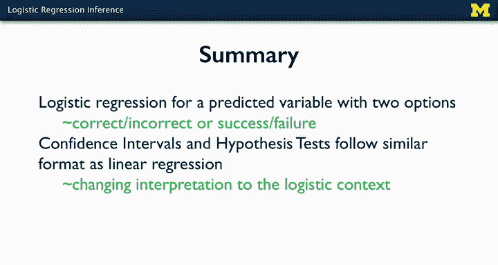

#  78：逻辑回归推断 📊

在本节课中，我们将继续学习逻辑回归，重点探讨如何对逻辑回归模型的斜率进行统计推断，包括构建置信区间和进行假设检验。

---

## 回顾与过渡

上一节我们介绍了逻辑回归模型的基本概念，并为一个关于侧手翻的数据集拟合了模型。本节中，我们来看看如何对这个模型的斜率进行统计推断。

## 数据与模型回顾

我们使用的数据来自一个包含25名成年人的随机样本，他们均尝试了侧手翻。
我们的主要关注变量是**是否成功完成侧手翻**，成功编码为 `1`，失败编码为 `0`。
我们的目标是探究能否根据**年龄**来预测侧手翻的成功与否。

在上一节中，我们拟合了一条逻辑回归曲线。这条曲线呈S形，显示了**成功完成侧手翻的预测概率**如何随年龄变化。
此外，我们获得了如右图所示的模型输出结果，其中包含了模型的系数。

## 构建斜率的置信区间

与我们在课程2和前几周学过的内容类似，置信区间的形式是：**最佳估计值 ± 误差范围**。
我们使用样本斜率，并加减其标准误的若干倍来构建区间。

逻辑回归置信区间的具体公式与线性回归相似，但关键区别在于我们使用**Z分布**而非t分布。其公式如下：

**公式：** `B₁ ± Z* × SE(B₁)`

我们可以从Python的输出结果中获取所需信息：
*   `B₁`（样本斜率）的估计值为 **0.2096**。
*   其标准误 `SE(B₁)` 为 **0.171**。
*   对于95%的置信区间，`Z*` 值为 **1.96**。

将数值代入公式计算：
`0.2096 ± 1.96 × 0.171`

计算后，我们得到置信区间为 **(-0.126， 0.545)**。这个区间与Python输出中提供的95%置信区间结果一致。

**思考：** 基于这个置信区间，斜率（系数）是否显著不为零？我们将在完成假设检验后再来讨论。

## 进行斜率的假设检验

接下来，我们使用假设检验框架来评估年龄对侧手翻成功概率的影响是否显著。

我们的假设如下：
*   **零假设 (H₀):** 总体斜率 β₁ = 0（年龄与成功概率的对数几率无关）。
*   **备择假设 (Hₐ):** β₁ ≠ 0（年龄对成功概率的对数几率有影响）。我们选择双尾检验，因为不确定年龄的影响方向。

检验统计量的计算公式与以往类似：

**公式：** `Z = (B₁ - 0) / SE(B₁)`

代入Python输出中的值：
`Z = 0.2096 / 0.171 ≈ 1.225`

这个计算结果与Python输出中提供的Z统计量一致。Python同时给出了对应的**P值：0.221**。

**决策：** 如果我们设定显著性水平 α = 0.05，那么由于P值 (0.221) 远大于α，我们**无法拒绝零假设**。因此，我们不能得出结论认为年龄与成功完成侧手翻的对数几率之间存在显著的线性关系。

现在，回顾之前的置信区间 **(-0.126， 0.545)**，它包含了**0**。这表明零是斜率的一个合理值，这与我们假设检验“无法拒绝零假设”的结论是一致的。

## 核心要点总结 🎯

本节课中我们一起学习了逻辑回归的统计推断：

1.  **应用场景**：逻辑回归用于预测变量只有两种结果（是/否，成功/失败）的情况。
2.  **推断方法**：置信区间和假设检验的公式与线性回归**非常相似**。
3.  **关键区别**：在解释结果时，必须结合**逻辑回归的上下文**，特别是要理解我们预测的是**事件发生的概率**，模型实际拟合的是概率的**对数几率（Logit）**。
4.  **本例结论**：对于侧手翻数据，我们没有找到足够证据证明年龄是预测成功与否的显著因素。

---

在接下来的课程中，我们将有机会使用NHANES的数据，分析血压与吸烟之间的例子。