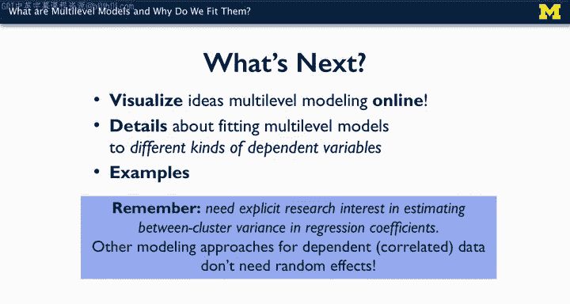

# 课程13：多层级模型的定义与应用场景 📊

在本节课中，我们将开始学习如何处理和分析具有依赖关系的数据。我们将介绍一种名为“多层级模型”的统计模型，它专门用于处理那些观测值之间因研究设计而相互关联的数据集。

---

## 概述

到目前为止，本课程讨论的回归模型都假设观测值是相互独立的。然而，在许多实际研究设计中，数据会存在依赖关系。例如，从同一个社区、学校或诊所收集的多个观测值可能彼此相关；或者在纵向研究中，同一个体在不同时间点的重复测量值也可能相关。为了准确分析这类数据，我们需要使用能够反映这种相关性的模型。多层级模型就是为此设计的一类强大工具。

---

## 什么是多层级模型？🤔

多层级模型是一类用于处理依赖数据的通用统计模型。其核心特点是，允许模型的回归系数在更高层级的随机抽样“簇”之间随机变化。

在之前讨论的模型中，回归系数（如截距和斜率）是我们要估计的固定常数。而在多层级模型中，这些系数可以因簇而异。例如，在纵向研究中，我们可以允许每个研究对象拥有自己独特的截距和斜率，而不是假设所有人都遵循完全相同的总体关系模式。

这意味着，我们不仅估计描述变量间关系的固定参数，还估计这些系数在不同簇之间的变异性。

---

## 多层级模型的方程表示

多层级模型通过引入“随机效应”来允许系数随机变化。让我们通过方程来理解这一点。

**第一层方程（观测层面）**：
对于一个位于簇 `j` 中的观测 `i`，其因变量 `Y` 可以表示为：
`Y_ij = β_0j + β_1j * X_ij + e_ij`
请注意，这里的截距 `β_0j` 和斜率 `β_1j` 都带有下标 `j`，这意味着它们的具体数值取决于观测所属的簇 `j`。`e_ij` 是观测层面的误差项。

**第二层方程（簇层面）**：
第一层方程中的随机系数本身又由第二层方程定义：
- `β_0j = γ_00 + u_0j`
- `β_1j = γ_10 + u_1j`

在这里，`γ_00` 和 `γ_10` 是我们要估计的固定参数，分别代表总体的平均截距和平均斜率。`u_0j` 和 `u_1j` 则是“随机效应”，它们是随机变量，允许每个簇 `j` 的截距和斜率围绕总体均值波动。通常我们假设这些随机效应服从均值为0的正态分布，其方差（`τ_00` 和 `τ_11`）正是我们感兴趣并要估计的“簇间变异”。

通过包含这些随机效应，我们实际上是在建模同一簇内观测值之间的相关性。

---

## 为何要使用多层级模型？✅

以下是考虑使用多层级模型的几个关键前提和原因：

1.  **数据结构**：数据必须组织成簇（如诊所、学校、社区），且我们有理由相信同一簇内的观测值存在相关性。
2.  **随机抽样**：这些簇本身必须是从一个更大的簇总体中随机抽样得到的（例如，随机抽样的医院，而不是性别这种固定分类）。
3.  **建模相关性**：我们希望明确地建模同一簇内观测值的相关性，以符合研究设计。
4.  **研究兴趣**：我们有明确的研究兴趣去估计所选回归系数（如截距、斜率）在簇之间的变异程度。

如果以上条件都满足，多层级模型能帮助我们回答诸如以下的问题：
- 不同医院在患者平均满意度上的差异，有多少可以由医院的规模来解释？
- 在一组药物使用者中，其长期药物使用趋势的个体间差异有多大？

---

## 多层级模型的优势 🏆

与其他处理依赖数据的方法相比，多层级模型具有独特优势：

*   **高效估计**：我们不是为每个簇估计一个独立的固定系数，而是估计一个代表所有簇随机效应方差的参数。这在簇数量很大时更为高效。
*   **收缩估计**：样本量较小的簇对总体方差估计的影响会向总体均值“收缩”，这防止了小样本簇产生不稳定的极端估计，使模型更稳健。
*   **解释变异**：我们可以在第二层方程中加入簇层面的预测变量，试图解释随机效应的变异。例如，我们可以研究“年龄”这个个体层面变量，能在多大程度上解释不同个体“年龄与健康结局关系”的斜率差异。

---

## 总结

本节课我们一起学习了多层级模型的基础概念。我们了解到，当数据因研究设计而产生依赖关系时，多层级模型通过引入随机效应，允许回归系数在随机抽样的高层级簇之间变化。这种方法不仅能更准确地建模数据相关性、提高模型拟合度，还能让我们量化并解释系数在簇间的变异，从而做出更丰富的统计推断。

在接下来的课程中，我们将通过可视化工具更直观地理解多层级模型的拟合过程，并学习如何将多层级模型应用于连续、二分类等不同类型的因变量。请记住，是否使用多层级模型，取决于我们是否有兴趣估计回归系数的簇间变异。