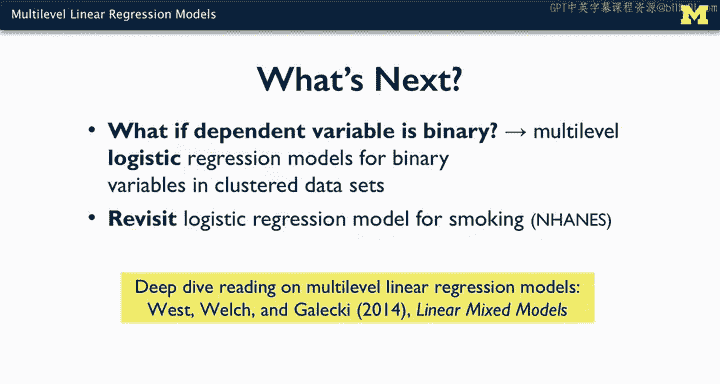

# 课程 14：多层级线性回归模型 📊

在本节课中，我们将学习多层级线性回归模型。这是一种用于分析具有依赖关系（例如，数据按群组或个体重复测量进行聚类）的连续型因变量的统计模型。我们将回顾模型的基本概念、公式、参数估计方法，并通过一个实际数据分析案例来演示其应用。

---

## 模型回顾与引入

上一节我们讨论了用于依赖数据的统计模型。本节中，我们来看看专门为连续因变量设计的多层级线性回归模型。

让我们回顾在第二周介绍线性回归时讨论过的欧洲社会调查数据。

*   这些数据来自对比利时1703名成年人的全国性样本进行的面对面调查访谈。
*   数据中的变量包括受访者ID、访问员ID、22个衡量受访者对各种话题态度和意见的变量。
*   在本研究中，我们特别关注访问员对数据的影响。即，不同的欧洲社会调查访问员可能因提问方式或招募的受访者类型不同，而对收集的数据产生不同影响。我们希望为访问员之间的变异性建模。
*   我们还有基于复杂抽样设计的最终受访者权重。欧洲社会调查使用了涉及整群抽样的复杂抽样设计。
*   除了这些最终受访者权重，我们还有访问员特定的应答率。我们可以将其视为访问员层面的协变量。

---

## 随机效应概念回顾

让我们重温上一讲中讨论的随机效应概念。

*   随机效应是允许回归模型中的系数随机变化的随机变量。其变化取决于随机选择的群组（例如，社区）或主体（例如，纵向研究中的个体）。
*   多层级模型在不同领域可能有不同的名称。
    *   它们可能被称为**随机系数模型**，因为系数被允许随机变化。
    *   它们可能被称为**变系数模型**。
    *   在更多纵向研究背景下，它们可能被称为**主体特定模型**。
    *   在社会科学的一些领域，它们可能被称为**分层线性模型**。
    *   在统计学等领域，它们也可能被称为**混合效应模型**，因为模型中混合了固定的回归参数（固定效应）和这些随机效应。

---

## 连续因变量的模型设定

让我们重新审视针对连续因变量 Y 的模型设定，这也是本讲的重点。

假设我们有一个连续因变量 Y，它在群组 J 内的个体 I 上进行测量。

我们可以写出包含固定效应的回归模型，如下所示：

**Y_ij = β_0 + β_1 * X_ij + u_0j + u_1j * X_ij + e_ij**

*   用蓝色标出的 β_0 和 β_1 是固定效应。这些回归系数没有下标 j，是我们试图估计的固定参数，它们捕捉了模型的整体截距以及 X 与 Y 的整体关系。
*   X_ij 是在群组 J 内每个个体 I 上测量的预测变量。
*   然后，我们在标准线性回归模型的基础上添加了这些随机效应，以捕捉群组间的方差。
    *   **u_0j** 允许每个群组在模型中拥有独特的截距。
    *   **u_1j** 乘以预测变量 X_ij，这意味着我们可以将 u_1j 与 β_1 结合，为每个群组 J 定义独特的斜率系数。
*   最后，我们还有误差项 e_ij，它捕捉了回归系数和随机效应未能预测的部分。

---

## 固定效应与随机效应

为了使术语更清晰：

*   **固定效应**是定义未知常数的回归系数或回归参数。它们定义了我们希望估计的预测变量与因变量之间的关系。固定效应主要用于定义模型中因变量的均值。
*   **随机效应**则是随机变量。因为它们是随机变量而非固定常数，所以我们需要为这些随机变量定义分布。

使用多层级模型是因为我们的研究问题明确包含了对这些随机群组效应变异性的估计。

---

## 随机效应的分布假设

我们为随机效应 u_0j 和 u_1j 假设什么分布？非常常见的是，我们假设随机效应服从均值为 0、具有指定方差和协方差的正态分布。

在本模型的情况下，我们有两个随机效应：u_0j（允许每个群组有独特截距）和 u_1j（允许每个群组有独特斜率）。因为我们有两个随机变量，所以我们假设这两个随机变量服从二元正态分布。

**（u_0j, u_1j）^T ~ N( (0, 0)^T, D )**

*   N 表示正态分布。
*   (0, 0) 对应于这两个随机效应的均值向量。我们假设平均而言，每个随机效应都等于 0。因此，平均群组的表现符合我们对 β_0 和 β_1 的预期。
*   矩阵 D 是这些随机效应的方差-协方差矩阵。
    *   u_0j 的方差是 σ_0²。
    *   u_1j 的方差是 σ_1²。
    *   此外，我们允许这两个随机效应（随机截距和随机斜率）之间存在协方差。矩阵 D 非对角线上的 σ_01 就是这两个随机效应的协方差。例如，随机截距越高，随机斜率可能越低，该协方差可能为负。这只是一种可能性，但我们在设定模型时允许这种情况。

我们还假设群组内的误差项服从均值为 0、方差为 σ² 的正态分布。

因此，我们实际上在估计三个方差分量：σ²、σ_0² 和 σ_1²，以及这两个随机效应的协方差 σ_01。

---

## 多层级设定

另一种书写此模型的方式是我们在上一讲中介绍的多层级设定。

我们可以将模型分解为：
*   **层级 1 模型**：因变量由与群组相关的随机系数定义，然后是在与因变量相同层级测量的预测变量（例如，群组内个体的年龄），以及误差项 e_ij。注意，层级 1 中包含的所有内容在实际数据中都有下标 ij。
*   **层级 2 模型**：随机系数由固定回归参数和允许该系数随机变化的随机效应定义。随机系数本身不是参数。

**层级 1： Y_ij = β_0j + β_1j * X_ij + e_ij**
**层级 2： β_0j = β_0 + u_0j； β_1j = β_1 + u_1j**

当我们将层级 2 和层级 1 的方程结合时，就得到了与之前几页幻灯片完全相同的模型。

为什么我们要考虑多层级设定？这种设定清晰地定义了在多层级模型中，在更高层级测量的协变量的作用。我们可以将每个随机系数的层级 2 方程视为一个仅包含截距的回归模型。我们旨在通过向模型中添加层级 2 协变量的固定效应（固定回归参数）来解释这些随机效应的方差。

---

## 解释随机效应方差

以下是一个例子。

以随机截距 β_0j 的方程为例。最初，我们用一个固定参数 β_0 加上与特定群组相关的随机扰动 u_0j 来定义它。我们拟合模型并计算随机截距的估计方差。假设出于示例目的，我们估计的 u_0j 的变异性为 2。

现在，我们在模型中加入了主体性别的固定效应（假设我们进行的是纵向研究，其中 J 表示被重复测量的主体，性别是不随时间变化的）。当我们添加“男性”这个预测变量到模型中时，我们期望 u_0j 的变异性实际上会下降，因为我们添加了 β_0j 的一个预测变量。如果这是一个好的预测变量，我们期望随机效应 u_0j 的方差会减小，就像在标准线性回归模型中通过添加预测变量时期望随机误差的方差会减小一样。

在重新拟合包含“男性”预测变量的模型后，我们发现 σ_0² 的估计值变为 1。与未包含“男性”作为预测变量的模型相比，我们解释了 50% 的截距变异性。这只是通过将性别的固定效应添加到我们的模型中实现的。

多层级建模的主要推断目标之一，就是看我们能否在这些更高层级（群组层级）识别出可以解释这些随机效应的预测变量。

---

## 参数估计与推断

我们如何估计模型参数？你将看到在 Python 中使用的计算技术称为**最大似然估计**。

MLE 的基本思想是：我们希望知道模型参数的哪些值使得观测数据出现的可能性最大。

我们可以使用 Python 等软件来计算固定效应（β_0、β_1、β_2 等）和方差分量（σ²、σ_0²、σ_1²）的 MLE，以及所有这些估计参数的标准误。

我们还可以使用针对此类模型的专门检验来对模型参数进行推断。
*   首先，我们可以像前几周讨论的那样，计算模型参数的置信区间或检验假设。
*   具体来说，我们可以使用一种称为**似然比检验**的技术来检验某些参数（例如，一个固定效应或一个方差分量）是否为 0。

似然比检验的思想是：如果我们将某个给定参数或一组参数从模型中移除，观测数据的概率或似然性是否发生显著变化？如果我们移除某些方差分量（这意味着我们移除了随机效应），是否会显著降低观测数据的似然性，从而使模型的拟合变差？这就是我们使用似然比检验的目的。

在本周的阅读材料中，你将看到关于如何对多层级模型中的参数执行此类似然比检验的非常具体的细节。在本讲座中，我们只看这些检验的结果。

---

## 欧洲社会调查实例分析

让我们回到那个 ESS 例子。我们关注 ESS 访问员在感兴趣的因变量测量上的变异性。

我们假设 ESS 中的访问员是从可能被雇用的更大访问员池中随机抽取的。我们感兴趣的是对警察的信任度与一个人认为人们通常愿意帮助他人的态度之间的关系。我们在第二周讨论线性回归和估计这种关系时考虑过这个例子。现在，我们将扩展该示例，以包含 ESS 访问员的随机效应，认为访问员可能会在收集的数据中引入聚类。

观测按访问员进行聚类，这些访问员是随机抽样的群组。如果这些访问员对数据有影响，我们可以在多层级模型中包含随机效应来解释这一点。

我们拟合一个多层级模型，以查看访问员是否对我们主要感兴趣的模型中的截距和/或斜率有影响。

---

### 固定效应结果

以下是我们示例的结果。

我们使用 Python 等软件来计算固定效应（即定义对警察的信任度与感知到的助人意愿之间关系的整体回归系数）的最大似然估计。该估计回归系数为正值 0.14，且显著。对于检验统计量，我们取该估计系数除以其标准误，并将该检验统计量参照 t 分布。我们看到看到如此大检验统计量的概率非常非常小。因此，在这种情况下，固定效应相对于标准误来说非常大。我们得出结论，这种关系是非零且显著的。

这意味着，那些对警察信任度较高的人，往往也对人们愿意帮助他人有更高的信心。

---

### 随机效应方差结果

但请记住，在这种情况下，我们超越了标准的回归分析。除了估计那些回归系数之外，我们还要考虑方差分量的估计。

让我们考虑模型中的整体截距 β_0。该截距的最大似然估计是 3.89。使用相同的检验方法，我们发现该参数也是显著的，P 值非常小。这意味着，在预测变量（对警察的信任度）为 0 时，助人意愿量表（范围在 0 到 10 之间）的均值为 3.89。这是我们试图估计的另一个固定效应。

因此，这些是我们对两个固定效应的估计：整体截距和整体斜率。

现在，请记住，对于多层级模型，我们超越了标准回归分析，我们还估计了那些随机效应的变异性。
*   随机截距的估计方差为 0.696。
*   随机斜率的估计方差为 0.012。
*   当我们应用似然比检验对这些方差分量进行推断时（本周的附加阅读材料将讨论），基于似然比检验，这两个方差都显著大于 0。

因此，有证据表明访问员之间的变异性在模型的截距和斜率方面都明显非零。这些描述了我们的整体模型中 u_0j 和 u_1j 的方差，并且这两个方差分量都是非零的。

这意味着，ESS 访问员围绕上一张幻灯片中的整体固定效应存在显著差异。访问员肯定有独特的截距和独特的斜率。他们可能因为提问方式或招募对象的原因，总体上收集到更高的助人意愿均值。但除此之外，他们用收集的数据记录了独特的斜率。因此，不同的访问员产生了对警察信任度与感知助人意愿之间关系的不同估计。

---

## 模型诊断与检验

我们还需要检查模型拟合情况并查看一些模型诊断。我们希望检查我们对随机效应和随机误差分布的假设是否合理。模型似乎拟合得好吗？

首先，我们将像在线性回归中那样查看残差的分布。它们看起来是正态的吗？它们看起来具有恒定方差吗？

但由于多层级模型中那些额外的随机效应，我们还将查看那些随机访问员效应的预测值（称为 EBLUP，即经验最佳线性无偏预测）的分布。记住这些是随机变量，因此我们无法直接根据模型估计它们。一旦我们拟合了模型，我们就可以计算这些随机效应的预测值，并且我们希望查看是否有特定访问员是异常值。

以下是基于拟合模型的残差的正态分位数-分位数图。你可以看到所有残差几乎完美地落在那条 45 度直线上。因此，这个 QQ 图表明残差是正态分布的，我们没有看到任何明显偏离该正态分布的异常值。就这个假设而言，这看起来非常好。

关于残差的恒定方差呢？这是残差与基于模型的预测值的散点图。这个散点图表明对误差的恒定变异性没有担忧。我们看到这个散点图有独特的外观，因为因变量上只有 11 个唯一值。这就是为什么你在这个图中看到那些平行的直线。

关于 EBLUP 呢？这些记住是对模型中包含的访问员随机效应的预测。
*   首先，查看随机截距的 EBLUP。我们假设它们服从均值为 0、恒定方差的正态分布。这个 QQ 图表明这些不同访问员的随机效应似乎确实是正态分布的，但有一个访问员很突出。这是访问员编号 4976，我们将更详细地查看他们的数据，以了解他们为何独特。
*   关于随机斜率的预测随机效应呢？再次，我们看到这些随机斜率遵循正态分布的一般证据。但同样，有一个访问员显得不寻常。因此，我们也想查看他们的数据。

---

### 异常访问员分析

首先，对于那个具有独特随机截距的访问员（4976），如果我们绘制他们的数据（助人意愿测量值对警察信任度测量值），你会看到他们有异常多的助人意愿小于 4 的应答。也许他们以一种奇怪的方式提问，或者他们在引导人们以不同的方式回答感知到的助人意愿，也许他们做出了暗示性陈述之类的。但这位访问员在因变量测量方面绝对是独特的，因此他们的截距低于预期。

那么具有独特斜率的访问员（7519）呢？关于 ESS 数据的一些非常有趣的事情出现了。当我们绘制他们的助人意愿对感知到的警察信任度时，看左手边的那簇点。然后有一个点远远落在外面。那个点在预测变量“对警察的信任度”上的值是 88。在 ESS 数据中，88 对应于缺失数据。

当我们为这种分析（无论是多层级建模还是回归建模）做准备时，我们需要非常仔细地查看描述性统计，并确保任何缺失数据在数据集中被适当地重新编码为真正的缺失值。当我们进行这项分析时，那个由 ESS 分配给缺失数据的特殊代码 88 被当作真实值处理。因此，这位访问员的斜率在分析中使用了那个 88。如果我们将该点包含在分析中，这导致他们的斜率非常平缓。这就是为什么与所有其他访问员相比，他们的斜率低于预期。

因此，在将该值 88 重新编码为缺失数据后，我们需要重新运行分析。这就是为什么描述性统计如此重要，因为这位访问员由于这一个数据点而显得非常独特。

---

## 结论与下一步

从这个例子中我们可以得出什么结论？前提是我们处理了缺失数据问题。

ESS 访问员实际上在这个整体分析中产生了独特的截距和斜率。我们希望在处理缺失数据后看看这是否仍然成立，但这将是我们的结论。

在这种情况下，这种方差不一定是好事。它增加了我们参数估计的不确定性，因为访问员正在引入这些估计的变异性。因此，我们应在移除异常值后重新评估访问员方差。如果每位访问员确实在随机子样本中工作，他们应该产生相似的截距和斜率（假设我们感兴趣的定义警察信任度与感知助人意愿之间关系的模型成立）。

分析的下一个步骤可能是向那些层级 2 方程添加访问员层面的协变量，以试图解释截距和斜率中的这种方差。我们可以添加数据集中存在的访问员层面应答率，或者如果我们有关于助人意愿和警察信任度等问题的访问员态度测量，也许访问员的态度可以解释这种变异性的一部分，也许这影响了他们提问的方式。

---

## 总结与预告

本节课中，我们一起学习了针对连续变量的多层级线性回归模型。我们回顾了模型设定、固定效应与随机效应的区别、参数估计方法，并通过欧洲社会调查的实例进行了深入分析。

接下来，我们将转向非连续的因变量，特别是二分类变量。我们将讨论用于聚类数据集的**多层级逻辑回归**模型，并重新审视之前为 NHANES 数据考虑的关于吸烟的逻辑回归模型。