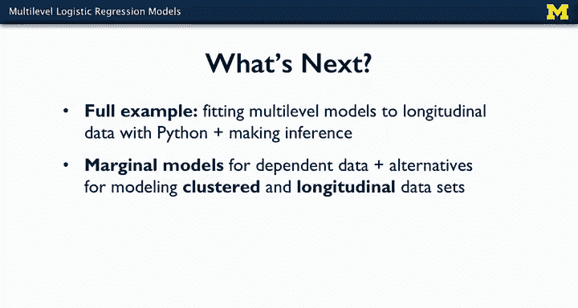

# 课程 15：多层级逻辑回归模型 📊

在本节课中，我们将学习如何为二元因变量拟合多层级统计模型，即多层级逻辑回归模型。我们将探讨其模型设定、参数估计、假设检验，并通过一个实际案例来理解其应用。

---

## 概述

上一节我们介绍了多层级线性回归模型。本节中，我们将重点转向因变量为二元（例如是/否、成功/失败）的情况。我们将学习如何构建和解释多层级逻辑回归模型，以处理具有层级结构（如个体嵌套于群组中）的二元数据。

---

## 模型设定

当因变量为二元时，我们使用逻辑回归。其核心是将事件发生概率的**对数几率**（log-odds）建模为预测变量的线性函数。

在多层级设定中，模型同时包含**固定效应**和**随机效应**。固定效应描述预测变量与对数几率之间的平均关系，而随机效应则捕捉同一高层级群组（例如，用 `j` 表示群组）内观测值之间的依赖性。

对于一个在群组 `j` 中的个体 `i`，其二元因变量 `y_ij` 的模型可以写为：

**公式：**
`logit(P(y_ij = 1)) = β_0 + β_1 * x_ij + u_0j + u_1j * x_ij`

其中：
*   `logit(p) = ln(p / (1-p))` 是逻辑连接函数。
*   `β_0` 和 `β_1` 是固定效应系数。
*   `u_0j` 是允许每个群组拥有独特截距的随机截距。
*   `u_1j` 是允许预测变量 `x` 与对数几率的关系随群组变化的随机斜率。

我们对随机效应做出与多层级线性模型相同的分布假设：它们服从多元正态分布，均值为0，并具有特定的方差和协方差。

我们拟合多层级模型的一个关键动机是**明确希望估计随机效应的方差**，即研究不同群组在因变量（此处为对数几率）上的变异程度。

---

## 参数估计与假设检验

对于非正态的因变量（如二元变量），模型参数的估计在计算上更具挑战性。

**估计难点：**
通常，我们无法直接写出确切的**似然函数**。实践中，我们常采用数学方法（如**自适应高斯求积法**）先对似然函数进行近似，然后寻找使该近似似然值最大化的参数估计值。这使得模型拟合的计算时间更长。

**假设检验：**
我们可以使用与多层级线性模型相同的**似然比检验**方法来检验参数的显著性，例如检验某个固定效应是否为零，或随机效应的方差是否为零（即随机效应不存在变异）。这要求我们有足够多的群组和每个群组内的观测数。

---

## 实例分析：NHANES吸烟数据

让我们回顾之前在逻辑回归中使用的NHANES（美国国家健康与营养调查）数据集，研究“一生中是否吸过100支烟”这个二元指标。

**问题所在：**
在第二周的分析中，我们假设所有NHANES观测值相互独立。但实际上，NHANES采用多阶段概率抽样设计，个体被嵌套于随机抽样的地理区域（群组）中。因此，同一群组内个体的吸烟行为可能存在相关性。忽略这种相关性会导致标准误被低估，从而可能做出错误的显著性推断。

**解决方案：**
拟合一个多层级逻辑回归模型，为每个抽样群组加入**随机截距**。这能同时实现两个目标：
1.  更准确地估计参数的标准误，反映抽样设计。
2.  直接估计并推断不同抽样群组间吸烟概率的变异。

**模型结果：**
1.  **固定效应**：与不考虑随机效应的模型相比，预测吸烟行为的关键变量基本相同，但**其标准误普遍变大**，这更准确地反映了数据的变异。
2.  **随机效应**：随机截距的方差估计值为0.046。似然比检验强烈拒绝“方差为零”的原假设，表明在控制了其他预测变量后，不同抽样群组间的吸烟概率仍存在显著差异。

**模型诊断：**
检查随机效应的预测值（EBLUPs）的Q-Q图，结果显示其近似服从正态分布，且未发现异常离群值，说明模型假设基本合理。

---

## 模型比较与下一步

从本例中我们可以得出结论：在考虑了群组随机效应后，我们发现了相同的吸烟行为预测因子。

**解释变异：**
既然存在显著的、未被解释的群组间变异，下一步可以尝试引入**群组层面的预测变量**（如该区域的社会经济地位指标）作为固定效应，以解释这部分变异。

**重要提醒：**
在比较不同多层级模型的方差成分时（例如，加入群组预测变量前后），必须确保两个模型：
*   基于完全相同的观测案例。
*   包含完全相同的**个体层面预测变量**。
只有保持第一层预测变量不变，方差成分的比较才有意义。

---

## 总结

本节课中，我们一起学习了多层级逻辑回归模型。我们了解了如何为二元因变量设定包含随机效应的模型，认识了其参数估计的复杂性，并通过NHANES案例看到，考虑数据层级结构能提供更准确的统计推断，并允许我们研究群组间的变异。

接下来，我们将通过Python实战，学习如何为纵向数据拟合多层级模型并进行推断。之后，我们将转向处理相关数据的另一种方法——边际模型，它提供了不依赖于随机效应的替代建模思路。