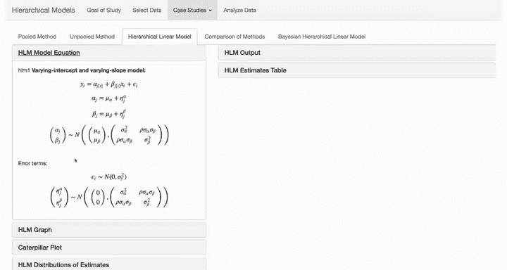

#  82：多层级建模实践：Cal Poly 应用案例 🎯


在本节课中，我们将通过一个由加州理工大学（Cal Poly）开发的交互式网络应用，来实践和可视化多层级模型的核心概念。我们将学习如何区分“完全合并”、“完全分离”与“多层级”建模方法，并观察随机效应如何运作。

---

## 概述

我们将使用一个关于音乐专业学生表演前焦虑情绪的真实数据集。数据具有多层结构：**层1**是每次表演前的日记记录，**层2**是每位音乐家。我们将通过应用探索如何为这种嵌套数据建立模型。

## 应用介绍与数据

上一节我们介绍了多层级模型的基本概念，本节中我们来看看如何在一个实际应用中操作。

该应用由 Cal Poly 统计系的 Jimmy Wong 开发，它允许用户交互式地探索多层级模型。应用中将“多层级模型”也称为“分层模型”。

应用的核心是展示三种分析方法：
*   **完全合并法**：忽略所有分组（层2）信息，将所有数据混合分析。
*   **完全分离法**：为每个分组（层2单位）单独建立一个模型。
*   **多层级模型法**：一种折中方法，通过引入**随机效应**，允许组间存在变异，同时借用组间信息来“增强”估计，特别是对于样本量小的组，其估计会向总体均值“收缩”。

以下是应用内置的数据集描述：
*   **数据来源**：一项已发表的同行评审研究。
*   **研究对象**：37 名音乐专业本科生。
*   **数据结构**：在整个学年中，每次表演前，音乐家需填写一份情绪量表。
*   **层2单位**：音乐家（`ID`）。
*   **层1单位**：每次表演前的日记记录（多次观测嵌套于每位音乐家）。
*   **因变量**：负性情绪（`Negative Affect`），衡量表演前的焦虑程度。
*   **预测变量**：包括表演类型、观众情况等。

应用也支持用户上传自己的数据集进行分析，这是一个非常实用的功能。

## 案例研究：随机截距模型

现在，让我们进入应用的“案例研究”部分，从一个简单的随机截距模型开始。这类似于我们之前讨论的 NHANES 吸烟例子。

我们选择“随机截距”案例。应用提供了多种可视化来比较不同方法。

### 完全合并法视图

在“Pooled”标签页下，我们看到的是忽略音乐家分组效应的结果。
*   它显示了负性情绪（`Negative Affect`）的分布直方图。
*   图中的垂直虚线是**合并均值**，即所有观测值的总平均，约为 16.2。
*   此方法完全忽略了日记记录嵌套于不同音乐家的事实。

### 完全分离法视图

切换到“Unpooled”标签页，视图变为为每位音乐家单独绘制的箱线图。
*   该图清晰展示了不同音乐家在表演前平均焦虑水平（`Negative Affect`）上存在巨大差异。
*   下方的表格列出了每位音乐家的均值、方差和样本量。
*   这种可视化强烈表明，需要考虑音乐家之间的变异，随机效应方法在此非常适用。

### 多层级模型视图

点击“Hierarchical Linear Model”标签页，我们进入多层级模型的分析界面。这里有几个子标签页：

1.  **模型公式**：
    *   展示了我们拟拟合的**随机截距模型**的公式。
    *   公式以多层形式呈现。截距被分解为总体固定效应和组别随机效应。
    *   应用也提供了合并后的单层方程形式，便于理解。
    *   明确列出了随机效应和层1误差的分布假设，即我们需要估计的两个**方差成分**。

    **模型公式示例（随机截距模型）**：
    ```
    层1: Y_ij = β_0j + e_ij,   e_ij ~ N(0, σ²)
    层2: β_0j = γ_00 + u_0j,   u_0j ~ N(0, τ²)
    合并: Y_ij = γ_00 + u_0j + e_ij
    ```
    其中，`γ_00` 是总体固定截距，`u_0j` 是第 j 组的随机截距效应，`e_ij` 是层1残差。

2.  **毛虫图**：
    *   展示了各组（音乐家）随机效应估计值的分布及其置信区间。
    *   直观体现了组间的变异性。

3.  **组内相关系数**：
    *   计算了**组内相关系数**，它衡量了同一音乐家内两次观测的相关性。
    *   在此案例中，ICC 估计值约为 0.181，表明同一音乐家的观测值之间存在中等程度的相关性。这证明了使用多层级模型的必要性。

4.  **模型输出**：
    *   在“HLM Output”标签页下，显示了模型拟合的统计结果。
    *   **固定截距**（总体均值）估计约为 16.2。
    *   **随机效应方差**（`τ²`，音乐家间的方差）估计约为 4.95。
    *   **残差方差**（`σ²`，音乐家内的方差）估计约为 22.46。

## 扩展模型：添加预测变量与随机斜率

在了解了基础模型后，我们可以尝试更复杂的设定。应用的主“Analyze Data”标签页允许我们自定义模型。

### 添加层1预测变量

例如，我们可以尝试在随机截距模型中加入一个层1预测变量，如“表演类型”。
*   添加后，模型输出会更新，显示该预测变量的固定效应估计值。
*   **注意**：在此特定操作中，应用提示模型“未收敛”。这提醒我们，在复杂模型中可能需要调整估计方法或检查模型设定。

### 随机斜率模型

让我们回到“案例研究”，选择“随机截距与随机斜率”的示例。这里，我们研究另一个预测变量（如“先前表现”）对负性情绪的影响，并允许这个影响（斜率）随音乐家不同而变化。

1.  **完全合并法视图**：散点图显示，总体上该预测变量与因变量的关系很弱。
2.  **完全分离法视图**：为每位音乐家绘制单独的回归线。可以看到，不同音乐家的回归线斜率和截距都有明显差异，这为引入**随机斜率**效应提供了视觉依据。
3.  **多层级模型视图**：
    *   查看模型公式，现在包含了针对斜率的层2方程。
    *   在“HLM Output”中，我们可以看到：
        *   该预测变量的**固定效应**（平均斜率）估计约为 -0.11，在 0.05 水平上不显著。
        *   **随机斜率方差**的估计约为 0.078。要判断这个随机效应是否重要，通常需要进行**似然比检验**来比较包含与不包含该随机效应的模型。

## 总结

本节课中，我们一起学习了如何利用 Cal Poly 的交互式应用来实践多层级建模。



*   我们比较了**完全合并**、**完全分离**和**多层级**三种建模策略的异同。
*   我们探索了**随机截距模型**，理解了如何通过估计方差成分（`τ²` 和 `σ²`）和计算**组内相关系数**来量化组间与组内变异。
*   我们尝试了更复杂的模型，包括添加**固定效应预测变量**和引入**随机斜率**。
*   该应用通过丰富的可视化（如箱线图、毛虫图、散点图）和即时模型输出，让初学者能直观理解“借用强度”、“收缩估计”等核心概念。

这个工具是学习和演示多层级模型的宝贵资源，建议大家通过课程提供的链接亲自操作，尝试不同的数据和模型设定，以加深理解。