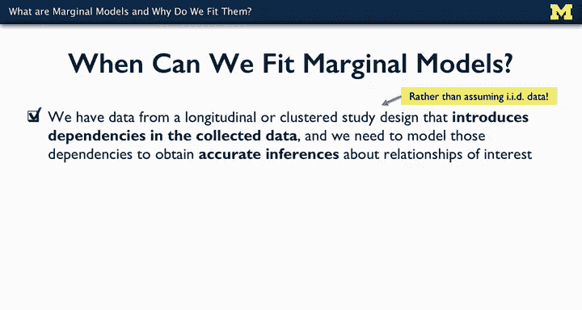

# 83：边际模型的定义与应用场景 📊

在本节课中，我们将学习一种处理依赖数据的替代建模方法——边际模型。我们将探讨其定义、应用场景、与多层模型的区别，以及为何及如何拟合这类模型。

---

## 概述

上一节我们介绍了使用随机效应的多层模型来应对研究设计引入的数据依赖性。本节中，我们将转向一种不包含显式随机效应的替代方法——边际模型。我们将了解边际模型的核心概念、适用场景以及其相对于多层模型的优势。

---

## 什么是边际模型？🤔

边际模型是一类用于建模依赖数据的统计模型。当数据来自随机抽样的集群（如地理区域、访员、重复测量的个体）时，集群内的观测值可能由于环境、共享态度等原因彼此相关。边际模型的目标是估计自变量与因变量在**所有集群**上的总体平均关系，而非针对特定集群的条件关系。

与多层模型的关键区别在于：
*   **多层模型**：通过允许系数（如截距、斜率）在集群间随机变化来捕捉数据依赖性。公式上体现为包含随机效应项。
*   **边际模型**：不包含随机效应项，不估计集群间在系数上的变异。其核心是确保模型估计的**固定效应参数的标准误**能够正确反映研究设计（如集群抽样）引入的数据依赖性。如果我们忽略集群内观测值的相关性，可能会导致标准误被低估，从而做出错误的统计推断。

下图直观展示了两类模型拟合的差异：

该图展示了不同儿童（如46、48、49号）在因变量VSAE上随时间（纵向）的测量值。虚线代表多层模型的拟合结果，它为每个儿童拟合了独特的轨迹（随机效应）。实线代表边际模型的拟合结果，它对所有儿童都给出相同的总体预测轨迹，不关心儿童间的个体差异。

---

## 如何拟合边际模型？🔧

拟合边际模型通常遵循以下步骤：

以下是拟合边际模型的核心步骤：

1.  **定义均值结构**：首先，为因变量的期望均值选择一个结构。这通常通过回归系数和预测变量来定义，与之前的线性模型定义方式相同。
2.  **选择协方差结构**：然后，根据研究设计，为来自同一集群的观测值的方差和协方差选择一个合适的结构。这个结构需要反映那些未被预测变量解释的残差之间的相关性。
3.  **比较与选择模型**：接着，比较具有不同协方差结构选择的边际模型的拟合优度。我们选择拟合最好的模型作为最终推断的基础。

---

## 协方差结构示例

协方差结构的选择取决于数据依赖性的性质。以下是两个常见例子：

以下是两种常见的协方差结构：

*   **自回归结构**：适用于纵向数据。假设残差（模型未能解释的部分）在时间上接近的观测之间相关性更强，而时间上相距较远的观测之间相关性较弱。同时，所有时间点的残差方差恒定。
*   **可交换结构**：适用于聚类数据（无时间顺序）。假设同一集群内，任何两个观测值之间的相关性是恒定且相同的。所有观测值的方差也恒定。

---

## 何时使用边际模型？✅

在以下情况中，边际模型是一个合适的选择：

以下是适用边际模型的三个条件：

1.  **数据存在依赖性**：数据来自纵向或聚类研究设计，该设计引入了观测值之间的依赖性。
2.  **不关心集群间变异**：分析目标不包含估计系数在主体或集群间的变异（即不关心随机效应的方差成分）。
3.  **关注总体平均关系**：希望推断目标总体中自变量与因变量之间的总体边际关系，而非以特定集群为条件的关系。

---

## 为何使用边际模型？🌟

边际模型在处理依赖数据时具有一些优势：

以下是边际模型的三个主要优势：

1.  **计算更高效**：拟合速度通常更快，计算时间更短，尤其对于非连续或非正态分布的因变量（如逻辑回归模型）。
2.  **可获得稳健标准误**：可以计算出反映指定相关结构的稳健标准误，从而更准确地衡量由聚类设计引起的抽样变异。
3.  **更易处理非正态结果**：相比多层逻辑模型，边际逻辑模型在计算上更容易估计。

需要注意的是，拟合边际模型时，我们无法再对系数在集群间的变异进行推断。

---

## 总结与预告

本节课我们一起学习了边际模型的核心概念。我们了解到，边际模型通过直接为残差指定协方差结构来应对数据依赖性，从而估计总体平均关系，并确保标准误的准确性。

在接下来的课程中，我们将回到之前的多层模型示例（如欧洲社会调查的访员效应、NHANES数据中聚类对吸烟概率的影响），并探讨如何使用边际模型方法来分析这些数据集。我们将讨论如何估计这些模型、评估模型拟合优度的方法，并通过Python进行实际操作练习，让你获得拟合边际模型的实践经验。