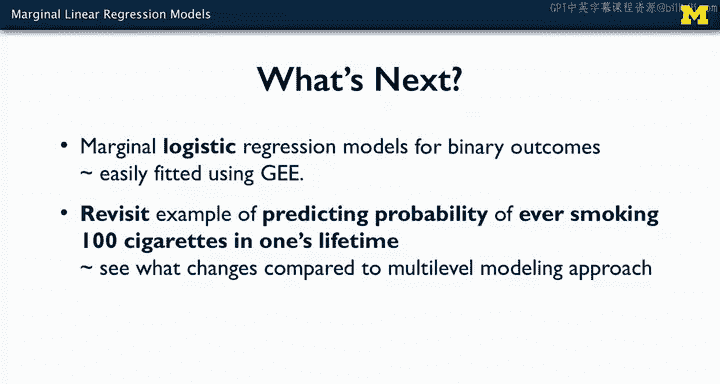

# 课程18：边际线性回归模型 📊

在本节课中，我们将学习如何为连续型因变量拟合边际模型。当数据因来自同一个体或同一个随机抽样的集群而存在相关性时，这种模型非常有用。我们将重点介绍一种名为广义估计方程的替代建模方法，用于处理具有依赖性的数据。

---

## 概述

上一节我们讨论了处理依赖性数据的边际建模方法。本节中，我们将具体探讨如何为连续型因变量拟合边际线性回归模型。我们将学习模型的基本形式、参数估计方法（特别是广义估计方程），以及如何选择合适的相关结构来进行推断。

---

## 边际模型回顾

在边际建模方法中，研究者可能不关心估计集群间斜率或截距的变异。他们可能只对所有高层集群的**边际固定效应**感兴趣。此外，研究者可能只关注整体的边际关系（可能针对不同亚组），而不是特定个体或集群的具体关系。

以下是拟合边际模型的替代方法，本周我们将重点介绍**广义估计方程**。

---

## 边际线性回归模型

让我们思考一下边际线性回归模型的样子。我们有一个连续型因变量，可以假设其边际分布为正态分布。

当我们为正态因变量拟合边际模型时，我们估计由以下模型定义的参数：

**公式：**
`y_i = X_i * β + ε_i`

**重要说明：**
边际模型**不包含显式的随机效应**。如果我们看这个回归模型，其中有 `p` 个不同的预测变量，请注意模型中没有任何代表随机效应的 `u` 项。这与我们在多层建模讨论中的模型不同。在这个边际模型中，我们只看到一个误差项 `ε_i`，它解释了观测值 `y` 与由回归函数（即 `β` 参数和预测变量的线性组合）定义的预测值 `ŷ` 之间的差异。

我们将来自给定集群 `I` 的观测向量记为 `y_I`（共有 `n_i` 个观测值）。我们假设 `y` 的观测向量服从正态分布，其均值由回归函数（固定效应或 `β` 参数与预测变量 `X_I` 的线性组合）定义，方差协方差结构由 `V_I` 定义。

**关键点：**
在 `V_I` 矩阵中，与标准线性回归不同，我们允许来自同一集群的观测值具有**非零协方差**。`V_I` 矩阵可以具有多种可能的结构。

**另一个重点：**
我们**不显式估计随机集群效应的方差和协方差**，因为模型中根本没有这些项。同一集群内观测值的相关性完全由这些误差项的相关性捕获，而这些相关性体现在 `V_I` 矩阵中。因此，拟合这些模型的一个重要部分是**为 `V_I` 矩阵选择一个结构**。

---

## 广义估计方程

广义估计方程是拟合边际模型的一种技术。当我们使用 GEE 为依赖性数据拟合模型时，我们实际上是试图找到定义我们模型的参数的估计值，这些估计值能解以下得分函数（也称为估计方程，GEE 技术由此得名）。

**公式：**
`Σ_i [ D_i^T * V_i^{-1} * (y_i - μ_i) ] = 0`

**术语解析：**
*   `D_i^T`： 是一个 `n_i × p` 矩阵的转置，其元素表示均值函数 `μ_i` 对回归参数 `β` 的偏导数。
*   `V_i`： 是集群 `I` 观测值的 `n_i × n_i` 方差协方差矩阵，由用户指定。
*   `y_i`： 是为第 `I` 个集群收集的结果测量的向量（列）。
*   `μ_i`： 是基于所选模型的那些结果测量的期望均值向量。固定效应（`β` 参数）通过定义 `μ_i` 的回归函数进入此估计方程。

我们使用称为**迭代加权最小二乘法**或**费希尔得分算法**等迭代技术来求解方程，以找到能解此特定得分方程的 `β` 参数估计值。

GEE 方法最早由统计学家 Liang 和 Zeger 在 1986 年的一篇重要论文中提出。

---

## 实践中的工作相关矩阵

在实践中，我们很少知道观测值的真实方差协方差矩阵是什么。我们尝试定义一个**工作相关矩阵**，作为我们对来自第 `I` 个集群的观测值真实相关结构的合理猜测。

我们通常指定这些观测值的相关性（而非协方差），因为对于许多非正态结果（GEE 常用于此类情况），观测值的方差实际上由模型的均值结构定义。因此，在实践中，我们更侧重于选择相关结构，而不太担心因变量的方差。

这种通用方法使得该方法能够轻松适应非正态因变量（如泊松分布、二项分布等）。我们将在考虑边际逻辑回归模型时重新讨论这一点，但现在我们的重点是连续正态情况下的边际线性回归模型。

---

## 如何进行统计推断？

参数估计值的方差使用所谓的**三明治估计量**计算。该估计量基于指定的工作相关矩阵。

我们的固定效应参数（`β`）的估计量是**一致的**。这意味着在足够大的样本量下，我们对这些固定效应参数的估计将收敛于这些参数的真实值。这是使用 GEE 的一个非常好的特性：即使我们错误指定了工作相关矩阵，固定效应参数的估计量仍然是一致的。

然而，对工作相关矩阵的错误选择会影响**标准误**（可能过大或过小），但不会影响固定效应参数本身的估计值。我们希望为工作相关矩阵做出一个好的选择，以确保我们的估计具有良好的标准误。

---

## 工作相关矩阵的选择

在使用 GEE 时，对于定义方差协方差矩阵 `V_I` 的工作相关矩阵，通常有四种主要选择：

以下是四种主要的工作相关结构：

1.  **独立结构**： 假设同一集群内的观测值相互独立，相关性为零。
2.  **可交换结构**： 假设同一集群内的观测值具有恒定的相关性。
3.  **一阶自回归结构**： 假设在时间上更接近的观测值比相隔更远的观测值具有更强的相关性，相关性随时间衰减。
4.  **非结构化**： 为观测值设定完全通用的相关结构，同一集群内的任何一对观测值都具有独特的相关性。

Liang 和 Zeger 在 1986 年的论文中提出了定义 GEE 模型的这些相关性的估计量。

我们在使用 GEE 时的重点主要是**固定效应**（那些回归参数 `β`），而不是对这些令人讨厌的相关性进行推断。我们主要将这些相关性视为一种干扰，目的是捕获同一集群内的依赖性，以便对反映同一集群内观测值依赖性的固定效应做出合理的推断。

---

## 模型比较与诊断

我们的推断对于方差协方差矩阵的可能错误设定具有稳健性。我们可以使用基于这些三明治标准误估计的 **Wald 检验** 来执行固定效应的假设检验。

我们还可以查看适用于 GEE 设置的信息准则，例如 **QIC 准则**。这些信息准则可用于比较具有不同相关结构的竞争模型的拟合优度。

**均值结构**的良好设定（包括模型中的交互作用或非线性预测变量）绝对重要。如果我们弄错了工作相关结构，对于固定效应来说是可以接受的（记住，我们的固定效应仍然会被一致地估计），但相关性结构选择不当会影响我们的标准误。因此，我们也希望为相关性结构做出合理的选择。

对于相当大的数据集，不同的工作相关矩阵选择不会对我们的推断产生巨大影响。非结构化通常作为一种通用的相关结构是有意义的。我们仍然可以考虑不同的潜在相关结构，以查看它们对我们的标准误有何种影响，然后再最终做出推断。

**QIC** 在比较不同模型的相关结构时很流行且应用广泛。我们会尝试识别具有最小 QIC 值的模型，这表明该相关结构代表了最佳拟合。Westgate 和 Burchett 在 2017 年的工作中描述了识别正确相关结构的更好替代方案。

---

## 实例应用：欧洲社会调查

让我们将 GEE 应用到之前讲座中讨论的欧洲社会调查分析中。

**回顾：**
我们感兴趣的是**对警察的信任度**（自变量）与一个人关于“人们是否普遍愿意帮助他人”的态度（因变量）之间的关系。在研究设计中，观测值按访问员进行聚类。

在之前的分析中，我们使用具有随机访问员效应的多层模型来解释这种聚类，或者完全忽略依赖性并使用标准线性回归。现在，我们将使用 **GEE** 作为多层建模的替代方法来解释这种依赖性。

我们使用 GEE 拟合了一个边际线性回归模型，并从一个**可交换相关结构**开始（假设同一访问员内的观测值具有恒定相关性）。我们使用此方法对这两个变量之间的整体边际关系进行推断，该推断将解释同一访问员内观测值的依赖性。

**结果：**
*   GEE 估计的对警察信任度的固定效应为 **0.04**（正相关）。
*   基于三明治标准误估计，该固定效应在 5% 水平上不显著（P 值 = 0.054）。
*   相比之下，在多层模型中，该固定效应的估计值为 **0.12**（且显著）。

**解释差异：**
*   **多层模型**（包含显式随机访问员效应）：对于特定访问员，对警察信任度每增加一个单位，预期助人意愿增加 0.12。
*   **边际模型**（不显式以随机访问员效应为条件）：**在所有访问员中**（不以任何特定访问员为条件），对警察信任度每增加一个单位，预期助人意愿增加 0.04。

我们可以看到，由于我们没有以集群（此处为访问员）的随机效应为条件，而是查看所有访问员的整体关系，因此我们做出了略有不同的推断。

---

## 模型诊断与比较

我们假设了访问员内的恒定相关性，该令人讨厌的相关性估计值为 **0.05**。此特定模型的相应 **QIC** 为 **6790.61**。

考虑替代的工作相关结构：
*   **非结构化**和**一阶自回归**相关结构在这种情况下意义不大，因为每个访问员内的横截面观测值没有明确的时间顺序。
*   **独立结构**（假设零相关性）的 QIC 为 **6791.55**。

比较这两个 QIC 值（数值越低拟合越好），可交换相关结构的模型 QIC 更低，这提供了支持可交换相关结构的证据，表明考虑访问员内的相关性是重要的。

---

## 本节总结

在本节课中，我们一起学习了：
1.  **边际线性回归模型**的基本形式和原理，它不包含显式随机效应，而是通过误差项的相关结构来处理集群内数据的依赖性。
2.  **广义估计方程** 作为拟合边际模型的核心技术，其目标是通过求解估计方程来获得固定效应参数的一致估计。
3.  实践中需要指定**工作相关矩阵**（如独立、可交换、自回归、非结构化），其选择主要影响标准误的估计，而不影响固定效应参数估计的一致性。
4.  可以使用 **QIC** 等信息准则来比较不同相关结构模型的拟合优度。
5.  通过**欧洲社会调查实例**，我们应用 GEE 进行了分析，看到了边际模型与多层模型在参数估计和解释上的差异，并利用 QIC 选择了更优的可交换相关结构。

总而言之，边际建模（特别是 GEE）为我们提供了一种强大的工具，可以在不关心集群间变异细节的情况下，对存在依赖性的数据做出关于整体固定效应的稳健推断。

---

## 下一步展望

接下来，我们将转向用于二分类结果的**边际逻辑回归模型**。这些模型可以很容易地使用 GEE 进行拟合。我们将讨论适用于其他类型因变量的 GEE 模型，并重新审视预测一生中是否吸过 100 支香烟的概率的例子。我们已经考虑了该分析的多层方法，现在我们将考虑边际建模方法，并观察相对于多层建模方法有何变化。