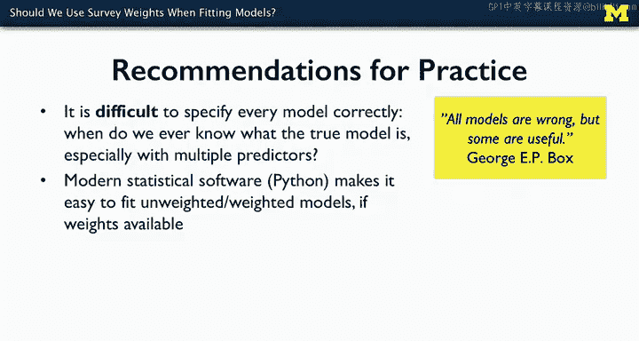

# 课程 P86：模型拟合中是否应使用调查权重 📊

在本节课中，我们将探讨一个在回归分析中常遇到的问题：当数据来自概率抽样调查并附有调查权重时，在拟合回归模型时是否应该使用这些权重。我们将理解权重的意义，分析使用与不使用权重的影响，并最终给出实践建议。

---

## 🔍 回顾：什么是调查权重

上一节我们介绍了不同类型的回归模型，本节中我们来看看一个尚未讨论的问题：权重。调查权重通常出现在通过复杂概率抽样收集的数据集中。这些权重至少**考虑了不同个案被选入样本的不等概率**。

在理论上，这些权重旨在实现对**有限目标总体**中特定参数的无偏估计。这意味着，通过使用权重，我们得到的估计值在多次重复抽样中，其平均值将等于总体中我们关心的真实参数值。

因此，我们面临的情况是：分析师希望为来自概率样本的数据拟合一个回归模型，并且数据集中存在代表不同选择概率的权重。问题是：在拟合模型和进行统计推断时，我们是否需要考虑这些权重？

---

## ⚖️ 是否应在估计中使用权重

使用调查权重来拟合回归模型，首先能确保**估计的回归参数相对于抽样设计是无偏的**。然而，这些权重**并不能保护分析师免于模型设定错误**。

作为分析师，你仍然需要努力正确地设定模型的均值结构、方差-协方差结构。权重无法帮你避免遗漏重要预测变量或错误设定非线性关系等问题。

假设一位分析师设定了一个错误的模型，但仍使用调查权重进行估计，并计算了回归参数的加权估计值。结果会如何？

*   **优点**：分析师将得到相对于抽样设计而言无偏的回归参数估计。这是好事。
*   **缺点**：分析师为推断的有限总体设定了一个错误的模型。这是坏事。

在这种情况下，分析师得到的是一个**错误总体模型的无偏估计**。在实践中，我们希望同时实现两个目标：获得回归参数的无偏估计，并尽最大努力为推断的有限总体设定一个正确的模型。

---

## 📈 不同情境的示例分析

以下是几种不同情境的对比，帮助我们理解权重和模型设定的相互作用。

### 情境一：使用权重，但模型设定错误

在这个数据集中，每个点的大小代表其调查权重。散点图显示X和Y之间存在**非线性关系**。然而，分析师错误地设定了一个**线性关系模型**，并使用了权重进行估计。

**结果**：拟合的直线被**拉向权重更高的点**。我们得到了总体中“最佳线性模型”的无偏估计，但模型本身设定错误，完全忽略了数据中重要的非线性特征。

### 情境二：忽略权重，且模型设定错误

分析师忽略权重，并再次错误地设定了线性模型。

**结果**：拟合的直线现在被**拉向权重较低的点**。这导致了对总体回归参数的**有偏估计**，并且模型本身也是错误的。这是最糟糕的情况，我们既没有得到无偏性，也没有正确的模型设定。

### 情境三：忽略权重，但模型设定正确

分析师正确地设定了模型（例如，加入了X²项来捕捉曲线关系），但忽略了调查权重。

**结果**：设定良好的模型很好地拟合了观测数据。如果模型被正确设定，我们**可能最终并不需要权重**来捕捉总体中的这种关系。一个设定良好的模型本身就能描述X和Y之间的关系。

### 情境四：使用权重，且模型设定正确

分析师既使用了权重进行估计，又正确地设定了模型。这是推断上的“最佳情境”。

**结果**：我们从一个设定良好的模型中得到了该关系的无偏估计。模型拟合良好。然而，与情境三的拟合图相比，两者**本质上没有区别**。我们会得出相同的结论。

**但存在一个缺点**：如果你已经很好地设定了模型，再使用权重进行估计，可能会**不必要地放大回归参数估计的标准误**。在进行假设检验时，这会影响我们的推断。因此，在这种情况下，我们可能不希望使用权重，以免因使用这些“多余”的权重而影响推断的精确性。

---

## ✅ 实践建议总结

本节课我们一起学习了权重使用的权衡。基于以上分析，当你在数据集中发现调查权重并希望拟合回归模型时，可以参考以下建议：

1.  **首要任务：尽力正确设定模型**
    运用你的专业知识，审视可用的预测变量，观察数据（如散点图），尽你所能地在回归函数中捕捉变量间的关系。

2.  **比较加权与未加权模型**
    使用Python等统计软件，可以轻松快速地拟合使用和不使用调查权重的模型。这有助于你检查结果和推断对使用权重的敏感性。

3.  **分析比较结果**
    *   如果两种方法得到的**估计系数相似**，但加权估计的**标准误更大**，那么你的模型很可能在一定程度上被正确设定了，此时权重可能是不必要的，它可能只是增大了估计的抽样方差。
    *   如果**估计系数发生显著变化**，则模型可能被错误设定了。在这种情况下，权重携带了关于你试图建模的总体关系的信息。此时，**应报告加权估计结果**，以确保至少相对于抽样设计是无偏的，即使模型可能不完美。

统计学家乔治·博克斯有一句名言：“**所有模型都是错的，但有些是有用的。**”在实践中，很难完美地设定每一个模型。我们很少能确切知道总体中真正的模型是什么。

因此，现代统计软件（如Python）使得拟合加权和未加权模型变得非常容易。你可以通过比较来检查推断的稳健性，并遵循上述建议。

---

## 📚 延伸阅读

此外，还存在一些**正式的统计检验**，用于比较拟合回归模型时加权估计与未加权估计的差异。你可以在本周的深度阅读材料中找到更多关于这些正式检验的信息。

---
**本节课中，我们一起学习了在回归分析中是否及如何使用调查权重。核心在于权衡无偏性与模型正确性，并通过比较加权和未加权的模型结果来指导实践决策。**