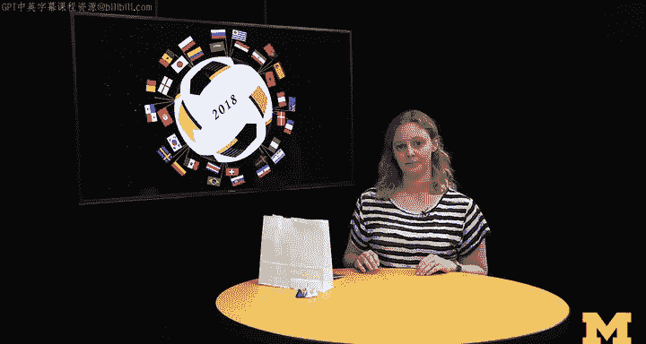
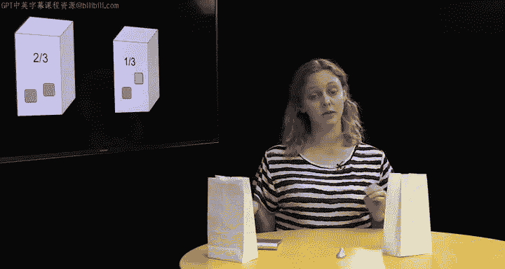

# 课程21：贝叶斯方法导论 🧠

在本节课中，我们将简要介绍统计学领域中的贝叶斯方法。统计学主要有两大框架：频率学派和贝叶斯学派。在本课程乃至整个系列中，我们主要关注频率统计。然而，我们确实希望尽早让你接触贝叶斯统计。你在频率统计中使用的大多数方法，在贝叶斯统计中都有相应的扩展或改编。本课程的核心目标是让你理解统计推理和统计思维。

## 概率的本质：世界 vs 心智

为了开始，我先问你一个问题：哪支球队赢得了2018年世界杯？你有答案了吗？现在，你能为你认为自己的答案正确的可能性分配一个概率吗？比如0%、20%或100%？你刚刚给出的这个数字，只在贝叶斯统计中被允许。

答案是法国队。恭喜那些知道答案的人，我自己可能也会答错。但在频率统计学的思想中，因为比赛已经结束，我们已经知道答案；你的答案要么正确，要么错误，你答对的概率要么是0%，要么是100%。

你给出的任何介于0%和100%之间的数字，都只能在贝叶斯框架下给出。原因在于，在频率统计中，概率是关于世界的（即某事客观上正确与否），而在贝叶斯统计中，概率存在于你的心智中。

在任何比赛开始前，你都可以进行一系列概率计算。例如，假设你知道有211支球队有资格参加世界杯，这意味着每支球队最初获胜的概率略低于0.5%。也许你非常擅长识别国旗，能从背景图片中认出参加世界杯的32支球队。那么你就知道每支球队最初获胜的概率约为3%。然而，你可能还知道德国队通常表现不错，因此你可能想提高他们的获胜概率，比如不说3%，而说5%，但你必须从其他球队的获胜概率中减去这部分。

这里的核心思想是：在频率统计中，你可以在比赛开始前进行这些更新和计算。然而，一旦任何比赛开始，这就不再被允许。但在贝叶斯统计中，只要你还不知道答案，你就可以更新概率。所以你可以说：“我知道德国队通常表现不错，我认为他们赢了，但我只有20%的把握，我不完全确定这是对的。”

## 更新概率：巧克力袋实验

现在，我们来看另一个例子。我这里有四块巧克力。三块是银色的，一块是紫色的。我将把它们放进两个不同的袋子里。一个袋子里有两块银色巧克力，另一个袋子里有一块银色和一块紫色巧克力。

我把袋子放到背后，然后随机挑选一个袋子（我自己也不知道挑中了哪个），并从该袋子中取出一块巧克力。假设取出的这块巧克力是银色的。这告诉了我关于这两个袋子的一些信息。我知道，如果选中的是“银-银”袋，有两种方式可以取出银色巧克力；而如果选中的是“银-紫”袋，只有一种方式可以取出银色巧克力。

在贝叶斯统计中，我利用这个新信息来更新这个袋子是“银-银”袋的概率。因此，我认为这个袋子是“银-银”袋的概率是三分之二，是“银-紫”袋的概率是三分之一。

在频率学派的框架下，因为我知道有两个袋子，所以选中任一袋子的可能性是50%，即等可能。这个例子阐释了贝叶斯统计中的两个核心思想：第一，概率存在于你的心智中，而非世界中；第二，你可以随着获得新信息而更新你的概率。知道我抽出了一块银色巧克力，这给了我额外信息，我据此更新了这个袋子是“银-银”袋的可能性。

贝叶斯统计与频率统计之间的这场辩论在统计学界非常具有争议性，影响深远。因此，请务必思考你更倾向于哪一方，并欢迎在统计学界参与这场辩论。

顺便说一句，实际上我选中的是“银-紫”袋。无论如何，我最终都得到了一块巧克力，这没什么不好。

## 总结

本节课中，我们一起学习了贝叶斯统计的基本思想。我们了解到贝叶斯方法与频率方法的核心区别在于对概率的解释：贝叶斯概率是主观的、基于信念的，并可以随着新证据的出现而更新；而频率概率是客观的、基于长期重复事件的。我们通过世界杯冠军猜测和巧克力袋实验两个例子，直观地体会了如何利用先验信息和似然性来更新后验概率。理解这两种不同的统计哲学，对于全面掌握数据分析思维至关重要。