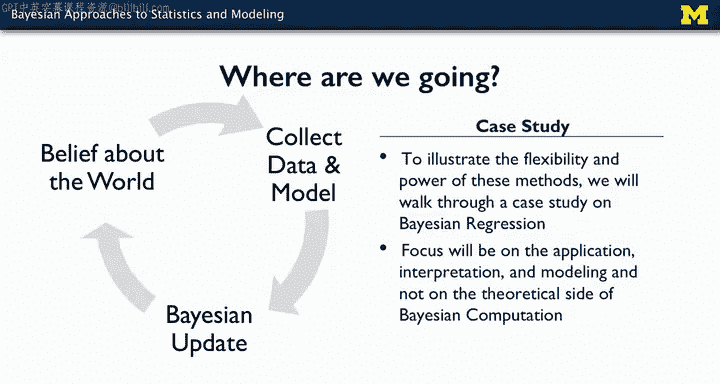

# 88：贝叶斯统计与建模方法 🧠

在本节课中，我们将学习贝叶斯统计与建模方法，了解它与我们之前课程中使用的频率主义方法有何不同。我们将通过一个案例来阐明其核心思想。

## 概述

我们之前主要使用**最大似然估计**来拟合模型。这种方法为数据选择最佳的单一参数值。例如，我们估计均值是5，但在讨论标准误之前，我们很少谈及不确定性。在频率主义框架下，概率被视作**长期频率**，即如果重复实验多次，某个结果出现的期望。

贝叶斯方法则以一种根本不同的方式思考这些问题。接下来，我们通过一个例子来说明。

## 案例：估计密歇根大学学生的平均IQ

假设有人请我确定密歇根大学学生的平均IQ。首先，我需要形成对这个问题的初始看法。

### 1. 建立先验信念

我对IQ了解不多，所以我去网上查询。我发现美国总人口的IQ分布均值为100，标准差为10。因此，我将此作为我的**初始信念**。我假设均值是100，标准差是10。这未必是最准确的信念，但它是我的起点。其他人可能有不同的信念，这完全没问题。

这个初始信念的分布如下图所示。它基于总人口信息，是我分析的起点。

同样，其他人可以有不同的信念。例如，有人可能认为密歇根学生的IQ更高，或者分布是偏态的，甚至可能是多峰的。这些都可以是合理的先验信念。但在此案例中，我将坚持使用均值为100、标准差为10的正态分布作为我的先验。

这些信念的**方差**大小也反映了我的**不确定程度**。方差大表示我对均值的位置非常不确定；减小方差则意味着我的信念更确定。

### 2. 观察数据并更新信念

现在，让我们去收集一些数据，看看我的信念会如何改变。

*   **第一次观察**：我遇到一个人，其IQ为125。我的信念应该如何更新？我观察到的数据点远高于我最初认为的均值（100），因此我的信念均值应该被**向右拉**。更新后的信念分布会向右移动，均值可能提高到124左右。
*   **第二次观察**：接着，我观察到一个IQ为115的人。由于115低于更新后的信念均值（约124），我的信念分布会**略微向左移动**。同时，因为现在有了两个数据点，我信念的**方差会减小**，不确定性降低了。
*   **持续更新**：我继续在校园里观察，记录下更多的IQ分数：125, 115, 115, 120, 125, 117... 每次观察，我都用新数据更新我的信念。最终，在观察了大量数据后，我得到了一个新的信念分布。

### 3. 后验分布

这个最终得到的、基于数据的信念分布，被称为**后验分布**。在我们的案例中，后验分布看起来如下图所示。它大致以119为中心，并且比最初的先验分布更窄、更确定。

这个从先验开始，用数据通过贝叶斯方式更新信念的过程，就叫做**贝叶斯更新**。这是贝叶斯主义者思考世界的方式。

## 频率主义 vs. 贝叶斯主义

现在，让我们退一步，比较两种方法的核心差异。

在频率主义分析中，我最终会得到一个**点估计**。例如，我可能会说：“我的点估计是118。” 这只是一个单一的数字。

而在贝叶斯分析中，我得到的是关于参数的**整个分布**（即后验分布）。这使我们能够以概率的方式回答更多关于我们感兴趣量的问题。

### 利用后验分布回答问题

有了后验分布，我们可以回答各种问题：

*   **期望值**：你认为IQ分数的最佳猜测是多少？我可以回答：我的信念分布的均值是119.55。
*   **最可能值**：如果你必须押注一个值，你会选哪个？我会选择后验分布的众数，这被称为**最大后验估计**。对于正态分布，众数等于均值。
*   **中位数**：同样可以计算。对于正态后验，中位数也等于均值。
*   **可信区间**：什么是95%**可信区间**？它类似于频率统计中的**置信区间**，但解释不同。在贝叶斯框架下，我可以说：“有95%的**概率**，密歇根学生平均IQ的真实信念值落在116到122之间。” 这比频率主义的“95%置信度”解释更直观。

能够对概率进行陈述是非常强大的。然而，天下没有免费的午餐，我们稍后会讨论这种增强解释力所带来的代价。

## 贝叶斯思维模型

从更高层面看，贝叶斯思维是一个循环：

1.  **先验**：我们从关于世界的某个信念（先验）开始。
2.  **建模**：我们收集数据，并通过一个模型来处理它。
3.  **后验**：我们使用模型和观测数据来更新我们对世界的信念，得到后验分布。
4.  **迭代**：然后，我们可以将这个后验分布作为下一次新分析的先验，继续这个循环，直到我们的信念收敛或达到所需精度。

贝叶斯分析的步骤可以总结为：
1.  建立先验信念。
2.  收集数据。
3.  更新信念，获得后验。
4.  重复步骤2和3，直到获得满意的分辨率或资源耗尽。
5.  使用最终的后验分布来回答关于感兴趣量的各种问题。

## 贝叶斯方法的优势与挑战

### 优势
*   **全面的推断**：所有关于我们感兴趣量的信念问题，都可以通过后验分布找到答案。
*   **最优决策**：结合**损失函数**，我们可以在不确定性下做出最优决策。
*   **强大的建模**：拥有整个分布而不仅仅是点估计，使我们能更好地建模世界。

### 挑战与代价
然而，这种以不同方式思考概率的解释也有其缺点：
*   **概率观的转变**：我们必须彻底改写概率的定义。频率主义将概率视为**长期频率**，参数是固定但未知的常数，数据是随机的。公式表示为：我们试图估计一个固定的 `μ`，最佳估计是 `x̄`。
*   **参数随机化**：贝叶斯主义将概率视为**信念程度**。他们将数据视为固定的，而将模型参数视为**随机变量**。这意味着我们相信存在一个关于参数 `μ` 的分布，并试图用数据推断这个分布。
*   **数学与计算复杂性**：除非使用特定的共轭先验，否则贝叶斯计算的数学可能非常困难，涉及高维积分。许多复杂模型没有解析解，我们别无选择，只能使用**抽样方法**来近似结果。这通常计算量很大，有时甚至难以处理。

## 总结

本节课中，我们一起学习了贝叶斯统计与建模方法的核心思想。我们通过一个估计平均IQ的案例，了解了如何从先验信念出发，通过观察数据来更新获得后验分布。我们比较了贝叶斯方法与频率主义方法在概率观和结果解释上的根本区别：贝叶斯方法提供了参数的完整概率分布，允许我们进行更直观的概率陈述。同时，我们也认识到这种强大能力伴随着数学和计算上的挑战。在接下来的案例研究中，我们将更具体地探讨贝叶斯建模的应用、解释及其优势。