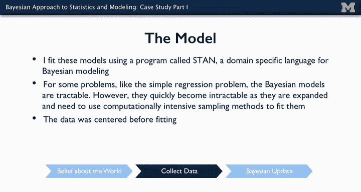

#  89：贝叶斯方法案例研究（上）🔍

在本节课中，我们将学习贝叶斯统计方法的基础，并通过一个多层回归问题的案例研究，初步探索贝叶斯建模的工作流程。我们将了解如何设定先验信念、结合数据更新信念，并解释模型结果。

---

## 概述：贝叶斯数据分析三步法

在深入案例之前，我们需要回顾构建贝叶斯模型的三个典型步骤。

第一步是建立对世界的信念。这包括设定先验分布和似然函数。你可以将其视为搭建模型，并确保所有组成部分就位。

第二步是利用数据和概率更新我们的信念。我们需要检查模型是否与数据相符，即进行模型拟合检验，确保模型尽可能捕捉现实。

第三步是根据模型结果更新我们对世界的看法。给定我们的数据和模型，我们应该如何改变信念，以便在探索新数据时可以重新开始这个过程。

---

## 案例研究：数据与模型设定

对于本案例研究，我们使用了基于“全国青年纵向调查”的数据集。它包含434个观测值，旨在研究母亲智商对孩子智商得分的影响。

以下是数据中一些关键变量的示例：假设一位母亲智商为121，上过高中，年龄27岁。我们将尝试基于这三个变量来预测其孩子的智商得分。这个数据集足够大以展示贝叶斯分析的优势，又足够小以便于理解。

我们将从一个线性模型开始。在频率统计中，我们经常看到这种形式。我们将模型表达为：

**公式：`child_iq = β₀ + β₁ * mother_iq + β₂ * mother_age`**

我们首先使用这个基本的回归模型，暂时不包括“高中”这个变量。这样做有两个原因：首先是为了保持初始的简单性，我们稍后会构建更高级的模型；其次是为了真正看清贝叶斯方法与传统方法相比有何异同。

---

## 贝叶斯框架的核心：先验分布

到目前为止，我们所做的与过去并无太大不同。但在贝叶斯框架中，我们需要为我们的信念指定先验分布，这是一个新的概念。

**关键点：每个参数都必须从一个捕捉我们信念的分布开始。我们赋予这些参数的分布称为先验。**

例如，对于截距项 `β₀`，我可能相信它应该以0为中心，并用正态分布来表示这个信念。同样，对于斜率 `β₁`（母亲智商的影响），在分析之初，我的信念是母亲的智商几乎完全决定了孩子的智商，因此我可能将 `β₁` 的先验中心设为1。但我对这个信念并不十分确定，所以我会给它一个较大的方差。对于 `β₂`（母亲年龄的影响），我最初的信念是它可能没有影响，因此我将其先验中心设为0。

贝叶斯分析的第一步就是明确陈述：“我的先验是什么？在进行数据更新之前，我实际上认为事情会是什么样子？”理想情况下，我们甚至应该在看到数据之前就建立这些先验。

一个好的做法是写下你所有的先验，并附上一小段说明选择它们的理由。

以下是我为本案例设定的初始先验（数据已中心化处理）：
*   **`β₀` (截距)**：由于数据已中心化，我预期截距接近0。我赋予它一个方差为20的较弱先验，意味着我不太约束这个参数。
*   **`β₁` (母亲智商斜率)**：我相信母亲的智商能解释孩子智商的大部分。我将其先验中心设为1（表示1:1的预期关系），但同样赋予较大的方差以表示不确定性。
*   **`β₂` (母亲年龄斜率)**：我最初的信念是母亲年龄可能对孩子的智商没有独立影响（在控制智商变量后），因此我将先验中心设为0。

最后，对于模型的误差，我假设孩子的智商观测值服从一个以我们的线性函数为均值、以 `σ_error` 为标准差的正态分布。`σ_error` 代表了模型的普遍误差，我们希望它尽可能小，这表明我们的预测很准确。

---

## 关于先验选择与主观性的讨论

需要强调的一点是：为什么我选择了这些特定的分布和先验？我在上面的句子中解释了它们。这总是一个好的做法。

但贝叶斯统计的一个特点是，它本质上允许建模者带有一定的主观性。两个不同的人可能会使用不同的先验，并因此可能得出不同的结论。如果一个人坚信 `β₂` 是零，而另一个人认为它是一个非零的常数，那么他们的模型预测可能会大相径庭。

这种主观性是存在的。如果这个模型因为我的假设而显得主观，那正是关键所在。我的假设是我的，并且被带到了分析的最前沿。我不是这个领域的专家，也从未处理过这些数据，所以我试图通过估计中的不确定性来表达这一点——我给我的模型很大的空间去尝试解释参数可能是什么，我不希望我的先验过多地影响我的测量结果。

另一个要点是，征求专家意见以纳入先验数据通常是一个好主意，这也是贝叶斯分析真正闪耀的地方。如果你从之前的实验中得到一个想法，或者专家告诉你某个参数应该有不同的预期，这些都可以在你看到当前数据之前融入到你的先验中，如果它们与数据一致，就能让你得到更好的参数估计。

---

## 模型拟合与计算说明

在我们查看实际模型拟合结果之前，需要说明几点关于模型拟合的事情。

我使用一个名为 **Stan** 的程序来拟合这些模型，它是一种用于贝叶斯建模的领域特定语言。我们可以通过Python与Stan交互，但需要构建一些脚本。

对于像简单线性回归这样的问题，贝叶斯模型本身是易于处理的。但如果我们想要贝叶斯统计的所有优点，也需要处理其缺点。数学计算可能很快变得难以处理，因此我们有时需要使用抽样方法。我们可能无法得到一条漂亮的后验分布曲线，而是得到一个看起来像直方图的东西。只要我们有一个良好的抽样算法来近似这个分布，这通常是可以接受的。

最后需要说明的是，在拟合之前，数据已经进行了中心化处理。退一步想，如果一个母亲的智商或年龄为0，我们试图预测她孩子的智商，这并没有实际意义。因此，在开始之前我对数据和预测变量进行了中心化处理，这不仅是为了对均值有一点解释，也消除了因为拟合远离零的数据而产生的噪声截距项。

---

## 总结

本节课中，我们一起学习了贝叶斯数据分析的基本流程：设定先验信念、结合数据更新信念、并根据结果修正认知。我们通过一个预测孩子智商的案例，具体了解了如何为线性回归模型的参数设定先验分布，并讨论了先验选择中的主观性与专家知识整合的重要性。我们还简要介绍了用于贝叶斯计算的工具（如Stan）以及数据预处理（如中心化）的必要性。

在下一部分，我们将深入实际的模型拟合结果，并继续探索更复杂的模型设定。