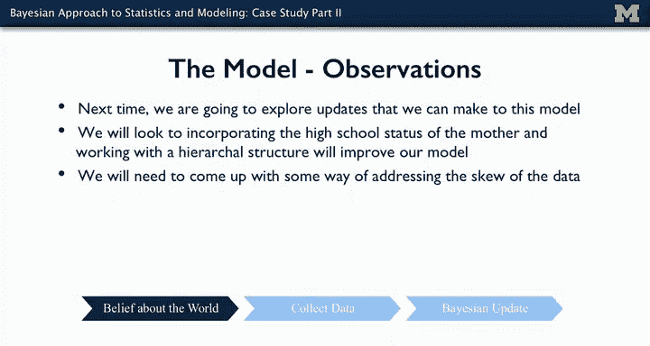

# 课程24：贝叶斯方法案例研究（中）🔍

在本节课中，我们将继续案例研究，深入探讨在贝叶斯框架下模型拟合的结果。我们将学习如何解读参数的后验分布，理解预测区间，并通过一系列诊断图来评估模型的性能与潜在问题。

---

## 模型拟合结果：从点估计到分布估计

上一节我们介绍了贝叶斯多层回归模型的基本设定。本节中，我们来看看拟合模型后得到了什么。

在传统的频率主义分析中，我们得到的是参数的**点估计**和**标准误**。例如，一个模型的输出可能如下：
*   截距估计值：`0`
*   IQ系数估计值：`0.61`，标准误：`0.05`
*   年龄系数估计值：`0.45`
*   残差标准差估计值：`18.2`

然而，在贝叶斯分析中，我们得到的是每个参数的**完整概率分布**（后验分布）。这是因为我们不是通过最大似然求一个最优值，而是通过抽样技术（如MCMC）来探索参数的所有可能值及其不确定性。

例如，对于IQ系数，我们得到的不是一个数字`0.61`，而是一个分布，其均值可能在`0.6`左右，并且有`95%`的区间可能在`[0.5, 0.7]`之间。这为我们提供了远比单一数字丰富的信。

---

## 解读参数的后验分布

以下是基于后验分布我们可以进行的分析：

**截距分布**：由于数据进行了中心化处理，截距的后验分布以`0`为中心，这符合预期。

**IQ系数分布**：其分布完全在`0`以上，这表明母亲IQ与孩子IQ之间存在正相关关系。我们的最佳估计是，母亲IQ每增加`1`个单位，孩子IQ平均增加约`0.6`个单位（范围大约在`0.5`到`0.7`之间）。模型可以表示为：
`child_iq = intercept + beta_iq * mom_iq + beta_age * mom_age`

**年龄系数分布**：其分布广泛地覆盖了`0`，这意味着母亲年龄与孩子IQ之间可能没有强关联，我们对这个参数非常不确定。

**残差标准差分布**：其均值约为`18.2`。这告诉我们，在给定预测值的情况下，实际观测值平均会偏离约`18.2`个单位，这量化了模型的预测不确定性。

此外，我们可以绘制参数之间的联合分布图。如果图中点云呈圆形或椭圆形，没有明显的倾斜模式，则说明参数之间相关性很弱，模型不存在严重的多重共线性问题，这是一个好迹象。

---

## 后验预测分布与区间

在贝叶斯框架中，一个强大的功能是进行**后验预测检查**。我们不仅得到参数分布，还能得到**预测值的分布**。

具体过程是：我们利用后验分布中抽取的每一组参数值（如截距、IQ系数、年龄系数），代入模型为新的或已有的观测数据生成一个预测值。重复这个过程成千上万次，就得到了该数据点预测值的完整分布。

例如，对于数据集中第一个观测（母亲IQ=100，年龄=25），我们得到的不是一个预测点（如`85`），而是一个预测分布。我们可以从这个分布中计算`95%`可信区间（例如`[70, 140]`），并检查真实观测值（蓝色竖线）是否落在这个区间内。

我们将这个检查应用到所有数据点上，并生成一个标准化图。图中：
*   **蓝点**表示真实值落在其`95%`预测区间内的观测。
*   **红点**表示真实值落在其`95%`预测区间外的观测。

理想情况下，大约应有`95%`的点是蓝色的。我们的模型基本符合，但注意到左侧（低IQ区域）有较多红点，暗示模型可能系统性地低估了这部分孩子的IQ。

---

## 模型诊断与发现

通过观察后验预测的各类诊断图，我们可以总结出当前模型的几个关键发现：

**预测区间宽度**：所有预测区间的平均宽度约为`71`。这意味着当被要求预测一个孩子的IQ时，我们只能说“大概是`100`，但上下浮动`35`左右”，不确定性相当大。

**误差分布**：预测误差（预测均值与真实值之差）的直方图显示，大部分误差在`±15`以内，但存在少数误差超过`40`的极端情况，表明模型对某些“异常”观测拟合不佳。

**后验预测检查图**：这是最重要的诊断工具之一。我们将**真实数据**的分布（蓝色曲线）与**模型重复预测值**的分布（多条灰色曲线）进行对比。
1.  **均值偏移**：模型预测值的分布均值似乎略低于真实数据的均值。
2.  **尾部不匹配**：模型严重低估了IQ在`50-70`区间的孩子数量，同时高估了`70-85`区间的数量。这说明模型为了拟合左侧的“厚尾”数据，将整体预测都向左拉偏了。

---

## 总结与下节预告

本节课中，我们一起学习了如何解读贝叶斯模型的后验输出。我们看到了参数如何以分布形式呈现，如何利用后验分布进行预测并计算可信区间，以及如何通过一系列诊断图（如联合分布图、预测区间覆盖图、误差直方图和后验预测检查图）来全面评估模型的性能。

基于本次分析，我们发现了当前模型的几个主要问题：
1.  未纳入“母亲是否高中毕业”这一可能重要的变量。
2.  预测区间过宽，不确定性大。
3.  模型系统性地高估中等偏低IQ（`65-80`），低估偏高IQ（`90-115`）。
4.  后验预测检查显示模型未能很好地拟合数据左侧的厚尾分布。

在下一部分，我们将尝试改进这个模型。我们将把母亲的高中教育状态作为变量加入，并可能调整模型的层次结构。同时，我们需要找到一种方法来处理数据中的偏态分布，以便更好地拟合那个左尾，而不让所有预测都产生向下的偏差。

我们第三部分再见。