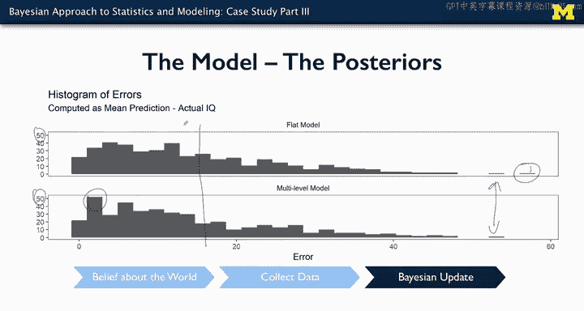

# 课程25：贝叶斯方法案例研究（下）🔍

在本节课中，我们将完成贝叶斯统计建模的案例研究。我们将基于上一部分构建的简单模型进行改进，引入新的变量和更复杂的结构，以更好地拟合数据并理解其中的关系。

---

## 模型改进：引入分组变量

上一节我们主要关注了寻找一个简单模型，并通过绘图来观察模型的拟合情况。本节中，我们将尝试改进模型。

首先，我们希望在新模型中考虑“母亲是否上过高中”这个变量。这或许能帮助我们捕捉到数据中更隐性的分组信息。

那么，我们应该基于哪些变量进行分组呢？是只考虑“高中”变量，还是也考虑不同的“母亲智商”分组？这取决于我们想要表达的信念。在本分析中，我们将保持简单：**仅基于母亲是否上过高中这个二元变量进行分组**，同时将母亲智商分为三个范围：
*   **低智商**：智商低于85
*   **中等智商**：智商在85到115之间
*   **高智商**：智商高于115

这样，我们就有了六个组合分组。

---

## 构建分层（多水平）模型

在模型中，我们将允许三个参数（截距、母亲年龄系数、母亲智商系数）在六个分组中各自变化。这意味着我们将有：
*   六个不同的截距参数
*   六个不同的母亲年龄斜率参数
*   六个不同的母亲智商斜率参数

这有助于通过允许斜率和截距变化来更好地“分桶”数据。

我们还将做出另一个假设：**每个分组的这些参数本身来自一个共同的分布**。例如，所有六个截距参数都来自一个共同的“全局截距”分布。我们对年龄斜率和智商斜率也做同样的假设。这样做是为了正则化这些值，防止过拟合。

在传统的分层或多水平模型中，我们允许这些参数自由变化。而在贝叶斯框架下，我们可以在更高层次上对它们进行约束，这几乎像一个三阶段模型。

**贝叶斯建模迫使我们明确陈述许多假设**。陈述这些先验假设允许他人对其进行质疑。例如，我对这些参数做出分层假设，这本身就是一个信念，应该被审视。所有模型都是主观的，贝叶斯或频率学派皆然。随着模型复杂度增加，这些建模选择都基于我们从第一个模型更新后的信念，它们并非绝对真理。贝叶斯统计只是迫使我们把更多假设摆在台面上。

以下是模型的数学形式。我们说孩子的智商 `child_iq` 是以下因素的函数：

`child_iq = β0_group + β1_group * mom_iq + β2_group * mom_age + ε`

其中，`β0_group`、`β1_group`、`β2_group` 的具体值取决于母亲所属的“高中”和“智商”分组。然后，我们假设每个分组内的这些参数来自更高层的共同分布。

---

## 模型的可视化理解

理解分层模型的一个简单方法是将其视为一个生成过程。

想象一下，我们有一个关于全局截距 `β0_global` 的分布（先验）。从这个分布中，我们为六个分组分别抽取六个具体的截距均值。每个分组的截距参数 `β0_group` 则服从以这个抽取的均值为中心的正态分布。我们对 `β1_global`（母亲智商斜率）和 `β2_global`（母亲年龄斜率）重复同样的过程。

最终，对于每个分组（例如“上过高中且低智商”），我们使用该组特定的 `β0_group`、`β1_group`、`β2_group` 来构建一个响应分布（预测孩子智商的分布）。我们的观测数据就被认为是来自这个响应分布。

我们可以自上而下地（生成式）思考模型：全局参数 -> 分组参数 -> 响应分布 -> 观测数据。也可以自下而上地（推断式）思考：观测数据 -> 告诉我响应分布 -> 告诉我分组参数 -> 告诉我全局参数。

这些模型通常有很多组成部分，但它们能以更直观的方式（思考数据如何生成）来建模非常复杂的关系。一个缺点是，在贝叶斯框架下拟合这类模型计算量可能非常大。

---

## 模型更新与误差分布

除了引入分层结构，我们还将改变误差 `ε` 的分布。我们之前看到数据有一个向左的尾巴，而预测分布没有捕捉到这一点。因此，我们尝试使用一个能捕捉偏态的分布。

我们使用**偏态正态分布**作为误差项。偏态正态分布类似于正态分布，但多了一个参数 `α` 来控制偏度：
*   如果 `α` 为负，分布向左偏（负偏）。
*   如果 `α` 为正，分布向右偏（正偏）。

我们希望这能帮助模型捕捉数据中观察到的左尾。

---

## 模型结果解读

拟合模型后，我们得到了后验分布。以下是主要发现：

**关于截距**：由于数据进行了中心化处理，所有分组的截距后验都大致以0为中心。但某些分组（如“上过高中且低智商”）的后验分布非常宽，这意味着我们对该组的截距信息很少（因为该组样本量 `n` 很小）。

**关于母亲智商系数**：不同分组的系数差异很大。一个有趣的发现是：对于“未上过高中但高智商”的母亲，其智商与孩子智商的系数关系为**负**；而对于“上过高中且高智商”的母亲，该系数为**正**。这可能意味着存在“均值回归”现象或其他因素在起作用。虽然0仍然在可信区间内，但这个差异值得进一步探究。

**关于母亲年龄系数**：除了少数分组（如“上过高中且中等/高智商”），大多数分组的年龄系数后验区间都包含0。这意味着我们无法确定年龄与孩子智商之间存在明确关系，不确定性很高。

**关于偏态参数**：偏态参数 `α` 的后验分布大部分为负值，这以合理的确定性表明数据整体存在左偏，证实了我们改变误差分布的决策是合理的。

---

## 模型预测性能评估

我们像上次一样构建了预测分布并进行检查：

**个体预测**：之前模型中落在预测区间外的观测点，在新模型中大部分都被包含了进来，说明预测有所改善。

**预测区间宽度**：与之前所有预测区间宽度都集中在70左右不同，新模型中不同分组的预测区间宽度不同。数据量少或组内方差小的分组，其预测区间更窄（确定性更高）；反之则更宽。这体现了分层模型根据分组调整不确定性的能力。

**误差分布**：误差的直方图显示，大多数误差集中在0附近，但右侧仍有一个长尾（存在一些难以预测的高误差点）。整体上，极端误差（如50-60）减少了，更多误差集中在40以下。

**后验预测检查**：与上一个模型相比，新模型的预测更好地捕捉了数据整体的形状和偏态，低估和高估的区域减少了。不过，模型似乎仍然难以完美拟合低智商区域的那个“隆起”，未来可能需要使用混合分布等更复杂的方法。

---

## 总结与展望

本节课中，我们一起学习了如何构建和评估一个分层贝叶斯模型。

这个多层模型在**预测能力**上并非巨大的飞跃，但在**统计推断**上是一个进步。我们现在可以剖析不同分组的效应，深入了解各组的斜率和截距。然而，这也带来了参数估计方差增大的代价，因为每个分组的数据只是总体的一个子集。

**下一步的建模方向**可能包括：
1.  使用混合分布或其他技术来处理那个过度膨胀的左尾。
2.  寻找更智能的智商分组切分点，而不是武断地使用85和115。
3.  结合非线性项与分层结构。

**几点核心启示**：
*   **贝叶斯模型**因为提供参数的完整分布而计算密集，但能建模非常复杂的关系。
*   **建模是一个迭代的、充满主观假设的过程**。有时，捕捉估计值的**不确定性**比估计值本身更重要。宽后验区间表明，在给定模型和当前数据下，我们对估计值非常不确定。
*   尽管存在计算复杂性和数学门槛等缺点，但贝叶斯方法所提供的强大建模能力和对世界的深入理解，常常是值得付出这些代价的。

感谢大家学习这个关于贝叶斯建模的三部分案例研究。我们看到了多种图表和建模数据、更新信念、理解模型含义的方式。贝叶斯方法因其强大能力，允许我们进行非常复杂的分析。希望你们喜欢这个关于贝叶斯统计的专题课程。再见！😊