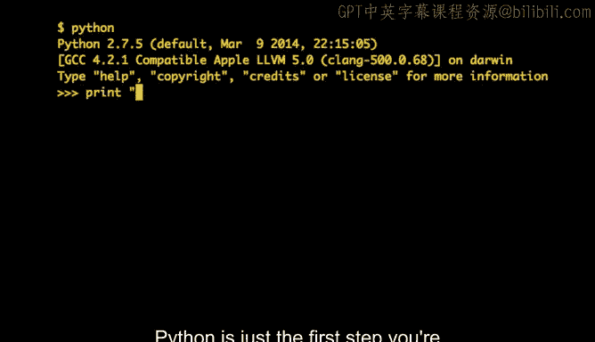
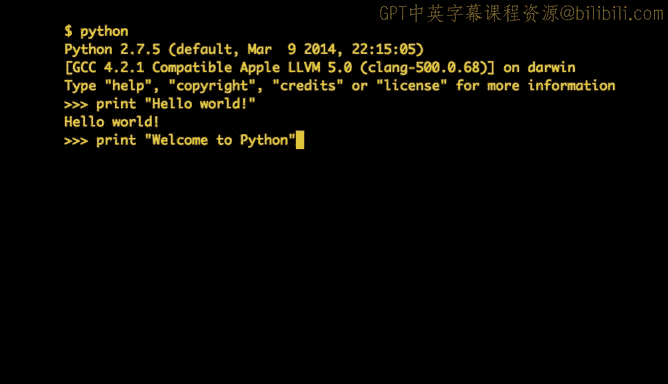
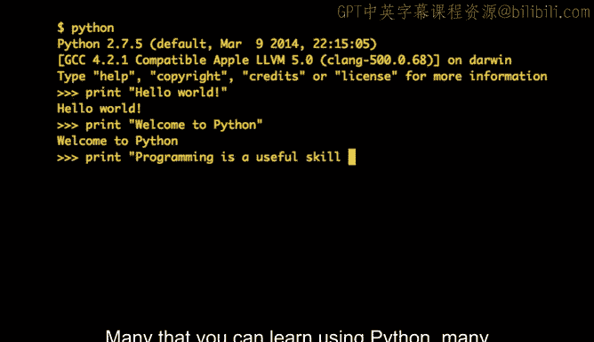

# 每个人的 Python 第一部分 2：来自Python创始人吉多·范罗苏姆的欢迎 👨‍💻

## 概述

在本节课中，我们将学习Python编程语言的创始人吉多·范罗苏姆（Guido van Rossum）的欢迎致辞。这段致辞将为你开启编程学习之旅提供鼓励和指引。

---

我是吉多·范罗苏姆，我创造了Python语言。

我已经为Python工作了25年，当然，我也与Python社区中许多其他贡献者一起合作。

我非常高兴在这个课程中见到大家。我也非常自豪你们使用我创造的语言来学习。

编程只是你们踏上编程之路的第一步。

---

编程中有许多令人兴奋的知识可以学习，其中很多都可以通过Python来掌握。

当然，也有很多知识可以通过其他工具来学习，并且你并非孤身一人。

将有数以百万计的人在你之前已经走过这条路，或者正在与你同时学习Python。

你们可以互相帮助。

---

你们可以一起学习。

---

## 总结

本节课中，我们一起聆听了Python创始人吉多·范罗苏姆的欢迎。他鼓励我们迈出编程学习的第一步，并指出Python是一个强大的学习工具，同时强调了学习社区和互助的重要性。