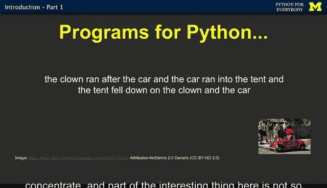

# 密歇根大学《给所有人的Python课》课程1：《编程入门指南》｜P3：为什么编程 🧑‍💻

在本节课中，我们将要学习编程的基本概念，理解为什么学习编程对每个人都至关重要，并初步了解程序员如何作为用户与计算机硬件之间的桥梁。

大家好，欢迎来到《给所有人的Python课》。我是查尔斯·塞弗伦斯，你们的讲师。

我们将这门课程命名为“给所有人的Python”，是因为我们坚信一个理念：随着我们的生活日益被科技包围，我们希望你能成为科技的创造者，而不仅仅是消费者。

我们希望改变你的视角，从技术的使用者这一面，转向另一面，即成为技术的创造者。你可以创造事物，这可能需要很长时间，并且你可能永远不想成为一名职业程序员，或许你只是想处理一点数据。但我们相信，每个人都应该基本了解如何编程，如何在计算机内部完成任务，这就像在现代日益技术化的社会中成为一个负责任的参与者一样重要。

计算机希望提供帮助。它们被编程，被设计。硬件被设计出来。我们将在下一节讨论硬件，但硬件是被设计和连接好的。当你给它通电时，它基本上只有一个问题，那就是：**下一步你想做什么？** 想想你的手机和上面所有的应用程序，每个应用都在问：下一步做什么？下一步做什么？因此，作为程序员，你的工作就是为用户服务。

用户有他们想做的事情，也许他们想把一只鸟弹向一头猪，或者他们需要分析一些数据，又或者他们想和手机对话。你必须成为一名真正的高级计算机科学家。作为用户，我们有这么多出色的程序员编写了如此多的软件，使这些手机变得智能。硬件本身并没有那么智能，我们程序员的工作就是充当硬件和用户之间的中介，构建美妙而美好的事物。

因此，你可以想象，程序员的工作就是在硬件和最终用户之间进行中介。如果你是一名职业程序员，试图销售你的软件，那么你就是在试图想象世界可能需要什么。你可以想象所有这些应用商店等地方，在那里你可以构建软件，与他人交换软件，并帮助他人。

正如我所说，我们正试图将你从设备的使用者这一面，翻转到制造者这一面。你可以将计算机视为管理日历、驾驶汽车、查看地图等的工具。但当你从程序员的角度来看待它时，你会使用编译器、解释器、编程语言和网络等工具。实际上，我们将学习使用这些工具。Python就是计算机“背面”的程序员用来为计算机“正面”创造新事物的工具。

那么，你成为程序员的动机是什么？对于职业程序员来说，一个普遍的动机是为其他人构建一些东西来使用。比如我参与开发了一个名为Sakai的开源软件，全世界有数百万人用它进行教学和学习。这让我非常有成就感。你可能会为网站构建一个留言板。但这通常不是你用编程技能做的第一件事。

你可能会处理一些数据，你可能是一名会计师、律师或图书管理员，有人有一些数据，你无法从中得到一份你真正好奇的报告。有人可能会说，你能写一小段Python代码来统计一下这种情况在周六发生多少次，然后在周一又发生多少次吗？告诉我们这种情况发生了多少次。于是你写了大约40行代码，它运行后告诉我们数据是什么，这非常有用。

为他人编写程序和为自己或他人编写程序的关键区别在于严谨性。你不必那么专业，只需编写自己能用的代码。如果它能运行并得到你想要的数据，那么任务就完成了。如果你想成为一名职业程序员，那么你必须学习如何更精确、更工程化。但在这套入门课程中，我们不会担心这些，我们只想让你学习编程的机制和语言。

因此，我们想带你从用户转变为程序员。作为程序员，你会开始认为自己生活在计算机内部。作为消费者，你在外面点击按钮等。而作为程序员，你将编写代码，这些代码将使用数据、网络、CPU和内存，然后为用户做一些事情。我们正试图改变你的视角，将你拉入计算机内部。

但你在计算机里做什么呢？什么是代码？什么是软件？什么是程序？程序就像一系列存储的指令。其核心思想是，计算机硬件本身在最低层次上并不那么智能，但如果我们给它正确的指令，它具有很大的灵活性，可以做出惊人的事情。如果我们给它正确的指令来听声音、数字化声音并理解声音，那么你就可以编写一个程序，让计算机能够“听”。计算机本身并不“听”，程序让它能够运行所有计算，使其看起来像是在“听”。但实际上是人类，或者说成千上万的人类，才使得你可以与手机对话。

因此，你可以想象，当你构建一些非常出色的东西时，比如让计算机能够听你说话的能力，你是在运用你和你的所有创造力以及你所做的所有研究，构建一些真正了不起的东西，并将其放入计算机中。但它仍然是一系列按步骤运行的存储指令。有人想出了必须发生的每一个小步骤。一旦我们弄清楚了，我们就仔细地写下指令，然后把它交给别人。这是一个能进行语音识别的程序。

如果你对此感兴趣，我认为它的创造非常美妙。作为一名职业程序员，我热爱我的生活，热爱我所做的事情——为人们构建东西并让他们快乐，然后我从中获得动力，再去构建别的东西。但归根结底，它只是一组指令。如果你想知道这组指令里有什么，那么请看，这是一个为人类编写的程序。现在，我可能有点暴露年龄了，但这是一个关于一首叫“Macarena”的歌曲的YouTube视频。

Macarena是一种算法或一系列步骤。希望你在五年前或许多年前，去酒吧时会看到所有人做这些动作：举起手，把东西放在周围，扭动、扭动、扭动，然后转身。你坐在那里想，好吧，他们做的指令序列是什么？事实上，这是一个循环：只要音乐在播放，你就伸出左手，伸出右手，翻转左手，翻转右手。我全忘了。但我想让你做一件事：看看这张幻灯片。我会安静一分钟。请你看这张幻灯片。如有必要，请暂停视频。这个程序里有三个错误。它看起来是对的，但有三个错误。我会停一下。

希望你已经暂停了视频。现在我要回来，向你展示这三个错误是什么。以下是三个错误。如果你没有找到它们，即使你仔细看，你也学到了一些关于人类的东西：我们人类在一个充满空气的世界里运作。这里有印刷错误，人们说错话，而我们作为人，会在感知和理解的过程中自动修正它们。

但即使你读这个，你可能也没有看到这些错误，因为你的大脑自动修正了它们，因为我们就是会修正环境中的错误。计算机不是这样的。它们不是这样的。尽管语音识别软件经过一段时间后确实学会了如何过滤错误，但那非常难编写。计算机不理解如何过滤错误，但通过足够的指令，你可以让它们在一定程度上过滤错误。这就是搜索引擎能工作的原因，这是一种软智能，但构建起来非常困难。但当我们开始谈论编写程序时，无论是编写搜索引擎程序还是语音识别程序，这些程序必须是完美的。它们出现最微小的上下文印刷错误，程序就根本无法工作。

所以，这里我们说“用右火腿打后脑勺”，什么？这里哪有火腿？所以你手里拿着火腿，想用它打自己的后脑勺。你可能没注意到，但计算机会直接说：语法错误，我退出。语法错误就是计算机对自己说“我不知道该做什么”的时刻。这里也一样。“我得打某人。”你在说什么？计算机会完全被这个搞糊涂。你可能会看着这个，然后自动修正并适应它。这就是一点关于人类编程的经验。所以，这就是代码。

接下来，让我们谈谈Python中的程序。正如我所说，它是一组指令。我将在这里放一些文本，我想让你数一数这段文本中每个单词的数量，然后告诉我最常见的单词是什么，以及这个单词出现了多少次。请看。

这里有趣的部分并不在于你是否能数出这些单词，而在于你的大脑对我刚刚提出的问题的反应。你可能会想，哦，这感觉不太好。我很棒，我会开车，会打棒球，会接东西，会唱歌，但要专注于数这些单词，感觉真的很烦人。事实证明，这是计算机非常擅长而人类非常不擅长的事情之一。因此，将这个问题委托给计算机是非常好的，前提是你懂计算机的语言，并且能和计算机交流。

我不指望你现在就看懂这段代码。我们将花好几周时间来学习它的所有基础知识。但这是一个程序，是一组指令。它大约有11到12行代码。在其中，我们指示计算机读取一堆文本，统计单词，并告诉我们最常见的单词是什么。如果我们运行这个程序，并给它一个单词文件，它会说最常见的单词是“the”，出现了16次。我刚才让你看的那段文本中，“the”是最常见的单词，出现了7次。

这基本上是一个程序的概要，它是一个解决我们刚才提出的问题的程序。我们接下来将讨论硬件架构，以及当你成为程序员时，你将利用的计算机内部发生了什么。

---

在本节课中，我们一起学习了编程的基本目的：作为用户与计算机硬件之间的桥梁，创造有用的工具和解决实际问题。我们了解到程序是一系列精确的指令，计算机严格地执行它们，这与人类处理信息的方式不同。我们还通过一个简单的单词计数例子，看到了编程如何将人类不擅长的重复性任务交给计算机高效完成。下一节，我们将深入计算机内部，了解硬件架构，为编写程序打下基础。