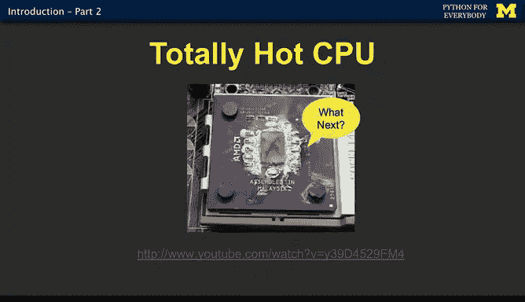

# 每个人的 Python 第一部分 4：硬件概述 🖥️

在本节课中，我们将学习计算机硬件的基本架构。我们将了解计算机内部的主要组成部分及其功能，为后续学习Python编程打下基础。

## 硬件架构概述

上一节我们介绍了课程的整体安排，本节中我们来看看计算机的硬件基础。理解硬件架构有助于我们明白程序是如何在计算机上运行的。

计算机硬件主要由几个核心部分组成：中央处理器、主存储器、辅助存储器以及输入输出设备。这些部件协同工作，执行我们的程序。

## 输入输出设备

输入输出设备是计算机与外部世界交互的桥梁。以下是主要的输入输出设备：

*   **鼠标**
*   **键盘**
*   **屏幕（显示器）**

通过这些设备，人类可以与计算机进行交互。

## 中央处理器与主存储器

计算机内部的核心是中央处理器和主存储器。中央处理器是计算机中负责执行指令的部件，可以将其视为计算机的“大脑”。主存储器则是程序和数据在运行时临时存放的地方。

中央处理器每秒可以执行数十亿条指令。一条指令可以看作是一组电信号，例如通过32根或64根微小的电线传输。中央处理器不断地询问“下一步做什么？”，并从主存储器中获取答案。

你的程序最初以文件形式（例如一个Python `.py` 文件）存储在辅助存储器中。当程序运行时，它会被加载并翻译到主存储器中。中央处理器便从主存储器中逐条获取并执行程序指令。这个过程称为“取指-执行周期”。

中央处理器本身并不“智能”，可以将其理解为一个非常快速、带有大量存储空间的计算器。

## 硬件的发展

硬件技术经历了巨大的发展。早期的计算机（如20世纪60-70年代的机型）体积庞大，可能占据整个房间。其核心是印刷电路板，上面布满了电阻、晶体管和电容器。

现代计算机的核心——中央处理器芯片——集成了数百万甚至数十亿个晶体管。这些微小的晶体管可以做出简单的“是/否”判断，也能以特定方式连接起来存储少量信息。技术的发展使得这些部件越来越小，性能却越来越强。

主板是连接所有硬件组件的核心电路板。它确保了中央处理器、主存储器等部件能够相互通信，使程序指令得以从存储器传输到处理器。

## 辅助存储器

我们需要辅助存储器的原因是主存储器虽然速度极快，但其内容在断电后会丢失。辅助存储器则用于永久保存数据和程序。

在早期，我们使用硬盘驱动器作为辅助存储器。硬盘内部有高速旋转的磁性盘片和一个读写磁头，数据以磁记录方式保存，断电后数据依然存在。

如今，机械硬盘正逐渐被固态存储设备取代，例如USB闪存盘。但理解其原理仍然很重要。

## 总结与核心概念

本节课我们一起学习了计算机硬件的基本组成。以下是本节的核心概念总结：

*   **中央处理器**：执行指令的核心部件。其工作可简化为不断循环的 **`取指 -> 执行`**。
*   **主存储器**：程序运行时临时存放指令和数据的地方，速度快，但断电后内容丢失。
*   **辅助存储器**：用于永久保存程序文件（如你的 `my_program.py`）和数据，速度较慢，但断电后数据不丢失。
*   **输入/输出设备**：计算机与外界交互的通道。

当你在计算机上编写Python程序时，你通过键盘（输入设备）将代码输入到一个文件中，该文件存储在辅助存储器里。程序运行时，它被加载到主存储器中并开始执行。可以说，当你的程序运行时，一个由你的指令构成的“你”正生活在主存储器里。

最终，中央处理器执行的是由0和1组成的机器语言指令。我们编写的Python代码需要通过编译器或解释器翻译成机器语言才能运行。随着学习的深入，你可能会接触到更多这方面的知识。

接下来，我们将开始动手编写Python代码。硬件是程序运行的舞台，现在舞台已经搭好，演员（你的程序）即将登场。