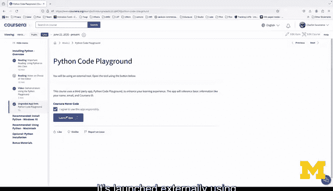
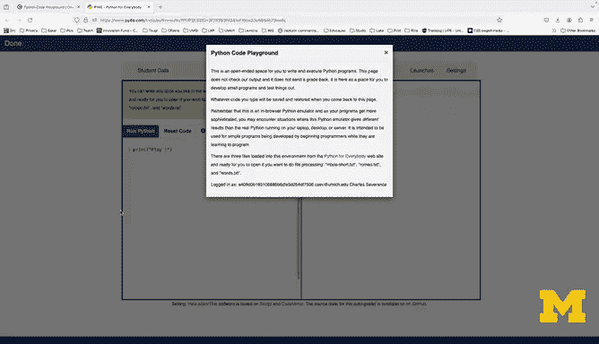
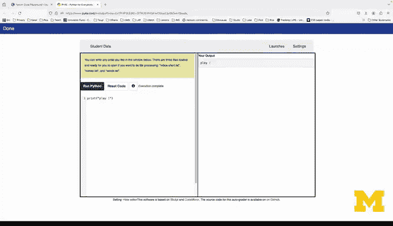

# 1：《编程入门指南》｜P6：06_02_03_演示：使用Python游乐场 🎮


在本节课中，我们将学习如何使用课程提供的Python游乐场工具。这是一个在浏览器中运行Python代码的环境，无需在本地计算机上安装Python。我们将了解它的基本功能、使用方法以及如何利用它来获取学习帮助。

## 课程概述 📋

上一周我们讨论了编程和计算机科学的基础理论。本节课程我们将开始实际编写Python程序。为了确保所有学习者都能实践编程，课程提供了一个在浏览器中运行的Python代码环境，称为“Python游乐场”。

## Python游乐场介绍 🏗️

Python游乐场是一个基于浏览器的编程环境。它使用一种名为“学习工具互操作性”的技术在浏览器新标签页中打开。该工具允许你编写和运行Python代码，而无需在本地设备上进行任何安装。

这对于使用iPad、Chromebook或受限制的学校计算机的学习者尤其有用。它确保每个人都能获得实践编程的机会。

## 如何使用Python游乐场 🛠️

以下是使用Python游乐场的基本步骤。

首先，在课程中找到名为“Python代码游乐场”的未评分作业并点击它。该工具将在新标签页中启动。

打开后，你会看到一个代码编辑区域，其中已包含一些默认代码。你可以使用“重置代码”按钮随时恢复到初始状态。



要运行代码，只需点击“运行”按钮。代码的执行结果将显示在输出区域。



例如，你可以删除默认代码，输入：
```python
print("Hello!")
```
然后点击运行，输出区域将显示：
```
Hello!
```

## 游乐场的核心功能与文件 💾

Python游乐场本质上是一个无约束的代码运行环境。它与自动评分器不同，不对你的代码内容做任何预设或评分。

该环境提供了三个示例文件，这些文件来自教材第七章及后续课程。你可以在编写代码时引用或借鉴这些文件。

你可以在其中编写任何Python代码进行实验和练习。编写的代码不会被评分，也不会传回Coursera平台。

## 获取学习帮助 🤝

Python游乐场的一个重要功能是便于获取教学团队的帮助。

课程论坛不允许直接粘贴代码。因此，当你需要帮助时，可以先将代码保存在Python游乐场中。

然后在论坛中描述你的问题。教学助理可以通过“查看学生代码”功能，输入你的姓名或邮箱，找到你最近保存的代码。

教学助理能够查看你的完整代码、运行它，并进行调试。这是一种与教学团队沟通的高效方式。

## 使用建议与总结 📝

尽管Python游乐场非常方便，但我们强烈建议你尽快掌握在个人电脑上安装和运行Python的技能。这对于长期学习更为有利。

然而，如果由于设备限制无法安装Python，Python游乐场为你提供了完美的解决方案。它确保了编程实践的可行性。



在本节课中，我们一起学习了Python游乐场的用途和操作方法。你了解了如何用它来运行代码、进行实验，以及在遇到困难时如何向教学团队寻求帮助。请善用这个工具来辅助你的编程学习之旅。


完成代码编写或获取帮助后，只需点击“完成”按钮即可退出该环境，返回课程界面。