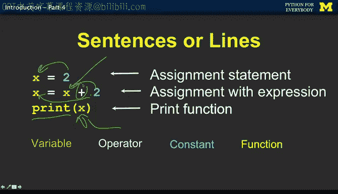
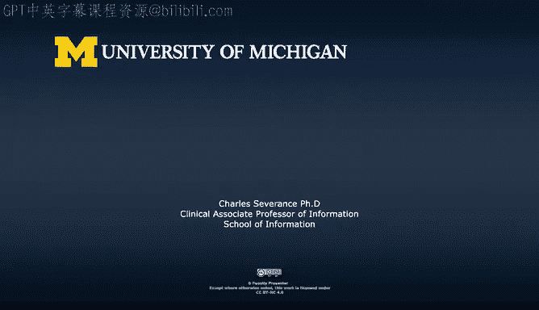

# 每个人的 Python 第一部分 7：Python基本要素 🐍

## 概述

在本节课中，我们将要学习Python语言的基本构成要素。我们将从如何与Python交互开始，逐步了解构成Python程序的核心概念，包括变量、语句、保留字以及如何组织代码。

## 与Python交互

现在，我们开始学习Python语言。

你可以把与Python的交互想象成和Python本身对话。

在大多数计算机上，无论是Windows的命令行、Macintosh还是Linux系统，都有一种启动Python的方式。如果你直接运行Python，它将进入交互模式，你可以输入命令。你需要在`>>>`提示符（我们称之为“尖括号提示符”）后输入Python命令。这也符合“接下来做什么”的思路。

Python就像在说：“我准备好了，可以处理你发送的任何Python语句。我准备好做你想做的任何事情。但我不知道要做什么，需要你告诉我该做什么。”

因此，你可以输入一系列Python语句。

你可能会输入的第一个语句是赋值语句：`X = 1`。

## 理解赋值语句

那么，这里发生了什么？

这个赋值语句常常让从数学转向编程的人感到困惑。

等号在这里有一种方向性。它像是一个箭头。它实际上是在说：“亲爱的Python，你有很多内存。请取一小块内存，记住它，并命名为X。我之后可能会用到它。现在，请把数字1放进去。”

这就像是在内存中找一个空闲位置放入1，并给这个位置起名叫X。

`print X` 这条语句的意思是：“去找到那个叫X的内存位置，把它里面的东西取出来，告诉我你放了什么进去。”

这看起来有点多余。但通常你会做比这更复杂的事情：把东西放进内存，然后再取出来。这是第一步。

## 表达式与运算

接下来，`X = X + 1` 是一个表达式。它的意思是：取出X中的值（是1），然后给它加1，结果变成2，再把这个2存回X。所以这给X加了1。

然后我们打印它，结果是2。最后我们退出。

如果你在这里输入了错误的内容，你会得到语法错误。Python会告诉你：“语法错误，语法错误，语法错误。”然后你可以继续。

这就是我们与Python对话的方式。

## 编程如同写作

那么，我们对Python说什么呢？

你几乎可以把它想象成写一篇文章。回想一下，你开始学习字母表，然后用字母组成单词，再用单词组成句子，最后组合句子形成段落，进而构成一个故事。

我们将要做类似的事情。这是我们最终要编写的程序。现在不必担心理解这个故事是做什么的，我们稍后会讨论它，并且在本课程中会多次回顾它。

这是一个关于如何在Python中计算文件中单词数量的“故事”。它解决了我之前提出的问题：什么是最常见的单词，以及它出现了多少次。我们将在本课程中多次回到这个问题。

## Python的词汇：保留字

如果我们从词汇开始，每种编程语言的第一要素就是所谓的“保留字”。

那么，保留字是什么意思呢？这些是如果我们使用，就必须按照Python期望的含义来使用的单词。

另一种说法是，我们不能在其他地方使用它们。我们不能创建一个名为`import`的变量，也不能创建一个名为`as`的变量。因为如果Python看到`import`，它对Python有非常特定的含义；看到`if`也有特定含义；看到`for`、`pass`或`while`也是如此。这些词都有特定含义。

理解这个的最好方式是，Python有点像一只狗。如果你对狗说话，你说：“嘿，狗，你喜欢贝多芬还是巴赫？”狗听到的是：“汪汪，汪汪，汪汪……”它不在乎。然后你说：“嘿，斑点，你觉得今天天气怎么样？你是真的喜欢日落还是更喜欢下雨？”狗的反应还是：“汪汪，汪汪，汪汪……”然后你说：“你觉得该去散步了吗？”狗就会想：“散步！明白了！”

狗一直在听你说话，但大部分都是“汪汪，汪汪，汪汪……”。但“散步”对狗来说是一个保留词。同样，“食物”、“零食”也是狗的保留词。大部分时间，你可以对狗说任何话，它们都是很好的倾听者，对吧？但当你说了狗的保留词，比如“散步”，如果你不兑现，那只狗会困扰你一阵子。

你可以把Python想象成这样。当Python看到`global`、`from`或`for`时，它会想：“哇，这个词对Python意义重大。”所以你最好按照Python期望的方式使用它。

## 句子：代码行

句子就是代码行。

当我们编写程序时，我们是在编写一个文本文件，我们写一行，再写一行，又写一行。每一行都是一个独立的句子，我们必须把它们写对，然后我们才能用一系列句子构建一个段落。

在这个特定的例子中，我们有另一个赋值语句，将数字2放入变量X中。然后取出那个2，给它加2，并将和存回X。`print`是一个函数，`X`是传递给它的一个参数，这将导致打印出4。

我们使用了运算符。这里的`+`被称为运算符，`=`也被称为运算符。`print`实际上是一个函数，`X`是传递给这个函数的参数。

因此，我们使用一系列不同类型的语法来生成我们需要编写的代码行。

## 从交互模式到脚本

现在，我们开始将这些代码行组合成段落，使其有意义。

在交互式Python环境（即`>>>`提示符）中对话很有趣，对于入门和输入`X = 1`之类的命令很有帮助。但不要做太多。我经常看到学生试图在那里编写整个程序，这会有点令人沮丧，因为你必须从头到尾完美地输入。

一旦Python代码可能超过三行，我们更常见的做法是使用像Atom这样的编程文本编辑器，将所有代码放入一个文件中。然后我们告诉Python从这个文件的开头开始读取并执行。我们称之为脚本或Python程序。

在Python中，我们倾向于将这种文件命名为`.py`。像Atom这样我推荐的文本编辑器，当文件以`.py`结尾时，会进行语法高亮，给你颜色，让代码更美观，帮助你理解，有时甚至能引导你发现语法错误和错误。

因此，脚本是存储在文本文件中的一组指令，然后你可以交给Python来运行它们。我有一系列视频，指导你安装Python、进行交互式操作、编写脚本以及运行脚本。

## 总结

本节课中，我们一起学习了Python的基本要素。我们从如何启动Python并与之交互开始，理解了赋值语句`X = 1`的含义，它不同于数学中的等号，而是指示Python在内存中存储和命名数据。我们看到了表达式如`X = X + 1`如何更新变量。我们探讨了Python的“保留字”，它们就像给狗的特定指令，具有固定含义，不能随意用作变量名。最后，我们了解到，虽然可以在交互模式中逐行输入代码，但对于更复杂的程序，更好的做法是将代码写入`.py`脚本文件中，然后一次性运行，这更高效且便于管理。这些基础概念是构建更复杂Python程序的基石。