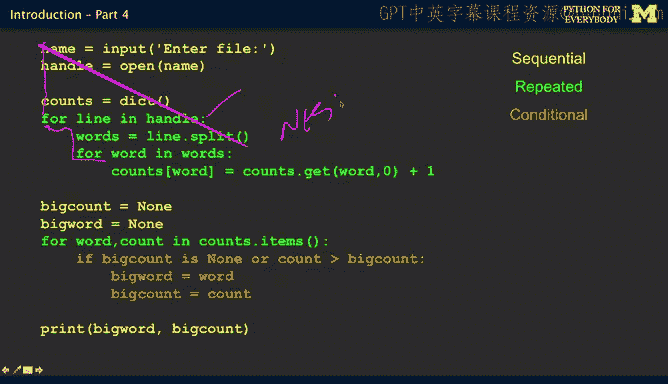
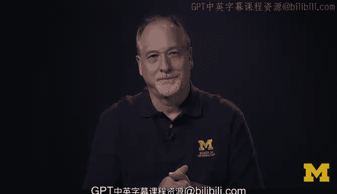

# 1：《编程入门指南（使用Python进行开发）》｜P8：08_03_02_编写代码段落 📝


## 概述

在本节课中，我们将学习编写Python代码的基本模式。我们将了解顺序执行、条件判断和循环这三种核心编程结构，并理解如何将它们组合起来构建程序。

## 顺序执行

上一节我们介绍了Python脚本的概念。本节中我们来看看脚本中最基本的代码组织模式：顺序执行。

你可以进行Python交互式编程，也可以运行脚本。脚本在最初的15分钟后更为常见。之后，几乎所有事情都用脚本来完成。

脚本中包含一系列步骤。我们使用几种基本模式来组合这些步骤。最基本的模式称为顺序执行。我们做一件事，然后做下一件事，接着再做下一件事。

以下是一个四行Python程序的例子，它包含四个基本步骤。如果你将这四行代码输入一个文件，然后让Python执行它们，Python会执行以下操作：将数字2赋值给变量`x`，然后打印它，输出结果是2；接着将2加到`x`上，然后再次打印，结果将是4。

```python
x = 2
print(x)
x = x + 2
print(x)
```

这里的图示称为流程图。过去人们要求我们画流程图，但我不确定其价值有多大。我想展示的是事件的顺序。程序运行这个，做某事，然后移动到下一个，做这个，再移动到下一个，做这个，依此类推。当你完成一个语句时，接下来要去哪里？在这个例子中，这是所有可能情况中最简单的，我们只是从一件事进行到下一件事。

## 条件判断

现在，当我们进行条件判断时，情况变得更有趣一些。实现条件判断的关键是`if`语句。

`if`语句是一个保留字。它以`if`开头，其中嵌入了一个会导致真或假结果的问题，后面跟着一个冒号，然后是一个缩进的代码块。

以下是条件判断的工作原理：这是一个条件语句。`print(‘smaller’)`是条件语句，意味着如果`x < 10`评估为真，那么它将执行。否则，它将被跳过。所以它要么执行并继续，要么直接跳过。

用一个图表来展示可能最容易理解：从`x = 5`开始，然后遇到`if`语句。`if`语句提出一个问题。如果问题为真，你走一条路；如果为假，你走另一条路。在这个例子中，`x`是5，所以条件为真，我们走这条路，打印出“smaller”，然后重新汇合。

接下来我们遇到另一个`if`语句：`x > 20`。在这种情况下，答案是否定的，因为`x`是5。我们是在询问问题，而不是改变`x`。所以我们直接跳过这行代码。

这段代码最终运行的方式是：程序进入，顺序运行第一行，到达这里，有条件地运行这行代码，然后完全跳过另一行。因此，那行代码从未运行。这是一个非常简单的例子，输出是“smaller”，然后是“finish”。

你会发现，我们组合这些结构来构建更复杂的程序。条件判断是我们要看到的三种模式中的第二种。

## 循环

最令人兴奋的模式是循环。它看起来更复杂一些，因为我们可以用它做更多事情。

基本思想是，有几个不同的循环关键字（保留字）：`while`和`for`。`while`循环的功能有点像`if`语句，因为它里面有一个问题。

它不会伤害`n`，也不会被这个改变。它只是查看`n`并提问：`n`是否大于0？如果为真，它就运行这段代码。所以到这里为止，它看起来像一个`if`语句。

现在，这里有一个小的顺序执行块。当你完成这个后，你做什么？我们只是落到下一个语句。你会注意到，`n = n - 1`的缩进级别与`print`语句相同。这就是我们如何在循环（或包含多个语句的`if`块）中组织代码的方式。

然后，当取消缩进时，就表示循环结束。发生的情况是：它运行这个，然后运行那个。但接下来它做什么？它处于循环的末尾，所以实际上它会回到循环的顶部。它回到`while`语句，我们实际上打印出了`n`（当时是5），然后`n`变成了4。

接着它重新评估这个问题：4大于0吗？是的。所以它打印出4，然后减去1，变成3。现在3大于0吗？是的。依此类推，它打印4，3，2，1。然后它打印1，接着从中减去1，所以它变成0。

现在它上来问这个问题：0大于0吗？因为`n`通过这个循环的连续迭代已经变成了0。所以`n`不大于0。因此，条件从真变为假。为假时，它就离开，退出循环。所以输出是5，4，3，2，1，然后退出。

一旦这个条件变为假，循环就退出。这就是我们告诉计算机我们希望它继续运行直到某事发生、我们实现了某个目标的方式。

循环有迭代变量的概念，以确保它们不是无限循环。变量`n`被精心构造为：在循环开始时被检查，然后在每次循环中被改变。这就是我们确保这个循环只运行五次而不是永远运行的方法。因为你可以构造我们称之为无限循环的东西，让它永远运行，但这不太实用，过一会儿电池就会耗尽或其他情况。所以你通常构造循环以使其完成，它们必须检查以确保自己已完成。

## 组合模式：一个完整的故事

如果我们回顾那个故事（指查找文件中出现次数最多的单词的程序），我们会看到它是如何工作的。

在Python中，你可以通过缩进来判断顺序代码：它只是向下、向下、向下执行。



`for`是另一个用于循环的保留字。它有一个冒号，表示那是一个缩进的代码块。实际上，这个例子中有一个`for`循环嵌套在另一个`for`循环里。这称为嵌套，我们稍后会讲到。

然后这个循环结束，它运行一段时间，接着有更多的顺序代码。有一个`for`循环，这是重复的代码，然后里面嵌套了一个`if`，这是条件代码。这个会运行一段时间，然后退出，执行一些顺序代码。

所以在这个文件中，我们看到了编程的四种基本模式中的三种：顺序代码、重复代码和条件代码。

从大纲的角度来看，这是我们的故事。这些是我们故事的段落。

*   第一段：从用户那里读取文件名并打开该文件以便读取。
*   第二段：在读取文件时，创建一个直方图，将单词映射到其出现频率。每次看到一个单词，就更新直方图，以便我们有一个所有单词的运行总数（使用我们稍后会学到的称为“字典”的东西，大约在第9或10章）。现在不用担心这个细节。这是在制作直方图。
*   第三段：一旦我们有了直方图，并且读完了所有单词，我们就遍历直方图以找到最大的值，然后打印出出现次数最多的单词及其计数。

这是一个由一些句子和段落、字母表、保留字和词汇等组成的小故事。我们正在学习如何去做。

现在不要试图完全理解这一切。我们将有专门讲解变量的章节、专门讲解条件判断的章节、专门讲解循环的章节。我只是试图给你一个宏观的图景，以便当我们学到那里时，你可以开始将这些部分组合起来。这起初可能有点令人困惑，但通常在第6章和第7章之后，情况会开始变得清晰。只需理解我们是一点一点学习的，然后到后面会越来越好。

## 总结

本节课中我们一起学习了编写Python代码的三种基本模式：**顺序执行**、**条件判断**（使用`if`语句）和**循环**（使用`while`和`for`）。我们看到了如何将这些模式像段落一样组合起来，构建一个完整的程序“故事”。第1章旨在概述我们将在整个课程中学到的内容，并建立一些基本词汇，以便我们可以讨论诸如微处理器、RAM和内存等概念，为后续学习打下基础。





