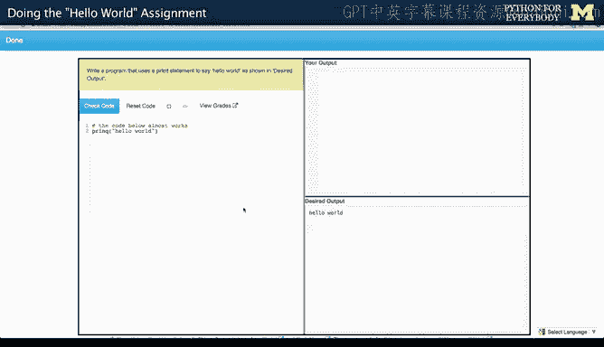
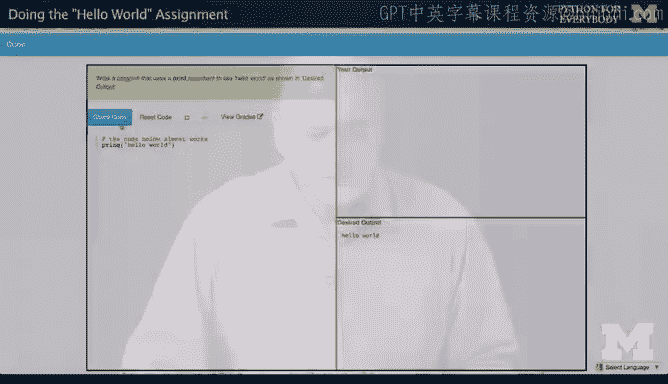
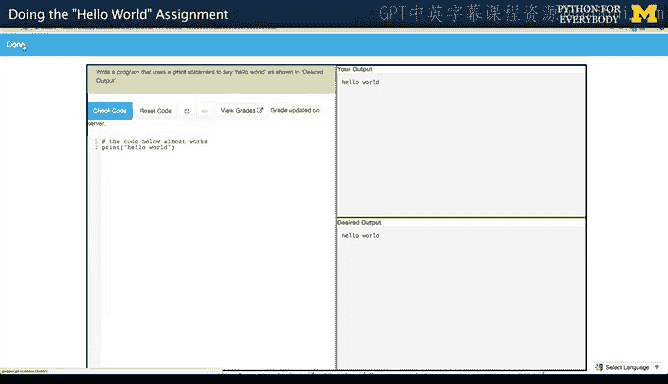

# 密歇根大学《给所有人的Python课》课程1：《编程入门指南（使用Python进行开发）》｜P9：完成Hello World作业演示 🖨️


在本节课中，我们将要学习如何完成本课程的第一个编程作业：打印“Hello World”。我们将详细介绍作业提交系统（自动评分器）的使用方法、常见问题以及注意事项。

---

## 作业系统概述



上一节我们介绍了Python编程的基础知识，本节中我们来看看如何提交你的第一个作业。课程使用一个在线的自动评分器来评估你的代码。当你点击作业链接时，首先会看到荣誉准则声明。

你需要输入姓名并勾选复选框以确认身份，然后点击“打开工具”按钮。系统会在新窗口中启动一个Python模拟编程环境。



> 这个环境足够完成前10章的作业，但从第11章开始，你需要在自己的电脑上安装Python。

## 工具界面与基本操作

以下是自动评分器界面中你会用到的主要功能按钮：

*   **检查代码**：将你的代码提交给Python运行并评分。
*   **重置代码**：将代码区域重置为初始状态。

初始时，作业通常会提供一部分代码，其中可能包含错误。例如，本次作业的初始代码中有一个拼写错误。

```python
# 初始代码可能包含错误，例如：
prinq("Hello World")  # ‘print’被错误拼写为‘prinq’
```

运行此错误代码后，自动评分器会返回错误信息，例如：“NameError: name ‘prinq’ is not defined on line 2”。你需要根据提示修正代码。

## 评分机制详解

修正代码后，再次点击“检查代码”。如果代码正确，系统会显示一个旋转图标，表示正在将成绩（100%）发送回Coursera的成绩册。

关于评分，有几个重要规则：

1.  **只记录最高分**：作业为通过/未通过制（100%或0%）。系统只记录你获得的最高分（100%）。即使你之后修改代码导致运行错误，已获得的100%成绩也不会被覆盖。
2.  **输出必须完全匹配**：自动评分器会严格比较你程序的输出和“期望的输出”。即使语法正确，如果输出不匹配（例如多了一个空格），也会被判为错误。
3.  **静态代码分析**：除了检查输出，评分器还会对你的代码进行简单分析，以确保你使用了要求的技术（例如，在需要时使用了`for`循环或`input`函数）。这意味着你不能直接打印出答案来通过作业，必须按照要求编写计算逻辑。

## 获取帮助与注意事项

如果你在作业中遇到问题，可以通过论坛向助教求助。助教拥有特殊权限，可以查看你在自动评分器中的具体代码并运行它，这比在论坛中粘贴代码更高效、更安全。

**请注意**：在本课程的前期，我们不允许在公共论坛中直接粘贴代码。这是为了防止其他同学不经思考直接复制粘贴你的代码。如果初期不通过自己的努力真正理解概念，后续更复杂的作业将难以完成。借用他人代码最终只是欺骗自己。因此，我们提供了更安全的助教协助通道。

## 完成流程总结

最后，我们来总结一下完成一个作业的标准流程：

1.  阅读题目，理解要求。
2.  在本地文本编辑器或评分器环境中编写代码。
3.  点击“检查代码”。
4.  根据反馈修正所有语法错误和输出错误。
5.  当代码通过所有检查（语法、输出、静态分析）并获得100%成绩后，点击“完成”按钮返回Coursera课程界面。

---



本节课中我们一起学习了如何使用自动评分器完成并提交“Hello World”作业，理解了其评分规则、求助方式以及独立完成作业的重要性。现在，你可以信心十足地开始你的第一个编程任务了。