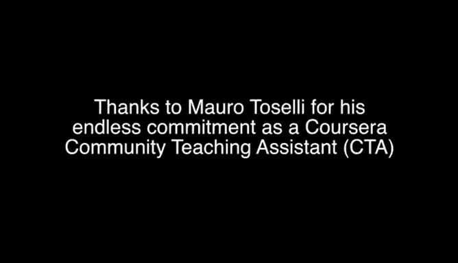
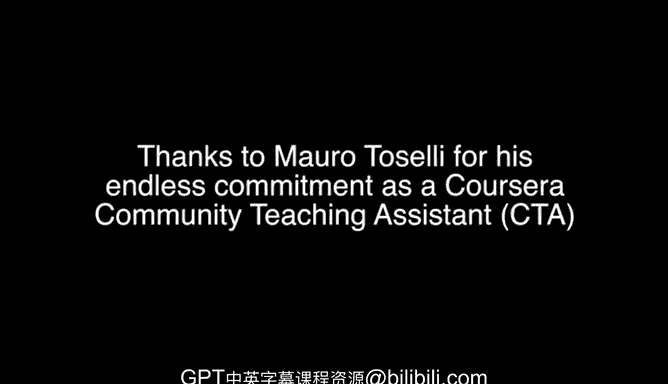

# 密歇根大学《给所有人的Python课》课程1：《编程入门指南（使用Python进行开发）》｜P10：10_03_02_面对面办公时间-意大利米兰 🎬

## 概述

在本节课中，我们将跟随课程讲师查克博士，走进一次在意大利米兰举行的特别线下办公时间。你将看到课程学习者们的真实互动，了解他们学习编程的初衷与感受，并体会“为所有人编程”这一理念的社区氛围。

## 课程内容

查克博士首先分享了他对编程的思考。他指出，编写操作系统时，他像计算机科学家一样思考，专注于解决性能规格等具体问题。而编写Python程序时，例如从邮件列表中筛选特定信息，或将邮件与其他内容匹配，亦或是找出论坛中最活跃的发帖者，其过程更像是逐步将自身逻辑融入程序之中。

本次办公地点在意大利米兰，这是有史以来规模最大的线下办公时间之一。查克博士希望进行标准的自我介绍环节，以便让大家彼此认识。

以下是学员们的自我介绍：

*   卢卡表示非常喜欢这门课程。
*   伊万说他喜欢老师，并且非常热爱这门课程。
*   塞巴斯蒂安曾参加过互联网历史课程。
*   安尼塔正在学习Python，并对课程感到兴奋。
*   芭芭拉表示喜欢这门课程。
*   阿尔贝塔只是想学习编程。
*   安德烈亚曾参加互联网历史课程。当他读到查克博士要来时，他开始尖叫，但办公室没人理解他的激动。
*   大卫表示这是他在Coursera上的第一门课程，他祝愿大家好运，并专注于自己的目标。

接着，我们见到了著名的社区助教马可。马可终于成功将查克博士请到了意大利，并组织了这次非常成功的办公时间，吸引了许多来自“为所有人编程”和“互联网历史”课程的学习者，他对此感到非常高兴。

在短暂的施工干扰后，谈话继续。我们差点漏掉一位学员，他的妻子也来到了现场。虽然她尚未选课，但查克博士鼓励她未来一定要参加。

最后，查克博士组织大家拍摄了一张大合影，并提议大家为马可所做的出色工作送上热烈的掌声以示感谢。

## 总结

本节课中，我们一起体验了一次充满活力的线下办公时间。我们听到了来自意大利米兰的学习者们分享他们学习编程的动机与热情，也感受到了课程社区的支持与联结。这次活动生动体现了“为所有人编程”不仅是学习代码，更是加入一个互助、分享的全球性学习社区。