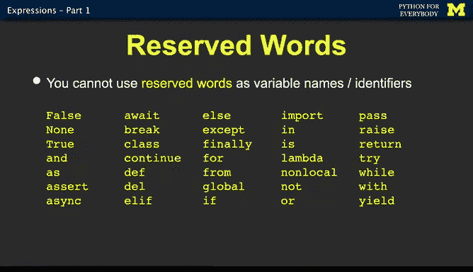
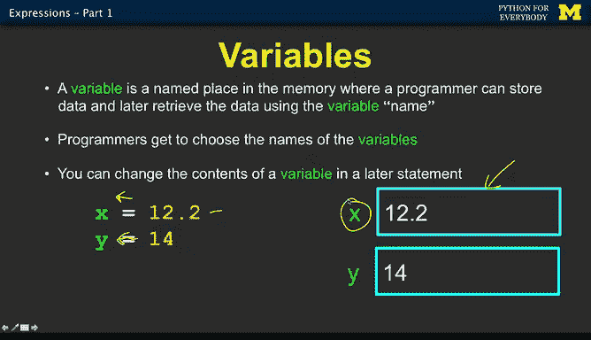
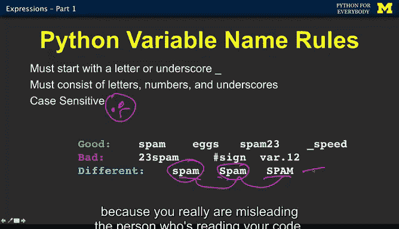
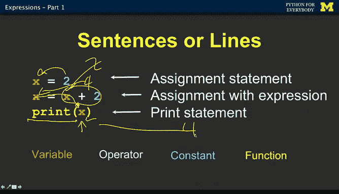

# 每个人的 Python 第一部分 11：常量、保留字与变量 🔧


在本节课中，我们将深入学习构成Python语言的基本元素，即常量、保留字和变量。我们将了解它们各自的含义、规则以及如何在实际编程中使用它们。最后，我们将一起编写第一个结构完整的程序。

---

## 概述：Python的“原子”构成

上一节我们介绍了编程的基本概念，本节中我们来看看构成Python语言的几个核心“原子”元素。理解这些基础构件是编写任何程序的第一步。

任何编程语言的重要组成部分都包括常量的语法。常量是程序中固定不变的值，理解它们非常直观。

以下是Python中常见的常量类型：
*   **数字常量**：例如 `123` 或 `98.6`。它们包括整数和浮点数，与我们计算器上使用的数字类似。
*   **字符串常量**：例如 `"hello world"`。我们使用字符串常量让程序能与用户进行友好的交流。



我们称它们为常量，是因为它们的值在程序运行过程中不会改变。常量是语言中固定的一部分。

---

## 保留字：Python的“专属词汇”

除了常量，另一个重要概念是保留字。正如在之前的讲座中提到的，保留字就像是Python的“专属词汇”。

当你在代码中使用这些词时，Python期望它们具有特定的、预定义的含义。它们之所以特殊，是因为你不能将它们用于其他目的。

以下是使用保留字的规则：
*   不要用保留字来命名函数。
*   不要用保留字来命名类。
*   不要用保留字来命名变量。

换句话说，在你需要自己选择名称的任何地方，都应避免使用这些词。大多数保留字都比较特殊，你不太可能自然地想用它们作变量名，但像 `break`、`in`、`or`、`from` 这些词则需要特别注意。


---

## 变量：存储数据的“标签”



第三个基本元素是变量。与保留字不同，变量名称可以由你自由选择。

变量是请求Python分配一小块内存并存入数据的地方，而你可以为这块内存选择一个“标签”。这起初可能有点奇怪，但你会逐渐习惯。

让我们通过一个赋值语句来理解变量：
```python
x = 12.2
```
这个语句可以理解为：Python，请找一块空闲内存，给它贴上标签 `x`，然后把值 `12.2` 放进去。Python会为我们记住这一切。

再看另一个赋值：
```python
y = 14
```
意思是：Python，再找一块空闲内存，贴上标签 `y`，放入值 `14`。

变量的值是可以改变的：
```python
x = 100
```
这时，Python发现 `x` 已经存在，所以不会分配新内存，而是将新值 `100` 放入 `x` 对应的内存中，覆盖掉旧值 `12.2`。因此，按顺序执行后，`x` 的最终值是 `100`。

---


## 变量的命名规则

既然你可以选择变量名，就需要遵循一些规则。良好的命名习惯能让代码更易读。

以下是变量命名的基本规则：
*   变量名可以以字母或下划线开头（尽管我们通常避免以下划线开头，因为Python内部常使用下划线）。
*   变量名的其余部分可以是字母、数字和下划线的组合。
*   **变量名是区分大小写的**。例如 `spam`、`Spam`、`SPAM` 是三个不同的变量。但依赖大小写差异来区分变量并不是明智的做法，这会误导阅读代码的人。
*   我们通常主要使用小写字母。有时用大写字母表示特殊含义（后续会讨论），有些应用会使用“驼峰式”命名法。
*   好的变量名示例：`spam`、`eggs`、`spam23`。
*   以数字开头是无效的（如 `23spam`）。
*   以 `#` 号开头会变成注释。
*   不能使用字母、数字和下划线之外的字符。

---

## 组合运用：表达式与输出




我们将这些元素组合起来，形成语句或代码行。下面的代码展示了如何在赋值语句的右侧使用变量：
```python
x = 2
x = x + 2
print(x)
```
第一行：分配内存，标签为 `x`，存入 `2`。
第二行：取出 `x` 的值 `2`，加上 `2` 得到 `4`，然后将 `4` 存入 `x`（覆盖旧值）。
第三行：这是一个 `print` 函数调用。函数的调用方式是函数名后跟一对括号 `()`，括号内放入你想打印的内容。执行这行代码会在输出中显示 `4`。`print` 是你用来产生输出的函数。

---

## 总结

本节课中我们一起学习了构成Python程序的三个基本原子元素：
1.  **常量**：程序中固定不变的值，如数字 `123` 和字符串 `"hello"`。
2.  **保留字**：Python语言预定义的、具有特殊功能的词汇，我们不能将其用作变量名等。
3.  **变量**：由我们命名、用于存储数据的内存位置，通过赋值语句（如 `x = 5`）来操作。




理解常量、保留字和变量是编写Python程序的基础。记住变量的命名规则，并避免使用保留字，这将帮助你构建正确且易于理解的代码。下一节，我们将运用这些知识来编写我们的第一个完整程序。