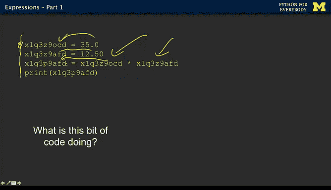
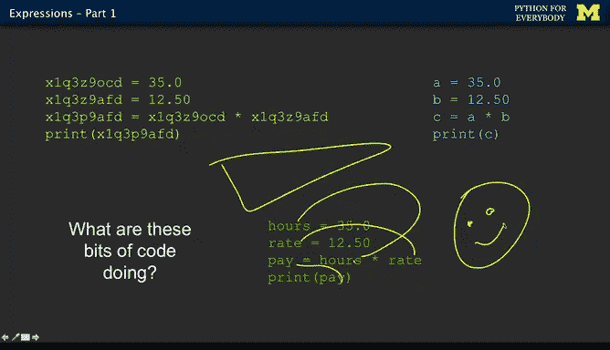
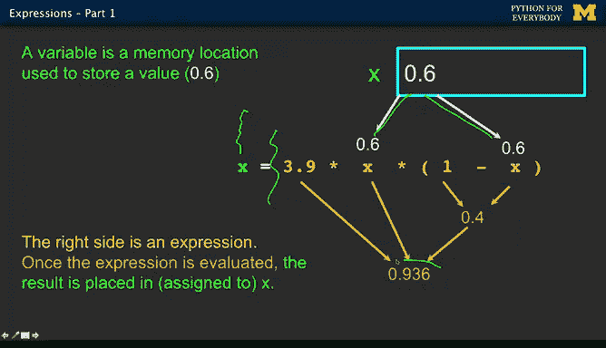

# 每个人的 Python 第一部分 12：变量命名与赋值 🐍


在本节课中，我们将要学习Python中变量的命名规则与赋值操作。理解如何为变量命名以及赋值语句的工作原理，是编写清晰、可维护代码的基础。

## 概述 📋

变量是编程中用于存储数据的基本单元。本节课将重点讲解如何为变量选择名称，以及Python如何处理赋值语句。我们将看到，虽然Python解释器对变量名称没有特殊要求，但为了代码的可读性，选择合适的名称至关重要。

## 变量命名：Python与人类的视角 👀

上一节我们介绍了变量的基本概念，本节中我们来看看如何为变量命名。关于变量名称的一个关键点是，命名权掌握在程序员手中。

我们有一种称为“助记符”的技术。其核心思想是，当你选择一个变量名时，应该选择一个有意义的名称。



Python并不关心你是否选择了有助记作用的变量名。你为变量选择的名称不会向Python传达任何额外信息。

当你是一名初学者时，有时使用过于“好”的变量名反而会造成混淆。因此，你会注意到，尤其是在前两章中，我写的代码有些使用了非常简单的变量名，有些则使用了非常巧妙的变量名。我这样来回切换，是为了向你强调：只要在一个程序内部保持一致，变量的名称就无关紧要。Python对此完全接受。

以下是一小段代码，共四行：


```python
thatthing = 35
thatthinp = 12
thatthinz = thatthing * thatthinp
print(thatthinz)
```

从顶部开始执行。第一行表示：找到一小块内存，用`thatthing`标记它，并把`35`放进去。第二行：找到另一小块内存，用`thatthinp`标记它，把`12`放进去。第三行：取出第一个东西和第二个东西，将它们相乘，并把结果放入第三个变量`thatthinz`中。如果你仔细观察这些变量名，它们都是独特且不同的，但你必须非常仔细地看。最后一行打印出第三个变量。

Python非常喜欢这段代码。Python觉得这很棒。它不知道你为何选择这些变量名，它也不在乎。它只关心它们是唯一的。Python对这些变量确实没有任何意见。

但是，如果你把这段代码交给一个朋友，并问他：“这段代码在做什么？”他可能会说：“你为什么选择如此疯狂的变量名？我必须盯着看才能分辨，比如这两个东西的区别仅仅是字母Z和字母P。这里我们打印的是带P的家伙，而这里取出的是带Z的家伙，对吧？这两个变量名只是那些字母有区别。”我的意思是，你可以这样做。对Python来说，这是完全可以理解的代码。但对人类来说，这并非完全可以理解。所以人们不会喜欢你写的代码，但Python会非常、非常高兴。我画不出一条快乐的蛇，否则我会画一条。

所以，这种命名方式是糟糕的、不友好的。

## 改进变量命名：从简单到清晰 ✨

让我们让它变得更友好一些。你可以选择这样的变量名：

```python
a = 35
b = 12
c = a * b
print(c)
```




Python看待这两段代码是完全一样的，它不在乎。但现在我们可以看着这段代码说：“哦，我看到第一个变量是`a`，我们把那个`a`放在那里；第二个变量是`b`，我们把`b`放在那里。然后我们把它们相乘，结果放入`c`，最后打印出`c`。”这样好多了，对吧？至少我们可以解析、阅读并理解代码要做什么，而无需检查这两个字符是否相同或不同。

所以这样更好，但它还不是“助记符”。助记符意味着我们选择一个变量名，使其对我们使用它的目的有意义。再次强调，对于Python来说，所有这些变量名都是一样的。Python只关心这个匹配这个，那个匹配那个。但对于人类来说，情况就大不相同了。

人类会快乐得多。现在，我们在心理上理解第一个变量`35`是小时数，第二个是每小时费率，然后我们计算了工资，并打印出来。所以这非常容易理解。问题在于，对于初学者程序员来说，它有时“过于”容易理解了。

## 助记符变量的意义与局限 🤔

Python了解工资单吗？如果我命名一个变量为`hours`，Python是否就应该知道那意味着“小时”？如果我命名一个变量为`pay`，那是否意味着Python了解这个？答案是否定的。Python平等地对待所有这三种命名方式。Python不会看着你的变量名并思考：“嘿，你这里有个错误吧？”

那么，举个例子，如果我重写这段代码，写成`pay = hours * hours`。Python会不会说：“嘿，这没道理，为什么在工资计算中你会把小时数乘以小时数？”答案是，Python会很乐意执行，因为它并不看那些单词。但是，一个试图理解你代码的人，或者在你编写代码时试图帮你调试代码的人，会非常感激你选择了好的名称。现在我可以看你的代码，如果看到你说`pay = hours * hours`，我会想：你为什么把小时数乘以小时数？你难道不是想用小时数乘以费率吗？

所以，助记符变量仅对人类有意义。我们稍后会看到一些让你困惑的情况，比如我命名一个变量为`friend`，另一个为`friends`。你可能会想：“哦，所以Python理解复数形式？”答案是否定的，Python不理解复数。不过，这样命名确实有帮助，这样当某个东西包含多个元素时，你可能会使用一个复数形式的变量名。

好了，关于这一点就讲这么多。我希望我已经讲清楚了我的观点。对于Python来说，所有这些命名方式都是一样的，但人类当然更喜欢第二种或第三种。不过要小心，在第十章之后，你会开始使用助记符变量，那时就不会有问题了。但在最初的几章里，你需要留意这一点。

## 赋值语句的深入解析 ⚙️

正如我提到的，赋值语句基本上不像数学中的等号。等号意味着相等，而赋值语句意味着箭头。关键的一点是，你几乎可以认为这里有一堵小墙，它完全先计算右边的表达式。

右边是一个表达式，Python会将其计算为一个单一的值，然后将其写入变量所在的内存位置。这就是为什么可以在赋值语句的两边使用同一个变量，因为右边会先被计算（忽略左边的变量），然后，一旦右边计算完成，它才会实际将结果存入左边的变量。

例如，假设在执行语句前，变量`x`的值是`0.6`。赋值过程会“隔离”右边这部分，通过取出`x`的旧值`0.6`来进行计算，运行计算过程，得到新值，然后，并且只有在那之后，它才会将新值（例如`9.36`）存储到`x`中，这会覆盖掉`x`中原来的`0.6`。

所以，一边先完成计算，产生一个结果，然后它可以覆盖另一边。这并不意味着你必须把变量放在两边，但它解释了为什么你可以这样做。



因此，有时我们会写像`x = x + 1`这样的语句。这是我们给`x`加1的方式。因为无论`x`是什么（比如`x`是`6`），右边`x + 1`会变成`7`，然后这个`7`被存入`x`，覆盖原来的值。我们称之为“递增”，我们很快就会看到这个操作。

这就是为什么你可以在赋值两边使用同一个变量。在数学中，`x = x + 1`毫无意义，但在编程中，这是我们最常做的事情之一。

## 总结 🎯

本节课中我们一起学习了Python变量的命名与赋值。我们了解到：
*   变量名对Python解释器而言只需保持唯一性，但对代码的可读性和维护性至关重要。
*   **助记符变量名**（如 `hours`, `rate`, `pay`）能极大帮助人类理解代码意图，但Python本身并不理解其含义。
*   赋值语句（`=`）不是数学等式，而是“先计算右边，再存入左边”的操作。
*   正因为如此，像 `x = x + 1` 这样的“递增”操作在编程中是常见且有效的。


现在，我们已经完成了变量和常量的学习，接下来我们将更详细地讨论表达式。