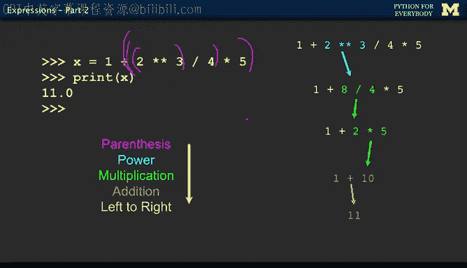

# 密歇根大学《给所有人的Python课》课程1：《编程入门指南（使用Python进行开发）》｜P13：数值表达式 🧮

在本节课中，我们将要学习Python中的数值表达式。我们将了解Python支持的各种数学运算符，它们如何工作，以及计算时的优先级规则。掌握这些是进行任何数学计算的基础。

## 表达式与运算符

上一节我们介绍了赋值语句，本节中我们来看看赋值语句右侧的表达式可以有多复杂。所有编程语言都包含各种运算符，例如 `x + 1` 或 `x - 1`。

这些运算符的符号源于20世纪60年代计算机键盘上的字符集。当时的键盘（如电传打字机）字符有限，无法直接表示数学中的乘号（×）或上标形式的幂运算。因此，我们不得不将数学公式和函数映射到键盘上可用的符号。

以下是Python中基本的数值运算符：
*   **加法**：使用 `+` 符号。
*   **减法**：使用 `-` 符号。
*   **乘法**：通常的乘号（×）被映射为 `*`（星号）。
*   **除法**：由于无法上下排列数字，使用 `/`（斜杠）表示。
*   **幂运算**：使用 `**`（双星号）表示。
*   **取余**：使用 `%` 符号，这是一个计算器中不常见但对计算机非常重要的运算符。

## 深入理解取余运算符

加法、减法、乘法和除法都比较直观。最有趣的可能是取余（模）运算符 `%`。

取余运算的工作原理是进行除法，但它不返回商，而是返回余数。例如，`23 % 5` 的结果是 `3`，因为23除以5商4余3。

你可能会问，这个运算符有什么用？以下是一些应用场景：
*   **生成特定范围的随机数**：取一个大随机数，然后用 `% 52` 取余，结果将是0到51之间的一个数，可以用来模拟随机抽一张牌。
*   **模拟掷骰子**：取一个大随机数，用 `% 6` 取余，结果对应骰子的一个面（0-5，通常加1得到1-6）。
*   **判断奇偶性**：用数字对2取余，如果结果是0则为偶数，是1则为奇数。

因此，取余运算符在某些情况下非常实用，值得我们特别关注。

## 运算符的优先级（计算顺序）

与数学一样，Python中的表达式计算也有顺序。有些运算符的“威力”比其他运算符大。当然，最稳妥的方法是使用括号 `()` 来明确指定计算顺序。大多数程序员为了代码清晰易读，也会主动添加括号。

例如，对于表达式 `2 * 3 + 4 / 5 ** 6`，为了让它更易读，我可以加上括号：`(2 * 3) + (4 / (5 ** 6))`。这与不加括号的计算结果完全相同，因为：
1.  `5 ** 6`（幂运算）最先计算。
2.  `4 / (第一步的结果)` 其次计算。
3.  `2 * 3` 然后计算。
4.  最后进行加法运算。

但了解默认的优先级规则仍然很重要。规则如下：
1.  **括号** `()` 拥有最高优先级，可以覆盖所有其他规则。
2.  **幂运算** `**` 优先级次之。
3.  **乘法** `*`、**除法** `/` 和 **取余** `%` 具有相同优先级，高于加法和减法。
4.  **加法** `+` 和 **减法** `-` 优先级最低。
5.  当多个相同优先级的运算符连续出现时，计算顺序为**从左到右**。

## 计算示例

这是一个经典的计算机科学作业题：表达式 `1 + 2 ** 3 / 4 * 5` 的结果是什么？

我们可以手动逐步计算：
1.  **幂运算优先**：计算 `2 ** 3`，得到 `8`。表达式变为 `1 + 8 / 4 * 5`。
2.  **乘除从左到右**：接下来计算 `8 / 4`，得到 `2.0`。表达式变为 `1 + 2.0 * 5`。
3.  **继续乘除**：计算 `2.0 * 5`，得到 `10.0`。表达式变为 `1 + 10.0`。
4.  **最后进行加法**：计算 `1 + 10.0`，最终结果为 `11.0`。

所以，`print(1 + 2 ** 3 / 4 * 5)` 会输出 `11.0`。

另一种理解方式是思考如何给这个表达式加上括号以明确顺序。根据优先级，等价的形式是 `1 + (( (2 ** 3) / 4 ) * 5)`。

## 总结

本节课中我们一起学习了Python的数值表达式核心知识。我们认识了基本的数学运算符，特别是用途独特的取余运算符 `%`。最重要的是，我们掌握了运算符的优先级规则：**括号第一，幂运算第二，乘除取余第三，加减最后，同级运算从左到右**。理解并运用这些规则，是正确编写和解读任何包含数学运算的Python代码的关键。记住，当你不确定顺序时，使用括号总是最清晰、最安全的选择。