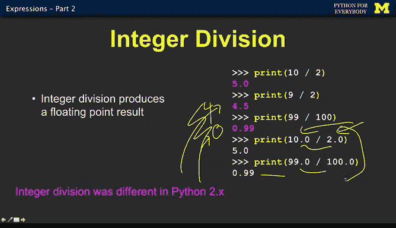
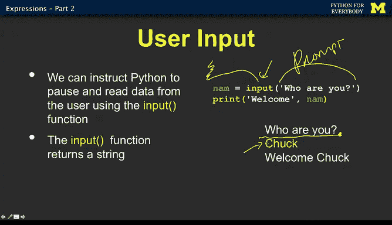

# 1：《编程入门指南（使用Python进行开发）》｜P14：变量类型 🧮


在本节课中，我们将要学习Python中一个非常重要的概念：**变量类型**。我们将了解Python如何区分不同类型的数据，以及为什么理解这些类型对于编写正确的程序至关重要。

---

## 变量与常量的类型

上一节我们介绍了变量、常量和表达式。本节中我们来看看Python如何区分不同类型的数据。

Python不仅会跟踪变量中存储的值，还会跟踪这个值的**类型**。例如，一个值可以是**整数**、**浮点数**或**字符串**。Python会根据操作数的类型来决定如何执行操作。

以下是一个简单的例子，展示了`+`运算符在不同类型下的行为：

```python
# 当操作数是整数时，+ 执行加法
ddd = 1 + 4
print(dddd)  # 输出：5

# 当操作数是字符串时，+ 执行拼接
eee = ‘hello’ + ‘ there’
print(eee)  # 输出：‘hello there’
```

在第一个例子中，`+`运算符看到两个整数，因此执行加法。在第二个例子中，`+`运算符看到两个字符串，因此执行拼接。注意，拼接时不会自动添加空格，所以我们需要在字符串中手动包含空格。

---

## 类型错误与追踪信息

当我们尝试对不兼容的类型进行操作时，Python会“不知所措”并停止执行程序，同时给出错误信息。

例如，尝试将一个字符串和一个整数相加：

```python
eee = ‘hello’
eee = eee + 1  # 这行代码会导致错误
```

Python会输出一个**追踪信息**，其中包含`TypeError`。这并非意味着你是一个糟糕的程序员，而是Python在说：“我不明白你想让我做什么。”追踪信息会告诉你错误发生的位置和原因，例如：“cannot convert ‘int’ object to str implicitly”。

---

## 使用 `type()` 函数检查类型

为了帮助我们理解变量中存储的数据类型，Python提供了一个内置函数 `type()`。

以下是使用 `type()` 函数的示例：

```python
eee = ‘hello’
print(type(eee))  # 输出：<class ‘str’>
print(type(‘hello’))  # 输出：<class ‘str’>
print(type(1))  # 输出：<class ‘int’>
```

通过调用 `type()` 函数并传入变量或常量，我们可以得知其具体类型，例如是字符串（`str`）还是整数（`int`）。

---

## 数字类型：整数与浮点数

我们已经隐式地使用了两种数字类型：**整数**和**浮点数**。


*   **整数**：没有小数点的数字，例如 `42`。
*   **浮点数**：包含小数点的数字，例如 `98.6`。即使写成 `98.0`，它也是浮点数。

它们内部表示方式不同。浮点数能表示的范围更大，但精度可能不如整数。整数是精确的，但其大小存在上限（通常非常大，初学者无需担心）。

**注意**：虽然我们最初的例子可能会用浮点数表示金额，但在实际金融应用中，**不应使用浮点数处理货币**，因为它可能导致精度问题。许多电影情节（如《上班一条虫》）都与此相关。

---

## 类型转换函数

有时我们需要在不同类型之间进行转换。Python提供了 `int()` 和 `float()` 等内置函数来实现这一点。

以下是类型转换的示例：

```python
# 将整数转换为浮点数
i = 42
f = float(i)
print(f)  # 输出：42.0
print(type(f))  # 输出：<class ‘float’>

# 将字符串转换为整数
sval = ‘123’
ival = int(sval)
print(type(ival))  # 输出：<class ‘int’>
print(ival + 1)  # 输出：124
```

**重要提示**：如果尝试转换一个不包含有效数字的字符串（如 `int(‘hello’)`），程序会报错并停止。

---



## Python 2 与 Python 3 的整数除法差异

整数除法的行为在Python 2和Python 3之间发生了重大变化。

在 **Python 3** 中，除法运算总是产生浮点数结果，这更符合直觉：

```python
print(10 / 2)  # 输出：5.0
print(9 / 2)   # 输出：4.5
print(99 / 100) # 输出：0.99
```

而在 **Python 2** 中，两个整数相除会进行**截断**（直接舍弃小数部分），得到整数结果。例如，`9 / 2` 在Python 2中结果是 `4`。为了在Python 2中获得浮点数结果，通常需要强制将其中一个操作数转换为浮点数。

---

## 从外部获取数据：`input()` 函数

到目前为止，我们的数据都直接写在代码里。现在，我们来看看如何从用户那里获取输入。

我们使用 `input()` 函数从键盘读取数据。该函数会显示一个提示信息，然后等待用户输入。用户输入内容并按下回车键后，输入的内容会以**字符串**的形式存储到变量中。


以下是使用 `input()` 函数的示例：

```python
name = input(‘Who are you? ‘)
print(‘Welcome,’, name)
```

运行这段代码时，程序会打印“Who are you?”，然后暂停。假设用户输入“Chuck”并回车，变量 `name` 将包含字符串 `‘Chuck’`。随后，程序继续执行，打印出“Welcome, Chuck”。`print` 函数中逗号会自动添加一个空格。



---

## 总结

本节课中我们一起学习了Python中**变量类型**的核心概念。

我们了解到Python会严格跟踪每个值的类型（如整数、浮点数、字符串），并根据类型决定操作行为。我们学习了如何使用 `type()` 函数检查类型，以及如何使用 `int()` 和 `float()` 函数进行类型转换。我们还探讨了Python 2和Python 3在整数除法上的重要区别。最后，我们介绍了如何使用 `input()` 函数从用户那里获取输入，这是让程序变得交互性的第一步。


理解这些基础类型及其操作，是构建更复杂、更有用程序的基石。在接下来的课程中，我们将综合运用这些知识来编写我们的第一个实用程序。