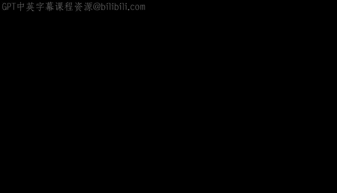
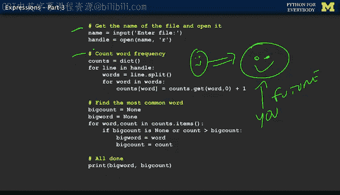
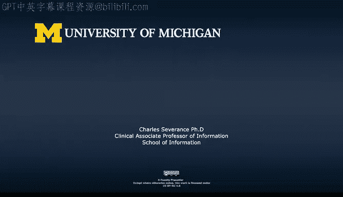

# 每个人的 Python 第一部分 15：在Python中编写注释 📝



在本节课中，我们将结合之前讲座的所有知识，实际创建我们的第一个程序。在开始编写程序之前，我们需要先讨论一下代码文档。

上一节我们介绍了助记变量名，这是为了方便人类阅读代码。本节中我们来看看另一种对程序员友好的方式——注释。

## 什么是注释？ 🤔

注释是我们在程序中添加的、会被Python解释器忽略的文本。它是一种极佳的方式，用于说明代码的意图。例如，当有一段长达10行、逻辑稍显复杂的代码时，你可以通过注释说明“这段代码的作用是反转这两个元素的顺序”。你也可以用注释记录代码的作者。

## 如何编写注释？ ✍️

在Python中，你可以在一行代码前加上井号（`#`）来将其转换为注释。

```python
# 每个人的 Python 第一部分 这是一个注释，Python会忽略这一行
print("这行代码会执行")
# 每个人的 Python 第一部分 print("这行被注释的代码不会执行")
```

有时，你会为了调试而添加一些代码。当你不再需要这些调试代码时，你可以用井号将其注释掉，而不是直接删除。这样，如果你未来需要重新启用它，只需移除井号即可。这是一种“开关”代码行的便捷方法。

## 注释的实际应用示例 📊

以下是我们在课程中反复使用的“词频统计”程序，我为其添加了四段注释：

```python
# 每个人的 Python 第一部分 获取文件名并打开文件
fname = input('Enter the file name: ')
try:
    fhand = open(fname)
except:
    print('File cannot be opened:', fname)
    exit()

# 每个人的 Python 第一部分 统计词频（创建直方图）
counts = dict()
for line in fhand:
    words = line.split()
    for word in words:
        if word not in counts:
            counts[word] = 1
        else:
            counts[word] += 1

# 每个人的 Python 第一部分 打印结果
print(counts)
```

第一段注释说明接下来的两行代码要做什么。第二段注释概括了随后的五行动态逻辑。最后一段注释说明了程序的收尾工作。

## 编写注释的最佳实践 💡

以下是关于如何有效使用注释的一些建议：

*   **为自己而写**：不要仅仅因为老师要求而写注释。写注释是为了帮助未来的自己。一天、一周或一个月后，你可能已经不记得当初为什么这样写代码了。好的注释是送给未来自己的一份礼物。
*   **避免无意义的注释**：不要为了写注释而写注释。例如 `x = 1 # 将1赋值给x` 这样的注释是多余的，因为每个人都能看懂 `x = 1` 的含义。
*   **解释复杂逻辑**：在代码逻辑复杂或不够直观的地方添加注释，帮助他人（包括未来的自己）理解代码的意图，而无需逐行分析细节。
*   **辅助调试**：注释可以帮助你或他人快速理解代码段的功能，从而验证其行为是否符合预期，这是调试过程中的重要一环。

## 总结 🎯





本节课中我们一起学习了Python中注释的编写方法。我们了解到，注释是以井号（`#`）开头的、会被Python忽略的文本行，其核心作用是**为代码添加说明和文档**。记住，编写注释的首要目的是帮助未来的自己理解代码逻辑，应注重质量而非数量，避免无意义的冗余说明。善用注释是写出可维护、易理解代码的关键一步。