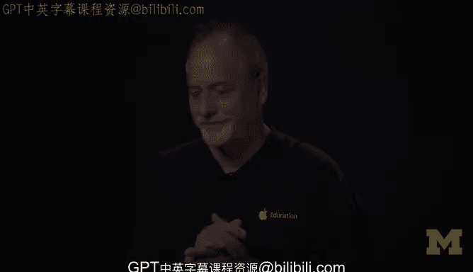

# 每个人的 Python 第一部分 16：你的第一个输入-处理-输出程序 🚀


在本节课中，我们将要学习编写第一个完整的Python程序。这个程序将演示计算机工作的核心模式：输入、处理和输出。我们将通过一个简单的“电梯楼层转换器”应用来理解这一模式。

## 概述

计算机程序通常遵循一个基本模式：**输入（Input）**、**处理（Processing）** 和 **输出（Output）**。程序首先从外部（如用户、文件）获取数据，然后对这些数据进行计算或操作，最后将结果呈现出来。本节课我们将编写一个三行程序来完整地体验这个过程。

## 程序背景与目标

世界上大多数地区的酒店，地面层被称为“0层”，而在美国，地面层则被称为“1层”。因此，如果你在欧洲的电梯里身处7楼，对应的美国楼层应该是8楼。我们的程序目标就是解决这个简单的转换问题。

虽然这个应用可能不会让我们致富，但它足以作为一个完美的示例，来展示一个具备完整输入、处理和输出流程的程序。

## 代码解析

以下是实现该功能的完整程序代码。我们将逐行分析其工作原理。

```python
# 每个人的 Python 第一部分 转换电梯楼层
inp = input('欧洲楼层？')
usf = int(inp) + 1
print('美国楼层', usf)
```

### 1. 注释

程序的第一行是注释：
`# 转换电梯楼层`

注释以 `#` 符号开头，其后的内容会被Python解释器忽略。注释的目的是为阅读代码的人（包括未来的你自己）解释代码的意图，它不影响程序运行。

### 2. 输入（Input）

程序的第二行负责获取用户输入：
`inp = input(‘欧洲楼层？’)`

*   `input()` 是一个内置函数，用于从用户那里获取输入。
*   它会先打印出括号内的提示字符串 `‘欧洲楼层？’`，然后暂停程序，等待用户键入内容。
*   当用户输入数字（例如 `0`）并按下回车键后，输入的内容会以**字符串（String）** 的形式被返回。
*   最后，这个字符串被赋值给变量 `inp` 保存起来。我们选择了 `inp` 作为变量名，它是“input”的缩写，这是一个有意义的助记变量名。

### 3. 处理（Processing）

程序的第三行是核心的计算处理部分：
`usf = int(inp) + 1`

*   我们的目标是将欧洲楼层数加1。但是，`inp` 变量中存储的是字符串（如 `‘0’`），不能直接进行数学运算。
*   因此，我们使用 `int()` 函数将字符串 `inp` **转换（Convert）** 成一个整数（Integer）。例如，`int(‘0’)` 的结果是整数 `0`。
*   **注意**：如果用户输入的不是有效的数字（如 `‘bob’`），`int()` 函数将无法转换，程序会报错（Traceback）并停止运行。目前我们假设用户输入正确。
*   转换成功后，我们执行 `整数 + 1` 的运算。
*   计算结果被存储到另一个变量 `usf` 中。`usf` 是“United States floor”（美国楼层）的缩写，这也是一个良好的助记变量名。

### 4. 输出（Output）

程序的最后一行负责输出结果：
`print(‘美国楼层’， usf)`

*   `print()` 函数用于向屏幕输出信息。
*   它可以打印多个项目，项目之间用逗号分隔。打印时，逗号会自动转换成一个空格。
*   所以这行代码会输出类似 `美国楼层 1` 的结果。

## 关键概念回顾

在编写这个程序之前和之中，我们接触并运用了以下几个核心编程概念：

*   **常量与变量**：我们使用变量（如 `inp`， `usf`）来存储和操作数据。
*   **保留字**：我们使用了Python语言定义的 `input`， `int`， `print` 等内置函数（它们不是保留字，但至关重要）和 `=` 等运算符。
*   **类型**：我们区分了字符串（String）和整数（Integer）这两种数据类型。
*   **助记变量名**：使用 `inp`， `usf` 这类有意义的变量名，使代码更易读。
*   **运算符与优先级**：我们使用了赋值运算符 `=` 和加法运算符 `+`。
*   **类型转换**：我们使用 `int()` 函数将字符串显式转换为整数，以便进行数学运算。
*   **注释**：使用 `#` 为代码添加说明。

## 总结

本节课中，我们一起学习了计算机编程的基本模式——输入、处理和输出（IPO），并亲手编写了第一个完整的Python程序。这个简单的楼层转换程序虽然只有三行，但它涵盖了从获取用户输入、进行数据类型转换与计算，到最终输出结果的全部关键步骤。

你已经掌握了编写一个能运行的小程序的基础。当然，大多数程序都比这复杂，需要处理更多逻辑和情况。但这是一个坚实的起点。



接下来，我们将进入一个让程序显得更“智能”的部分：**条件执行**。我们将学习使用 `if` 和 `else` 等保留字，让程序能够根据不同情况做出不同决策。敬请期待！