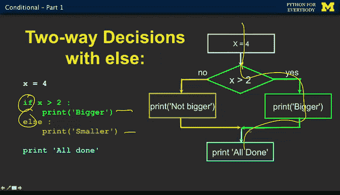

# 每个人的 Python 第一部分 18：条件语句第一部分 🔀


在本节课中，我们将要学习Python中的条件执行。条件执行是让程序具备“智能”的关键，它允许程序根据不同的情况做出选择，执行不同的代码路径。

---

## 概述：什么是条件执行？

上一节我们介绍了顺序执行，即代码按顺序逐行运行。本节中我们来看看条件执行。条件执行意味着程序可以根据特定条件，选择执行不同的代码块。这就像走到一个岔路口，你可以选择向左转、向右转或直行。这种选择能力是让计算机显得“智能”的核心部分。

实现条件执行的关键是 **`if` 语句**。

## `if` 语句的基本结构

`if` 语句是一个保留字，用于指示我们将有条件地执行某些操作。它的结构并不难理解。

一个 `if` 语句包含一个**条件**。这个条件本质上是一个问题。例如，`x = 5` 是一个赋值语句，它会改变变量 `x` 的值；而 `x < 10` 则是一个问题，它在询问“`x` 小于 10 吗？”，并返回 `True`（真）或 `False`（假）。

`if` 语句以冒号 `:` 结尾，并开始一个**缩进的代码块**。这类似于一个大纲，表示“如果条件为真，就执行这个代码块；否则，跳过它”。

让我们看一个例子：

```python
x = 5
if x < 10:
    print('Smaller')
if x > 20:
    print('Bigger')
print('Finis')
```

在这个例子中：
1.  因为 `x` 是 5，`x < 10` 这个条件为 `True`，所以会执行缩进的 `print('Smaller')` 语句。
2.  而 `x > 20` 这个条件为 `False`，所以会跳过缩进的 `print('Bigger')` 语句。
3.  最后，未缩进的 `print('Finis')` 会无条件执行。

因此，我们只会在输出中看到 `Smaller` 和 `Finis`。这就是“条件”的含义：根据所提问题的答案，缩进块内的代码可能执行，也可能不执行。

你可以把这个过程想象成开车：遇到 `if` 路口时，根据条件判断是“直行”进入缩进代码块，还是“绕行”跳过它。

## 比较运算符

为了构造条件，我们需要使用比较运算符。这些运算符的符号设计源于早期计算机键盘的限制。

以下是Python中常用的比较运算符：

*   **`<`**：小于
*   **`<=`**：小于或等于
*   **`==`**：等于（注意：这是**两个**等号）
*   **`>=`**：大于或等于
*   **`>`**：大于
*   **`!=`**：不等于

需要特别注意的是 **`==`**（双等号）。单个等号 `=` 是赋值运算符，它会把右边的值赋给左边的变量。而双等号 `==` 是**比较**运算符，它用于询问“左边的值等于右边的值吗？”，并且不会改变任何变量的值。

以下是使用这些运算符的例子：

```python
x = 5
if x == 5:
    print('Equals 5')
if x > 4:
    print('Greater than 4')
if x >= 5:
    print('Greater than or Equals 5')
if x < 6:
    print('Less than 6')
if x <= 5:
    print('Less than or Equals 5')
if x != 6:
    print('Not equal 6')
```

所有条件都为真，因此每个 `print` 语句都会执行。

## 缩进与代码块

在Python中，**缩进具有语法意义**，这与许多其他编程语言（如Java、C、JavaScript）不同，在其他语言中缩进仅用于提高可读性。

在 `if` 语句的冒号 `:` 之后，你必须缩进接下来的代码。所有保持相同缩进级别的行都属于同一个代码块。当缩进级别恢复到与 `if` 语句齐平时，表示代码块结束。

这允许我们创建包含多行代码的条件执行块：

```python
x = 5
print('Before 5')
if x == 5:
    print('Is 5')
    print('Is Still 5')
    print('Third 5')
print('After 5')
print('Before 6')
if x == 6:
    print('Is 6')
    print('Is Still 6')
    print('Third 6')
print('After 6')
```

*   当 `x == 5` 为真时，会执行其下所有缩进的三行 `print` 语句。
*   当 `x == 6` 为假时，会跳过其下所有缩进的三行 `print` 语句。

**关于缩进的注意事项**：
*   通常使用**4个空格**进行缩进（这是推荐做法）。
*   避免混合使用**空格**和**制表符**（Tab键）。它们在屏幕上看起来可能一样，但Python会将其视为不同的字符，从而导致错误。
*   建议在文本编辑器（如VS Code、Sublime Text、Notepad++）中设置“将制表符转换为空格”，以确保一致性。
*   空行和注释行不影响缩进逻辑。

## 嵌套的代码块

代码块可以嵌套在其他代码块内部，形成多层结构。例如，在循环（我们将在后续章节学习）内部可以有 `if` 语句，在 `if` 语句内部还可以有另一个 `if` 语句。

```python
for i in range(5): # 这是一个循环（外层块）
    print(i)
    if i > 2:      # 这是一个嵌套在循环内的if语句（内层块）
        print('Bigger than 2')
    print('Done with i', i)
print('All Done')
```

在这个例子中：
1.  `for` 循环开始一个外层代码块（缩进1级）。
2.  循环内的 `if` 语句开始一个内层代码块（缩进2级）。
3.  通过减少缩进（回退到上一级）来结束一个代码块。

理解代码块的开始（冒号和增加缩进）和结束（减少缩进）是阅读和编写Python代码的关键。你可以尝试在脑海中为这些代码块画上方框，这有助于理清逻辑结构。

## 双向选择：`if-else` 语句

到目前为止，我们看到的 `if` 语句都是“单向选择”：条件为真就执行，为假就跳过。但很多时候我们需要“双向选择”：条件为真时做一件事，为假时做另一件事。这就像道路分叉，你必须选择其中一条。

在Python中，我们使用 **`if-else`** 结构来实现：

```python
x = 4
if x > 2:
    print('Bigger')
else:
    print('Smaller')
print('All done')
```

*   如果 `x > 2` 为真（本例中为真），则执行 `if` 下的代码块（打印 `'Bigger'`），并跳过 `else` 下的代码块。
*   如果 `x > 2` 为假，则跳过 `if` 下的代码块，转而执行 `else` 下的代码块（打印 `'Smaller'`）。

**关键点**：在 `if-else` 结构中，**有且仅有一个**分支（`if` 或 `else`）的代码会被执行。执行完所选分支后，程序会继续执行 `if-else` 结构之后的代码。

---

## 总结

本节课中我们一起学习了Python条件执行的基础知识：
1.  **`if` 语句**是实现条件执行的核心，它根据一个条件（返回 `True` 或 `False` 的表达式）来决定是否执行其下的代码块。
2.  **比较运算符**（如 `==`, `>`, `<=`, `!=`）用于构建条件。特别注意 `==`（等于）与 `=`（赋值）的区别。
3.  **缩进**在Python中至关重要，它定义了代码块的开始和结束。使用一致的4个空格进行缩进，并避免混用空格和制表符。
4.  条件执行可以包含**多行代码**，只要它们保持相同的缩进级别。
5.  代码块可以**嵌套**，形成复杂的逻辑结构。
6.  **`if-else` 语句**提供了双向选择，确保在两种互斥的情况下总有一种代码路径会被执行。

通过掌握条件语句，你的程序开始具备了根据输入或状态做出不同反应的能力，这是编程中实现逻辑和“智能”的第一步。



在接下来的课程中，我们将探讨更复杂的条件执行模式，例如多路选择（`elif`）。