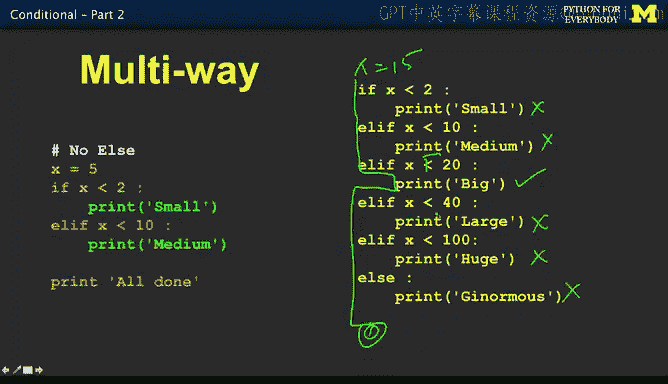

# 每个人的 Python 第一部分 19：条件语句第二部分 🔄

## 概述

在本节课中，我们将学习更复杂的条件执行模式，特别是多分支的 `if-elif-else` 结构。我们将理解其执行流程、逻辑顺序，并通过示例和练习来掌握其用法。

---

## 构建更复杂的条件执行模式

欢迎回来。现在我们将构建并讨论一些你可以构建的、稍微更复杂的条件执行模式。

在使用 `if-then-else` 时，需要做的一件事是可视化代码块。开始思考代码块。在这种情况下，你可以将代码块视为从 `if` 开始，在最后一个缩进行之后结束。但 `if` 和 `else` 属于同一个整体结构的一部分，你可以将其视为一个代码块。

关于这些代码块的一个特点是，它们有一个入口和一个出口。这并非至关重要，但这是你在脑海中开始绘制代码块的好方法。你看到一个入口和一个出口。其中有一些复杂性，有一些你正在构建的逻辑。这就是这些代码块的工作原理。

---

## 多分支条件语句：`if-elif-else`

复杂性的下一步是多分支 `if` 语句，它使用一个名为 `elif` 的关键字，这实际上是 `else` 和 `if` 的组合。

其工作原理可能更容易通过流程图来理解。它执行流程如下：程序到达此处，检查条件是否为真。如果是，则运行对应的代码块，然后整个结构执行完毕。如果为假，则检查下一个 `elif` 条件，如果为真，则运行其代码块并结束。如果所有 `elif` 条件都为假，则运行 `else` 部分的代码块并结束。

一个关键点是，它只会执行这三个分支中的一个，不会执行两个。它会按顺序检查这些条件。`else` 部分就像一个兜底选项。

让我们看看这个特定的例子是如何工作的。它取决于变量 `x` 的值。

如果 `x` 是 0，程序会进入，询问问题：`x < 2` 吗？是的，它是。所以它会运行这个代码，然后在这里结束。它会跳到这里，执行，然后直接跳过所有后续部分。

如果你绘制一个代码块，这个框就是这里。你跳出这个框。一旦你完成了这一行代码或这个代码块，你就退出了这个块。你不会再回来查看这个问题。你运行了一个条件为真的分支，然后就完成了。

另一方面，如果 `x` 是 5，情况会是：程序进入，第一个条件为假，所以跳过。然后来到下一个 `elif`，这个条件为真。于是它跳入并执行这段代码，运行完毕，结束。它不会运行第一个分支，也不会运行 `else` 分支，只会运行第二个 `elif` 分支。所以程序进入，检查：不小于 2，但小于 10。所以我们将运行那个小代码块。现在我们完全结束了。

所以流程是：否，否，但是是。这就是它的工作原理。这些条件是按顺序检查的，不是并行或同时查看的。

另一方面，如果 `x` 是 20，它会说：假，跳过。问号，假，跳过。哦，`else`。那么如果程序执行到这里，`else` 总是会被触发，然后运行那个分支。所以我们说：如果小于 2？不。如果小于 10？不。如果到了这里，我们就执行 `else` 部分，完成并继续。所以这部分不运行，那部分不运行，而 `else` 部分运行。

规则是：三个分支中的一个会运行，另外两个不会。一旦触发了一个分支，整个 `if` 语句就完成了。我再次将其视为一个代码块。你马上会看到，你可以有一个这样的结构，一旦其中一个条件为真，它就运行对应的代码，然后完全退出整个代码块。

---

## `if-elif-else` 结构的变体

这个结构还有其他变体。如果你愿意，可以没有 `else`。没有必要必须有 `else`。我们所做的只是取消了下一条行的缩进。这里没有 `else`，但这没关系。这意味着对于某些值，可能没有任何分支会执行，因为没有 `else`。如果有 `else`，那么至少有一个分支会执行。但如果没有 `else`，则有可能零个分支执行。

在这个例子中，`x` 是 5。它不会执行第一个分支，但会执行第二个分支，因为 `x` 小于 10。但如果 `x` 是，例如，50。那么第一个条件为假，第二个条件也为假，我们就直接通过。那么对于 `x` 为 50 的情况，这两个分支都不会执行。所以这仅仅意味着，如果你不想，你不必包含 `else`。

此外，你可以有很多个 `elif`。`if x < 2`，执行这个，`elif`，`elif`，`elif`，`elif`，`elif`。记住，它按顺序检查它们：第一、第二、第三、第四、第五。

所以如果 `x` 是 15。第一个条件为假，第二个条件为假，第三个条件为真，所以它会运行这段代码。然后它会继续执行下面接下来的代码。

所以，再次强调，只有其中一个会触发。流程是：否，否，是，否，否。我的意思是，15 确实小于 40。如果它检查到这里，条件会为真，但这无关紧要，因为已经有一个条件触发了。然后它处理整个代码块，这就是我们的整个代码块。所以一旦它执行了一个分支，接下来要做的就是退出整个代码块。

---

## 练习与理解

好的。明白了。好的，这里有几个谜题。我给你一点时间暂停视频，问题是：查看这些代码，对于特定的 `x` 值，有些分支永远不会执行。那么，对于某些特定的 `x` 值，哪个分支永远不会发生？意思是你可以为 `x` 选择任何值，但有些分支你无法使其执行。

好的，我暂停一下。让你暂停视频，如果你想的话。然后我会回来向你解释。

好的，你有了一些暂停的时间。希望你已经暂停了，或者没有暂停，但这没关系。你仍然可以在我开始画图并告诉你答案之前暂停。好的，那么。

在这个例子中。如果 `x` 小于 2，执行这个，否则如果 `x` 大于或等于 2，执行那个。那么永远不会执行的分支是这里的这个 `else` 分支。

这是因为无论 `x` 是什么值，它要么小于等于 2，要么大于等于 2。所以对于任何 `x` 值，无论你选什么，它要么运行这个分支，要么运行那个分支，但永远不会为任何 `x` 值运行那个 `else` 分支。

这有点棘手。我只是碰巧以这样一种方式构建了我的逻辑问题，它们覆盖了 `x` 的所有可能值。所以这个 `else` 有点无关紧要。现在，我甚至不会这样写这段代码。如果我打算画这个或写这段代码，我可能会直接让这里是一个 `else:`，然后去掉那个 `elif`。但这更像是一个谜题。

在下一个例子中，我们必须记住这些条件是按顺序发生的。所以如果 `x` 小于 2，我们将运行这个。如果它小于 20，我们将运行这个，如果它小于 10，我们将运行这个。但问题是，所有小于 10 的 `x` 值，对于这个条件会为真，这个条件总是为真。所以像 6 这样的值，这个条件变为真。这意味着如果值是 6，它将运行这个分支并退出，永远不会问这个问题。

所以这是关键。即使对于 6，这个条件为真，那个条件也为真，但它甚至永远不会到达这里，因为这个条件首先触发了。这就是为什么无论 `x` 的值是什么，这行代码永远不会运行。

---

## 总结

在本节课中，我们一起学习了更复杂的条件执行模式，重点是 `if-elif-else` 多分支结构。我们理解了其执行流程是按顺序检查条件，并且只有一个分支会被执行。我们还探讨了该结构的变体，例如省略 `else` 分支，以及拥有多个 `elif` 分支的情况。通过分析示例和解决逻辑谜题，我们掌握了如何预测代码的执行路径，并理解了条件顺序的重要性。记住将条件语句视为具有单一入口和出口的代码块，有助于清晰地构建和理解程序逻辑。