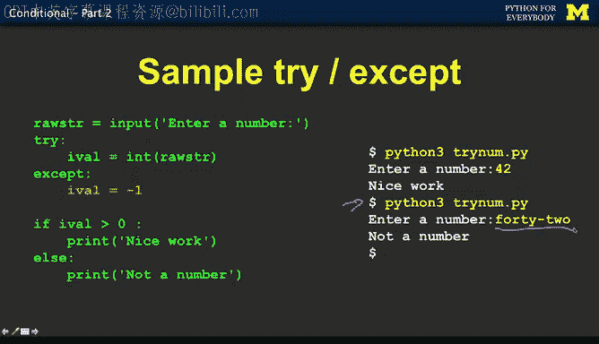

# 每个人的 Python 第一部分 20：条件语句第三部分 🛡️


在本节课中，我们将要学习Python中一种非常重要的错误处理结构——`try`和`except`。这种结构允许我们优雅地处理可能出错的代码，防止程序意外崩溃。

## 概述

上一节我们介绍了嵌套决策等条件逻辑。本节中我们来看看如何通过`try`和`except`结构来“捕获”程序运行中可能出现的错误，使程序更加健壮。

`try`和`except`结构是一种“保险策略”。它的核心思想是：将一段可能失败的代码放在`try`块中执行。如果代码成功运行，程序将跳过`except`块继续执行；如果代码运行失败并引发错误（即“回溯”），程序将转而执行`except`块中的代码，而不会让整个程序崩溃。

## `try`和`except`的基本结构

以下是`try`和`except`结构的基本语法：

```python
try:
    # 可能出错的“危险”代码
    危险操作
except:
    # 如果上面的代码出错，则执行这里的代码
    备用操作
```

## 为什么需要`try`和`except`？

考虑以下代码，它试图将用户输入转换为整数：

```python
astr = ‘hello’
ival = int(astr) # 这行代码会引发错误
print(‘Done’)
```

运行这段代码时，因为`‘hello’`无法转换为整数，程序会在`int(astr)`这一行“爆炸”（引发回溯错误），并且永远不会执行`print(‘Done’)`这行代码。程序会直接停止。

有时我们允许程序这样停止，以便于调试。但有时，尤其是在处理用户输入时，我们不希望程序崩溃，而是希望给出一个友好的错误提示，然后继续运行。这就是`try`和`except`的用武之地。

## `try`和`except`的工作原理

让我们用一个具体的例子来理解其工作流程。

假设我们有一段可能出错的代码：`ival = int(astr)`。我们可以将其放入`try`块中：

```python
astr = ‘hello’
try:
    ival = int(astr) # 危险操作
except:
    ival = -1 # 如果转换失败，则执行这里
print(‘First’, ival)
```

当这段代码运行时：
1.  `astr`的值是`‘hello’`。
2.  程序进入`try`块，尝试执行`ival = int(astr)`。
3.  转换失败，本应引发回溯错误。
4.  但由于错误发生在`try`块内，Python不会让程序崩溃，而是立即跳转到`except`块。
5.  执行`except`块中的代码`ival = -1`。
6.  跳出`except`块，继续执行后续代码`print(‘First’, ival)`，输出`First -1`。

**关键点**：程序没有崩溃，我们优雅地处理了错误，并将`ival`设置为了一个默认值（-1）。

如果`try`块中的代码成功执行了呢？

```python
astr = ‘123’
try:
    ival = int(astr) # 这次转换会成功
except:
    ival = -1
print(‘Second’, ival)
```

运行过程如下：
1.  `astr`的值是`‘123’`。
2.  程序进入`try`块，执行`ival = int(astr)`，成功将`‘123’`转换为整数`123`。
3.  `try`块内的代码全部成功执行，没有引发任何错误。
4.  因此，程序会**完全跳过**`except`块，不执行其中的`ival = -1`。
5.  继续执行`print(‘Second’, ival)`，输出`Second 123`。

**核心概念**：`except`块中的代码只有在`try`块中发生错误时才会执行。如果`try`块成功，`except`块就像不存在一样。

## 使用`try`和`except`的注意事项

初学者可能会想：既然`try`和`except`能防止崩溃，那我是不是应该把整个程序都放进去？**这是一个需要避免的做法**。

以下是原因：
`try`块中一旦某行代码出错，程序会立刻跳出`try`块，执行`except`块，然后从`except`块之后继续。**它不会返回`try`块去执行剩下的代码**。

请看下面的图示和代码：

```
开始
├── try块开始
│   ├── 执行代码A (成功)
│   ├── 执行危险代码B (失败！)
│   └── 执行代码C (永远不会被执行)
└── except块开始
    └── 执行备用代码D
结束
```

```python
try:
    print(‘This will print.’) # 代码A
    ival = int(‘hello’)       # 危险代码B
    print(‘This will NEVER print.’) # 代码C
except:
    print(‘A problem occurred!’) # 代码D
print(‘Done.’)
```

输出将是：
```
This will print.
A problem occurred!
Done.
```

请注意，第三个`print`语句（代码C）从未执行。因此，最佳实践是**只将你认为可能出错的那一两行代码放入`try`块**，而不是将大量安全的代码也放进去。

## 一个完整的实践示例

让我们看一个从用户获取输入并判断是否为数字的完整程序：

```python
rawstr = input(‘Enter a number: ‘) # 获取用户输入
try:
    ival = int(rawstr) # 尝试将输入转换为整数
except:
    ival = -1 # 如果转换失败，将ival设为-1

if ival > 0:
    print(‘Nice work!’)
else:
    print(‘Not a number’)
```



**运行场景一（用户输入数字）：**
1.  用户输入：`42`
2.  `rawstr` = `‘42’`
3.  `try`块执行`ival = int(‘42’)`，成功，`ival` = `42`
4.  跳过`except`块
5.  判断`ival > 0`为`True`，输出：`Nice work!`

**运行场景二（用户输入非数字）：**
1.  用户输入：`forty-two`
2.  `rawstr` = `‘forty-two’`
3.  `try`块执行`ival = int(‘forty-two’)`，失败！
4.  跳转到`except`块，执行`ival = -1`
5.  判断`ival > 0`为`False`，输出：`Not a number`

在这个例子中，无论用户输入什么，程序都不会崩溃，总会给出一个明确的反馈。

## 总结

本节课中我们一起学习了Python条件语句的最后一部分——`try`和`except`错误捕获结构。

我们了解到：
*   `try`/`except`是一种预防代码运行时错误导致程序崩溃的“保险机制”。
*   其基本模式是：将可能出错的代码放在`try:`块中，将错误处理代码放在`except:`块中。
*   如果`try`块中的代码成功，则跳过`except`块；如果失败，则执行`except`块。
*   应尽量只将真正“危险”的代码行放入`try`块，因为一旦出错，`try`块内剩余的代码将不会被执行。
*   使用`try`/`except`可以使程序在面对非法输入或意外情况时更加健壮和友好。


结合之前学习的比较运算符、`if`、`if-else`和嵌套决策，你现在已经掌握了Python中进行条件判断和流程控制的核心工具。