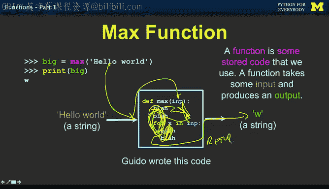

# 每个人的 Python 第一部分 22：22_06_01_使用函数 👨‍💻


## 概述

在本节课中，我们将要学习编程中的第四种模式：**存储与重用**。我们将了解什么是函数，如何定义和调用函数，以及函数如何帮助我们避免重复代码。

---

## 存储与重用模式

上一节我们介绍了顺序、条件和循环模式。本节中我们来看看第四种模式：存储与重用。

存储与重用模式的核心思想是，程序员不喜欢重复自己。如果你有四行代码，想在后面再次使用，你可能会复制粘贴。但如果你发现这四行代码有错误，就必须找到所有复制的地方去修改。如果你的程序中有100处使用了这段代码，你就需要修改100个地方。

因此，我们提出一个解决方案：将这段代码放在一个地方，给它起个名字，然后在所有其他地方使用这个名字。这就是存储与重用。其理念是 **“不要重复自己”**（Don‘t Repeat Yourself，简称DRY）。

以下是存储与重用的步骤，而函数就是我们用来存储和重用的东西。

---

## 定义函数

我们引入了一个新的关键字：**`def`**。它代表开始定义一个函数。

```python
def thing():
    print('Hello')
    print('Fun')
```

*   **`def`** 是关键字。
*   它以冒号结尾，就像许多开启一个缩进代码块的语句一样。
*   你可以为你存储的代码块命名，这里我们暂时叫它 `thing`。
*   括号内是一些可选参数，我们稍后会看到。目前这个函数没有参数。
*   然后是一个缩进的代码块。
*   当你取消缩进时，就标志着函数定义的结束。

理解这一点很关键：当Python解析或查看这段代码时，它实际上**不会执行**里面的两个 `print` 语句。它只是记住它们。这有点像把它存储到一个区域，几乎像一个变量。变量 `x = 2` 是把 `2` 放入名为 `x` 的容器。而函数 `thing` 是把两行代码放入名为 `thing` 的容器。

所以，函数有点像变量，但它存储的是代码。最重要的是，定义函数时不会执行这些代码，因此不会有任何输出。它的副作用是扩展了Python，我们创建了一个可以调用的新东西 `thing`。

---

## 调用函数

我们通过函数名后加括号来**调用**或**调用**一个函数。

```python
thing()
print('Zip')
thing()
```

以下是执行过程：
1.  `def` 语句不做任何事，只是记住 `thing` 函数。
2.  执行到 `thing()` 时，Python说：“去运行 `thing` 里的代码”。于是执行 `print('Hello')` 和 `print('Fun')`。
3.  函数执行完毕，返回到调用点，继续执行下一行 `print('Zip')`。
4.  再次遇到 `thing()`，再次跳转执行函数内的两行 `print` 语句。
5.  程序结束。

关于函数的一个要点是：当Python调用一个函数时，它会记住返回的位置。这就像暂停当前代码，跳转去运行函数，然后返回到暂停点继续执行。

---

## 内置函数

我们一直在使用函数，例如：
*   **`print()`**：打印内容。
*   **`input()`**：从用户读取输入。
*   **`type()`**：告诉我们对象的类型。
*   **`int()`** 和 **`float()`**：进行类型转换。

随着我们通过构建函数来扩展Python，我们可以将它们视为新的保留字或函数名。函数名的命名规则与变量相同，应避免使用保留字等。

---

## 参数与返回值

函数是一段可重用的代码。我们使用 `def` 关键字定义函数，然后通过函数名加括号来**调用**它。调用时可以传入可选的**参数**。

以下是一个我们尚未使用过的内置函数：**`max`** 函数。

```python
big = max('Hello world')
print(big)  # 输出：w
```

这是一个传递参数的例子。我们将字符串 `'Hello world'` 传递给 `max` 函数。`max` 会扫描这个字符串并找到“最大”的字母。它判断小写字母比大写字母“大”，所以返回 `'w'`。这个返回 `'w'` 的过程称为**返回值**。然后，这个 `'w'` 被赋值给变量 `big`。

同样，**`min`** 函数寻找最小的字符。

```python
tiny = min('Hello world')
print(tiny)  # 输出：' ' (空格)
```

在这里，空格被认为是字符串中最小的字符，因此被返回并赋值给 `tiny`。

你可以这样理解：`max` 函数是内置于Python中的一段代码。我们传入一个字符串作为参数。函数内部的代码运行，读取参数，进行处理，然后通过 `return` 语句将答案（例如 `'w'`）发送回来。

---

## 函数调用与表达式

函数调用可以成为表达式的一部分。



```python
print(float(99) / 100)  # 输出：0.99
```

Python计算这个表达式时，遇到 `float(99)` 会暂停计算，去运行 `float` 函数的代码，得到返回值 `99.0`，然后用 `99.0` 替换函数调用，继续计算 `99.0 / 100`，得到 `0.99`。

再看一个变量传递的例子：

```python
i = 42
f = float(i)
print(type(f))  # 输出：<class 'float'>
```

我们将整数 `42` 传递给 `float` 函数，它返回 `42.0`，然后赋值给 `f`。

在复杂表达式中也是如此：

```python
result = 2 * float('3') + 1
```

计算过程是：遇到 `float('3')`，暂停，运行 `float` 得到 `3.0`，替换回来，计算 `2 * 3.0` 得 `6.0`，再加 `1` 得 `7.0`。你可以将函数调用视为暂时挂起当前操作，等待函数返回一个值来替换它。

---

## 类型转换函数

我们一直在使用 `int` 和 `float` 进行类型转换，尤其是在处理输入时。因为 `input()` 函数总是返回一个字符串。

```python
sval = '123'
print(type(sval))  # <class 'str'>
# 每个人的 Python 第一部分 print(sval + 1)   # 错误！不能将字符串与整数相加

ival = int(sval)
print(type(ival))  # <class 'int'>
print(ival + 1)    # 输出：124
```

字符串 `'123'` 和整数 `123` 是不同的。如果我们尝试 `'123' + 1`，程序会崩溃，因为类型不匹配。但通过 `int(sval)`，我们将字符串 `'123'` 传递给 `int` 函数，它返回整数 `123`，然后赋值给 `ival`。现在我们就可以对整数进行数学运算了。

函数也可能执行失败：

```python
# 每个人的 Python 第一部分 int('hello Bob')  # 这会导致程序崩溃 (ValueError)
```

如果我们尝试 `int('hello Bob')`，`int` 函数内部的代码无法将字符串转换为整数，因此函数本身会“崩溃”（引发异常），导致我们的程序也停止运行。

---

## 总结

本节课中我们一起学习了：
1.  **存储与重用（DRY）模式**：通过函数避免代码重复。
2.  **定义函数**：使用 `def` 关键字定义函数，函数体需要缩进。
3.  **调用函数**：使用函数名加括号 `()` 来执行函数中的代码。
4.  **参数与返回值**：函数可以接收输入（参数）并返回输出（返回值）。
5.  **内置函数**：如 `print()`, `input()`, `max()`, `min()`, `int()`, `float()` 等。
6.  **函数在表达式中的作用**：函数调用会先被其返回值替代，然后参与表达式计算。

下一节，我们将停止仅仅使用内置函数，开始实际定义和使用一些我们自己的函数。