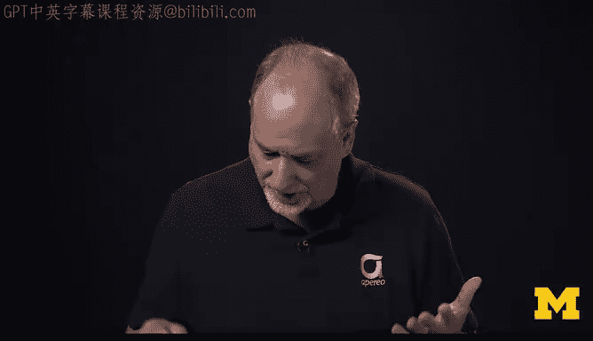
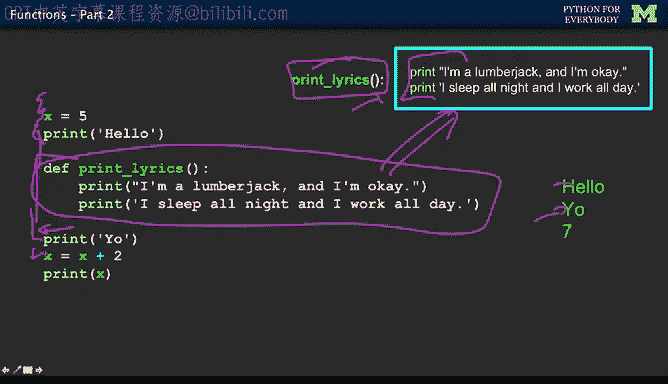
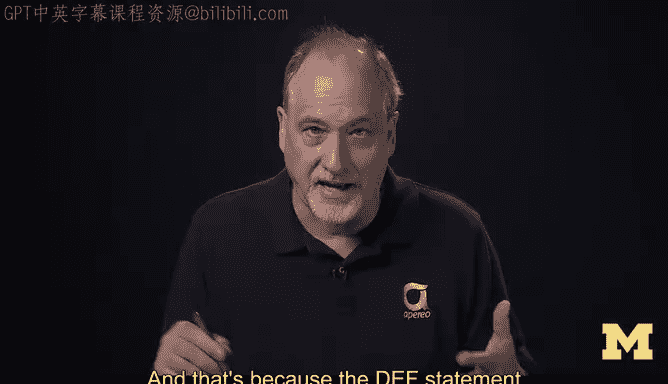
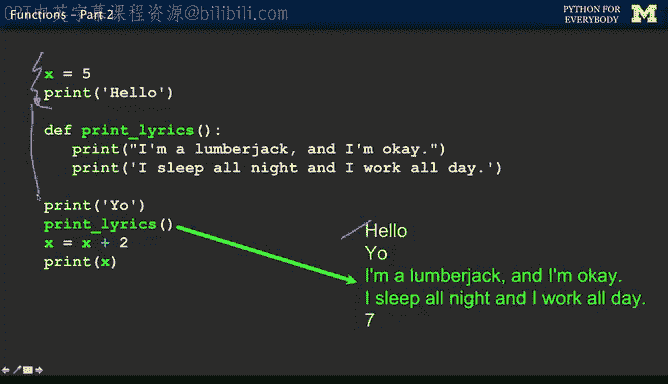
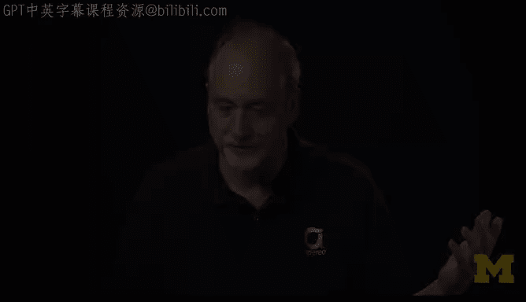

# 密歇根大学《给所有人的Python课》课程1：《编程入门指南（使用Python进行开发）》｜P23：构建函数第一部分 🧱


在本节课中，我们将要学习如何构建自己的函数。我们将探索如何使用 `def` 关键字来定义函数，并了解在定义函数时可以做出的一些选择。



## 概述

函数是编程中用于封装和重用代码的强大工具。理解如何定义和调用函数是掌握Python的关键一步。本节我们将从基础开始，学习函数定义与调用的核心机制。

## 函数定义：`def` 语句

`def` 语句用于定义一个函数。这里有一个核心概念需要理解：**`def` 语句只负责定义函数，它并不会自动运行函数内部的代码**。它只是将代码块“记住”或存储起来，供后续调用。

我们可以用一个例子来说明这一点。



## 一个“功能失调”的代码示例



以下是一段不会按预期工作的代码：

```python
x = 5
print('hello')

def print_lyrics():
    print("I'm a lumberjack, and I'm okay.")
    print('I sleep all night and I work all day.')

print('yo')
x = x + 2
print(x)
```

程序执行流程如下：
1.  将变量 `x` 设置为 `5`。
2.  打印出 `hello`。
3.  遇到 `def` 语句。Python 会读取并记住 `print_lyrics` 函数内部的代码，但**不会执行它们**。函数体通过缩进来界定。
4.  继续执行后续代码：打印出 `yo`。
5.  将 `x` 加 `2`，此时 `x` 变为 `7`。
6.  打印出 `x`，输出结果为 `7`。
7.  程序结束。



那么，函数 `print_lyrics` 中的两行打印代码发生了什么？答案是：**它们从未被执行**。这是因为我们只定义了函数，却没有调用它。

上一节我们看到了只定义不调用函数的结果，本节中我们来看看如何正确地调用函数以实现代码复用。

## 定义并调用函数

要让函数中的代码运行，我们必须在定义之后显式地调用它。以下是修正后的代码：

```python
x = 5
print('hello')

def print_lyrics():
    print("I'm a lumberjack, and I'm okay.")
    print('I sleep all night and I work all day.')

print('yo')
print_lyrics()  # 这里是函数调用
x = x + 2
print(x)
```

程序执行流程如下：
1.  将变量 `x` 设置为 `5`。
2.  打印出 `hello`。
3.  定义 `print_lyrics` 函数（不执行内部代码）。
4.  打印出 `yo`。
5.  **调用 `print_lyrics()` 函数**。此时，Python 跳转到函数定义处，执行其内部的两条 `print` 语句。
6.  函数执行完毕后，程序返回到调用点之后继续执行。
7.  将 `x` 加 `2`，此时 `x` 变为 `7`。
8.  打印出 `x`，输出结果为 `7`。

这样，我们就完成了“存储”（定义）和“重用”（调用）两个步骤。

到目前为止，我们定义的函数都没有参数。但函数可以接收输入，这通过参数来实现。接下来，我们将学习如何定义带参数的函数。

## 定义带参数的函数

参数是传递给函数的输入值。我们可以在定义函数时，在括号内指定参数名。

参数名最好被视为一个**别名**或**占位符**。它代表了在函数被调用时，传入的第一个实际值。在函数内部，我们使用这个参数名来引用传入的值。

以下是一个带参数的函数示例：

```python
def greet(lang):
    if lang == 'en':
        print('Hello')
    elif lang == 'es':
        print('Hola')
    elif lang == 'fr':
        print('Bonjour')

greet('en')  # 输出：Hello
greet('es')  # 输出：Hola
greet('fr')  # 输出：Bonjour
```

程序执行流程如下：
1.  `def greet(lang):` 定义函数，并声明一个参数 `lang`。此时不执行任何代码。
2.  第一次调用 `greet('en')`：
    *   Python 跳转到函数定义处。
    *   在本次调用中，参数 `lang` 成为字符串 `'en'` 的别名。
    *   执行函数体：`lang == 'en'` 为真，因此打印 `Hello`。
    *   函数结束，返回调用点。
3.  第二次调用 `greet('es')`：
    *   `lang` 成为 `'es'` 的别名。
    *   `lang == 'en'` 为假，检查 `lang == 'es'` 为真，打印 `Hola`。
4.  第三次调用 `greet('fr')`：
    *   `lang` 成为 `'fr'` 的别名。
    *   前两个条件为假，检查 `lang == 'fr'` 为真，打印 `Bonjour`。

通过传递不同的参数，同一段函数代码可以产生不同的行为，这极大地增强了代码的灵活性和可重用性。参数 `lang` 本身并不是一个独立存储值的变量，它只是每次函数调用时传入的实际值的一个临时引用。


## 总结

本节课中我们一起学习了Python函数的基础知识：
1.  使用 **`def`** 关键字来定义函数，但这只会“存储”代码，不会执行它。
2.  必须通过函数名后加括号 **`()`** 来调用函数，才能执行其内部的代码。
3.  函数可以定义**参数**，参数是函数接收输入的占位符，在函数内部作为传入值的别名使用。
4.  通过给函数传递不同的参数值，可以使同一段函数代码执行不同的操作。




理解定义与调用的区别，以及参数的工作原理，是构建更复杂、更模块化程序的基础。