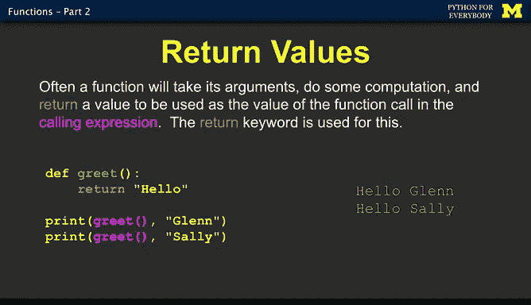
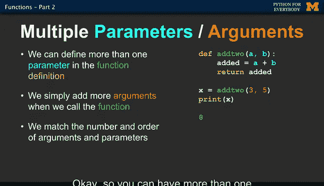

# 每个人的 Python 第一部分 24：构建函数第二部分 🧱➡️




在本节课中，我们将深入学习函数的另一个核心概念：**返回值**。我们将探讨函数如何通过 `return` 语句向外部世界传递信息，并理解参数与返回值如何协同工作。

***


## 理解返回值

上一节我们介绍了如何定义函数和传递参数。本节中我们来看看函数如何将计算结果“送回来”，这就是**返回值**。

当我们使用像 `float()` 或 `input()` 这样的语句时，我们会看到类似 `x = input("提示信息")` 的写法。这里，`input()` 函数执行后会有一个结果值被赋给变量 `x`。这个结果值就是函数的**返回值**。

作为函数的编写者，我们通过 `return` 语句来决定这个返回值是什么。

***

## `return` 语句的作用

`return` 语句主要做两件事：
1.  **立即结束函数的执行**。
2.  **确定函数的返回值**。

考虑以下简单函数：
```python
def greet():
    print("Hello")
    return "World"
```
当我们调用 `result = greet()` 时，会发生：
*   函数 `greet` 开始执行，打印出 “Hello”。
*   遇到 `return "World"`，函数**立即停止**。
*   字符串 `"World"` 作为返回值，被赋给变量 `result`。

因此，`print(result)` 会输出 `World`。

***

## 结合参数与返回值的示例

让我们看一个同时使用参数和返回值的更好例子。

```python
def greet(lang):
    if lang == 'es':
        return 'Hola'
    elif lang == 'fr':
        return 'Bonjour'
    else:
        return 'Hello'

print(greet('en'), 'Glen')
print(greet('es'), 'Sally')
print(greet('fr'), 'Michael')
```
以下是代码执行过程的分解：
1.  `greet('en')` 被调用，参数 `'en'` 传递给函数内部的变量 `lang`。
2.  函数执行，因为 `lang` 不是 `'es'` 或 `'fr'`，所以执行 `else` 分支。
3.  `return 'Hello'` 执行，函数结束，并将字符串 `'Hello'` 作为返回值送出。
4.  这个返回值 `'Hello'` 替换了原来的 `greet('en')`，所以 `print('Hello', 'Glen')` 被执行，输出 `Hello Glen`。
5.  同理，`greet('es')` 返回 `'Hola'`，最终输出 `Hola Sally`。
6.  `greet('fr')` 返回 `'Bonjour'`，最终输出 `Bonjour Michael`。

***

## 再看 `max` 函数

为了更深入理解 `return`，我们再次分析内置的 `max` 函数。

当我们写下 `big = max("hello world")` 时：
1.  首先计算等号右边：调用 `max("hello world")`。
2.  字符串 `"hello world"` 被传入 `max` 函数（我们无需关心其内部参数名）。
3.  `max` 函数内部执行一系列操作（例如，遍历字符，找到最大的 `'w'`）。
4.  在函数末尾，会执行一条类似 `return largest_char` 的语句（假设 `largest_char` 是 `'w'`）。
5.  `return` 语句将 `'w'` 作为返回值送出，并**立即结束** `max` 函数的执行。
6.  这个返回值 `'w'` 替换了原来的函数调用部分，最终被赋值给变量 `big`。

一开始你需要这样细致地理解每一步，但熟练之后，你会自然而然地使用它。

***

## 多个参数

函数当然可以接受多个参数。定义和调用时，参数的数量和顺序必须匹配。

```python
def addtwo(a, b):
    added = a + b
    return added

x = addtwo(3, 5)
```
以下是执行过程：
*   调用 `addtwo(3, 5)`，`3` 赋值给参数 `a`，`5` 赋值给参数 `b`。
*   函数内部计算 `added = 3 + 5`，得到 `8`。
*   执行 `return added`，将 `8` 作为返回值送出。
*   返回值 `8` 被赋给变量 `x`。

函数内部参数的名称（`a`, `b`）是局部的，对外部没有影响。

***

## 无返回值函数



并非所有函数都需要返回值。根据是否有返回值，函数可分为两类：
*   **无返回值函数**：执行一些操作（如打印、修改文件），但不通过 `return` 返回具体值。Python 中，它们默认返回 `None`。
*   **有返回值函数**：通过 `return` 语句返回一个值，如上文所有示例。

***

## 总结

本节课中我们一起学习了函数的核心机制——返回值。
*   我们了解了 `return` 语句的双重作用：**结束函数执行**和**指定返回值**。
*   我们通过示例，分析了参数如何传入函数，以及返回值如何从函数内部传递到调用处。
*   我们区分了有返回值函数和无返回值函数。


理解这些基础概念，能帮助你在未来需要封装代码逻辑时，知道如何构建和使用自己的函数。