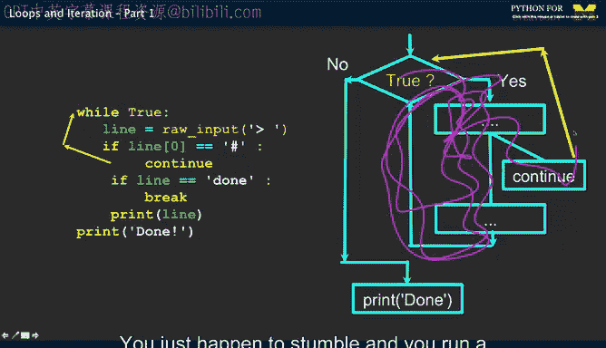

# 每个人的 Python 第一部分 26：循环与迭代 🔄


## 概述

在本节课中，我们将要学习编程中一个极其强大的概念：**循环与迭代**。循环允许计算机自动、重复地执行任务，这正是计算机发挥其真正威力和价值的地方。我们将从 `while` 循环开始，了解其工作原理，并学习如何使用 `break` 和 `continue` 语句来控制循环的流程。

## 循环的基本概念

循环的核心思想是：在代码的某个位置，程序可以**返回并再次执行**之前的代码块。在Python中，我们主要通过 `while` 和 `for` 这两个关键字来实现循环。本节课我们先重点介绍 `while` 循环，它属于**不定循环**。

## While循环：不定循环

`while` 是一个关键字，其结构类似于 `if` 语句。它后面跟着一个条件判断，该判断会产生一个 `True` 或 `False` 的答案。

```python
while n > 0:
    print(n)
    n = n - 1
print('Blastoff!')
```

如果条件为 `True`，则执行其下方缩进的代码块；如果为 `False`，则跳过该代码块。在这一点上，`while` 和 `if` 是相同的。但关键区别在于：当 `while` 的代码块执行完毕后，程序会**返回**到 `while` 语句的开头，**重新检查**条件。

### While循环的执行流程

以上述代码为例，假设初始 `n = 5`：
1.  检查 `n > 0`，结果为 `True`，进入循环。
2.  打印 `5`，然后执行 `n = n - 1`，`n` 变为 `4`。
3.  返回 `while` 开头，重新检查 `n > 0`（`4 > 0` 为 `True`）。
4.  打印 `4`，`n` 变为 `3`。
5.  重复此过程，依次打印 `3`， `2`， `1`。
6.  当 `n` 变为 `0` 后，再次检查条件 `n > 0`（`0 > 0` 为 `False`）。
7.  条件为 `False`，循环结束，程序跳转到 `while` 循环块之后的代码，打印 `‘Blastoff!’`。

循环结束后，变量 `n` 的值为 `0`，这是循环最后一次迭代后留下的“残余值”。

## 迭代变量与无限循环

任何循环都有一个关键部分，称为**迭代变量**。它是一个在循环过程中会发生变化的值。如果循环中没有任何东西改变，导致条件永远无法变为 `False`，就会陷入**无限循环**。

```python
# 每个人的 Python 第一部分 这是一个无限循环的示例
n = 5
while n > 0:
    print(‘Lather’)
    print(‘Rinse’)
print(‘Dry off!’)
```

在这个例子中，`n` 的值从未改变，`n > 0` 这个条件永远为 `True`，因此循环会永不停止地打印 “Lather” 和 “Rinse”。这就像洗发水说明上的“涂抹，冲洗，重复”，在计算机科学家看来，这是一个无限循环的指令。

无限循环会导致计算机“卡死”，通常表现为系统响应缓慢或出现等待图标（如旋转的沙滩球）。因此，在编写循环时，必须确保存在让循环条件最终变为 `False` 的机制。

## 零次循环

`while` 循环也可能一次都不执行。如果一开始条件就为 `False`，那么循环体将完全被跳过。

```python
n = 0
while n > 0:
    print(‘This will never print.’)
```

这时的 `while` 循环功能上就像一个永远不会执行的 `if` 语句。

## 使用 Break 语句跳出循环

有时我们需要在循环中间根据特定条件提前退出。这时可以使用 `break` 语句。

```python
while True:
    line = input(‘> ‘)
    if line == ‘done’:
        break
    print(line)
print(‘Done!’)
```

`break` 是一个可执行语句。当它运行时，会**立即终止当前所在的循环**，并跳转到循环体之后的代码行继续执行。

在上面的例子中，我们故意创建了一个条件永远为 `True` 的无限循环 `while True:`。但在循环内部，我们检查用户输入。如果输入是 `‘done’`，则执行 `break`，循环立刻终止，程序接着打印 `‘Done!’`。`break` 就像循环体内的一个“紧急出口”或“传送器”，可以无视循环内剩余的代码，直接跳出循环块。

## 使用 Continue 语句跳过当前迭代

与 `break` 彻底跳出循环不同，`continue` 语句用于**跳过当前迭代中剩余的代码**，并**直接开始下一次迭代**。

```python
while True:
    line = input(‘> ‘)
    if line[0] == ‘#’:
        continue
    if line == ‘done’:
        break
    print(line)
print(‘Done!’)
```

在这个改进的例子中：
*   如果输入行的第一个字符是 `#`，则执行 `continue`。程序会跳过本循环中后面的 `print(line)` 语句，直接回到 `while` 循环的开头，等待下一次输入。
*   如果输入是 `‘done’`，则执行 `break`，彻底结束循环。
*   其他情况则正常打印输入行。

简单来说：
*   **`break`**：跳出整个循环。
*   **`continue`**：结束本次迭代，进入下一次迭代。



## 总结

本节课我们一起学习了 `while` 循环，这是一种强大的**不定循环**工具。我们了解了它的基本结构、执行流程，以及**迭代变量**对于防止**无限循环**的重要性。此外，我们还掌握了两个控制循环流程的关键语句：用于提前退出循环的 `break`，和用于跳过当前迭代的 `continue`。

`while` 循环非常灵活，但它依赖于我们精心设计逻辑条件来确保循环最终能够终止。在接下来的课程中，我们将转向另一种循环——使用 `for` 关键字的**定循环**，它通常能让我们更清晰、更安全地处理已知次数的迭代任务。