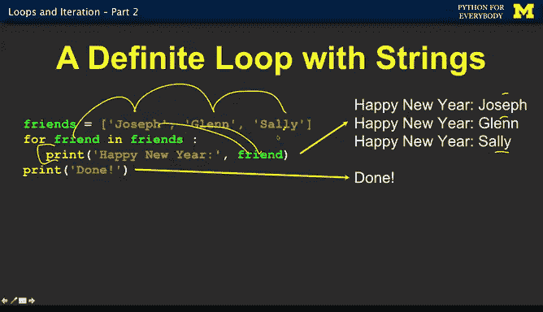
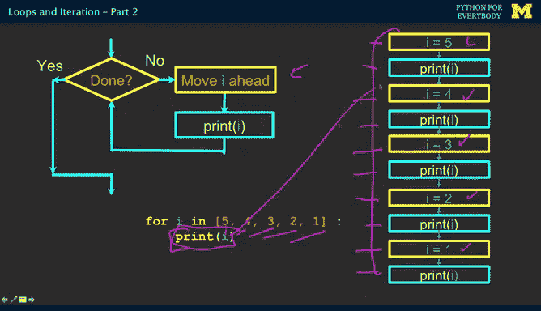

# 1：《编程入门指南（使用Python进行开发）》｜P27：确定循环 🔄


## 概述

在本节课中，我们将要学习Python中的**确定循环**。我们将了解它与之前学过的**不确定循环**有何不同，学习其基本语法，并通过示例理解它是如何工作的。

## 从不确定循环到确定循环

上一节我们介绍了使用 `while` 关键字的不确定循环，它会在某个逻辑条件为假或遇到 `break` 语句时停止。

确定循环是**有限**的。它们会遍历一个集合中的所有元素，例如文件中的所有行、列表中的所有项目或字符串中的所有字符。对于这种循环，我们使用 `for` 结构。它更可预测，也更容易验证，因为我们明确知道要遍历的集合。

## `for` 循环的基本语法

以下是 `for` 循环的一个简单例子。

```python
for i in [5, 4, 3, 2, 1]:
    print(i)
print('Blastoff!')
```

`for` 是用于确定循环的关键字。在 `for` 循环中，我们首先看到的是**迭代变量**，它是语法的一部分。在上面的例子中，迭代变量是 `i`，你可以选择任何你喜欢的变量名，但 `i` 是常见的迭代变量名。

`in` 是另一个Python保留字，后面跟着一个集合。在这个例子中，集合是一个包含五个整数的列表：`[5, 4, 3, 2, 1]`。

这个 `for` 语句的意思是：执行缩进的代码块五次。第一次循环时，`i` 的值是 `5`；第二次是 `4`；第三次是 `3`；第四次是 `2`；第五次是 `1`。执行完五次后，循环结束，程序继续执行 `print('Blastoff!')`。

Python为我们处理了所有细节。我们不需要设置停止循环的逻辑条件，这非常方便。

## 遍历字符串列表

循环的集合不一定是数字列表，也可以是字符串列表。



```python
friends = ['Joseph', 'Glenn', 'Sally']
for friend in friends:
    print('Happy New Year:', friend)
```


这里，`friends` 是一个包含三个字符串的列表。`friend` 是迭代变量，它将依次遍历列表中的每个字符串。

这意味着循环将运行三次：
*   第一次，`friend` 是 `'Joseph'`。
*   第二次，`friend` 是 `'Glenn'`。
*   第三次，`friend` 是 `'Sally'`。

因此，程序会依次打印出三条祝福信息。

## `for` 循环的工作原理

你可以将 `for` 语句看作一个复杂的指令。它负责判断何时继续循环、何时结束，并自动将迭代变量设置为集合中的下一个值。

以下是 `for` 循环执行过程的简化描述：
1.  检查集合中是否还有元素？如果没有，循环结束。
2.  将迭代变量 `i` 设置为集合中的下一个值。
3.  执行循环体内的代码（例如 `print(i)`）。
4.  返回步骤1。

所有这些逻辑（图中黄色部分）都由 `for` 语句为你构建。你只需告诉它要遍历什么集合以及要对每个元素做什么，它就会自动生成相应的代码。



当然，你也可以用 `while` 循环和递增/递减的索引变量来实现同样的功能，但 `for` 循环让这一切变得更简单。

## 总结

本节课中我们一起学习了：
*   **确定循环** (`for` 循环) 用于遍历一个**有限集合**中的所有元素。
*   其基本语法是：`for <迭代变量> in <集合>:`，后面跟着缩进的循环体。
*   `for` 循环会自动管理迭代过程，包括设置迭代变量的值和判断循环结束条件。
*   它可以遍历列表、文件中的行、字符串中的字符等任何集合。

确定循环是处理序列化数据的强大工具。接下来，我们将探讨**循环的惯用法**，学习如何使用循环来完成寻找最大值、最小值或检查某个值是否存在等常见任务。