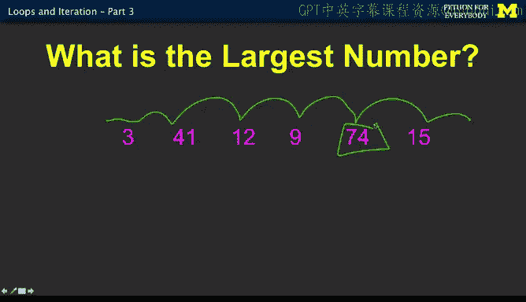

# 每个人的 Python 第一部分 28：28_07_03_查找最大值 🧮


在本节课中，我们将要学习如何利用循环来解决一个常见问题：在一系列数字中查找最大值。我们将理解循环背后的逻辑模式，并学习如何通过逐步迭代来累积答案。

## 循环的目标与模式

上一节我们介绍了循环的基本工作机制。本节中我们来看看循环通常用来解决什么问题。我们可能想在一组数据中寻找最大值、检查某个值（如42）是否存在、或者寻找最大的字母（类似于 `max` 函数）。循环的核心思想是：遍历集合中的每一个值，对它们执行某些操作，最终得出一个结果。

我们将采用一种通用模式来编写循环。在接下来的两个小节中，我会使用完全相同的 `for` 循环结构，但循环内部的操作会不同。这个模式是：
1.  在循环开始前，设置一些变量的初始值。
2.  在循环体中，对列表中的每一个值执行操作。
3.  循环结束时，我们就能得到最终结果（如最大值、最小值、平均值等）。

在循环运行过程中，我们并不知道最终答案。我们的目标是，当循环最终完成时，我们得到了某些结果。迭代过程让我们逐步接近答案，但并非瞬间知晓。我们需要通过设置初始状态，然后反复检查来构建答案，最终在循环底部得出确定的结果。

## 一个简单的循环示例

以下是我们要反复使用的一个基础循环。我们将遍历这些数字：`9, 41, 12, 3, 74, 15`。目前，我们只是在循环中打印出每个值，以便观察循环是如何工作的。

```python
for itervar in [9, 41, 12, 3, 74, 15]:
    print(itervar)
```

## 人类与计算机的解题思路



现在，我们来看一个具体问题。假设我给你一系列数字（可能是一百万个，也可能是六个），你需要告诉我其中最大的数字是什么。如果让你作为一个人类来解决这个问题，当数字一个接一个快速闪过时，你的大脑会如何工作？

请看这些数字：`3, 41, 12, 9, 74, 15`。你找到最大值了吗？最大值是74。但更有趣的是，你的大脑是如何解决这个问题的？如果你的任务是处理一百万个数字，你会采用什么精确的技巧？

作为人类，我们可能一眼就“看到”了74。但计算机不会这样看问题。计算机必须按顺序逐个查看：`3, 41, 12, 9, 74, 15`，并在最后才得出结论：74是最大的。因此，当我们构建循环时，必须理解计算机是如何顺序地、而非“神奇地”处理这类问题的。

## 查找最大值的算法思路

你大脑中使用的方法，很可能是在心里维护一个“目前所见最大值”的变量。具体步骤如下：
1.  开始时，我们还没看到任何数字。可以先将“目前所见最大值”设为一个非常小的数，比如 `-1`。
2.  看到第一个数字 `3`。这是目前看到的唯一数字，所以“目前所见最大值”更新为 `3`。
3.  看到第二个数字 `41`。`41` 比 `3` 大，所以“目前所见最大值”更新为 `41`。
4.  看到第三个数字 `12`。`12` 比 `41` 小，所以“目前所见最大值”保持为 `41`。
5.  看到第四个数字 `9`。`9` 比 `41` 小，所以“目前所见最大值”保持为 `41`。
6.  看到第五个数字 `74`。`74` 比 `41` 大，所以“目前所见最大值”更新为 `74`。
7.  看到第六个数字 `15`。`15` 比 `74` 小，所以“目前所见最大值”保持为 `74`。
8.  所有数字处理完毕。此时，“目前所见最大值” `74` 就是整个序列的最大值。

关键在于，循环结束时，我们记录的“目前所见最大值”就变成了“全局最大值”，因为我们不会再看到新的数字了。这就是在Python中构建此类循环的逻辑。

## 用Python代码实现

以下是用Python代码实现上述逻辑的示例：

```python
largest_so_far = -1  # 步骤1：循环开始前，初始化变量
print('Before', largest_so_far)

for the_num in [9, 41, 12, 3, 74, 15]:  # 步骤2：遍历每个值
    if the_num > largest_so_far:         # 检查当前值是否大于已知最大值
        largest_so_far = the_num         # 如果是，则更新最大值
    print('Loop:', the_num, largest_so_far) # 打印当前状态

print('After', largest_so_far)           # 步骤3：循环结束后，得到最终结果
```

代码执行过程如下：
1.  **循环前**：`largest_so_far` 初始化为 `-1`。
2.  **循环中**：
    *   第一次迭代 (`the_num = 9`)：`9 > -1` 为真，`largest_so_far` 更新为 `9`。
    *   第二次迭代 (`the_num = 41`)：`41 > 9` 为真，`largest_so_far` 更新为 `41`。
    *   第三次迭代 (`the_num = 12`)：`12 > 41` 为假，`largest_so_far` 保持 `41`。
    *   第四次迭代 (`the_num = 3`)：`3 > 41` 为假，`largest_so_far` 保持 `41`。
    *   第五次迭代 (`the_num = 74`)：`74 > 41` 为真，`largest_so_far` 更新为 `74`。
    *   第六次迭代 (`the_num = 15`)：`15 > 74` 为假，`largest_so_far` 保持 `74`。
3.  **循环后**：输出 `largest_so_far` 的最终值 `74`，这就是列表中的最大值。

这个模式非常强大：我们在循环前进行设置，在循环中处理每个值，最后在循环结束时获得我们最初寻找的结果。


## 总结


本节课中我们一起学习了如何利用循环模式查找一系列数字中的最大值。我们理解了计算机需要顺序处理数据的特性，并掌握了“目前所见最大值”这一核心算法思想。通过初始化变量、在循环中比较并更新、最终输出结果这三个步骤，我们可以解决这类“在迭代中累积答案”的问题。接下来，我们将探讨更多类似的循环模式，例如如何查找最小值、计数、求和以及计算平均值等。