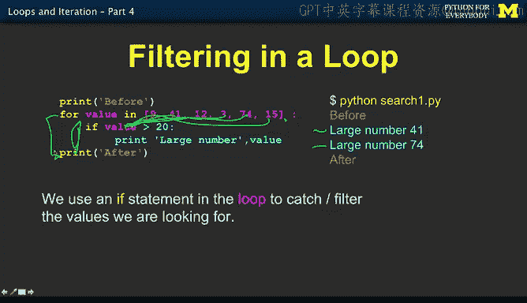
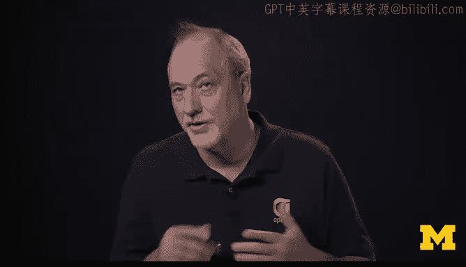
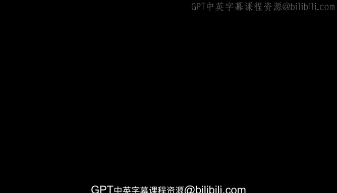

# 每个人的 Python 第一部分 29：循环惯用法 🔄


在本节课中，我们将学习几种在循环中常用的编程模式，这些模式被称为“循环惯用法”。我们将学习如何计数、求和、计算平均值、筛选数据以及搜索特定值。掌握这些模式是编写高效、清晰代码的关键。

上一节我们介绍了循环的基本概念，本节中我们来看看几种在循环中处理数据的常见模式。

## 计数模式 🧮

计数模式用于统计循环执行的次数或列表中元素的数量。其核心思想是初始化一个计数器变量，然后在每次循环迭代中将其递增。

以下是实现计数的步骤：

1.  在循环开始前，将计数器变量（例如 `count`）初始化为 `0`。
2.  在循环体内，每次迭代将计数器加 `1`。
3.  循环结束后，计数器的值就是总次数。

```python
zork = 0  # 初始化计数器
for thing in [9, 41, 12, 3, 74, 15]:
    zork = zork + 1  # 递增计数器
    print(thing, zork)
print('Loop is all done. There were', zork, 'things.')
```

## 求和模式 ➕

求和模式用于计算一系列数值的总和。其思路与计数类似，但每次增加的是当前迭代的值，而不是固定的 `1`。

以下是实现求和的步骤：

1.  在循环开始前，将总和变量（例如 `total`）初始化为 `0`。
2.  在循环体内，将当前迭代的值加到总和变量上。
3.  循环结束后，总和变量的值就是所有数值的总和。

```python
zork = 0  # 初始化总和
for thing in [9, 41, 12, 3, 74, 15]:
    zork = zork + thing  # 将当前值加到总和上
    print(thing, zork)
print('Total is', zork)
```

## 计算平均值 📊

计算平均值结合了计数和求和两种模式。我们需要同时跟踪元素的数量和它们的总和，然后在循环结束后进行计算。

以下是计算平均值的步骤：

1.  在循环开始前，初始化计数器 `count` 和总和 `sum` 为 `0`。
2.  在循环体内，每次迭代将计数器加 `1`，并将当前值加到总和上。
3.  循环结束后，用总和除以计数器的值得到平均值。

```python
count = 0
sum = 0
print('Before', count, sum)
for value in [9, 41, 12, 3, 74, 15]:
    count = count + 1
    sum = sum + value
    print(count, sum, value)
print('After', count, sum, sum / count)
```

## 筛选模式 🔍



筛选模式用于在循环中根据特定条件选择元素。我们使用 `if` 语句在循环体内进行条件判断。



以下是实现筛选的步骤：

1.  在循环中遍历每个元素。
2.  使用 `if` 语句检查当前元素是否满足条件。
3.  如果满足条件，则执行相应的操作（例如打印该值）。

```python
for value in [9, 41, 12, 3, 74, 15]:
    if value > 20:
        print('Large number', value)
```

## 搜索模式（使用布尔标志） 🎯

搜索模式用于判断列表中是否存在某个特定值。我们使用一个布尔变量（称为“标志”）来记录是否找到了目标值。

以下是使用布尔标志进行搜索的步骤：

1.  在循环开始前，将标志变量（例如 `found`）初始化为 `False`。
2.  在循环体内，检查当前元素是否等于目标值。
3.  如果找到目标值，将标志变量设置为 `True`。
4.  循环结束后，检查标志变量的值即可知道是否找到。

```python
found = False
print('Before', found)
for value in [9, 41, 12, 3, 74, 15]:
    if value == 3:
        found = True
    print(found, value)
print('After', found)
```



本节课中我们一起学习了五种核心的循环惯用法：计数、求和、计算平均值、筛选和搜索。这些模式是构建更复杂程序的基础模块。通过组合这些模式，你可以高效地处理和分析数据列表。记住，熟练运用这些惯用法能让你的代码更加简洁和强大。