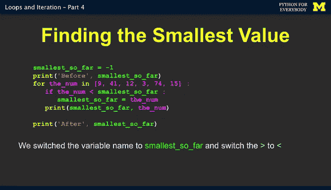

# 密歇根大学《给所有人的Python课》课程1：《编程入门指南（使用Python进行开发）》｜P30：查找最小值 🔍


在本节课中，我们将要学习如何在一个数字列表中查找最小值。我们将回顾之前查找最大值的方法，分析其局限性，并引入一个更健壮、通用的解决方案。

## 回顾查找最大值的方法

上一节我们介绍了如何查找列表中的最大值。其核心思路是初始化一个变量（如 `largest_so_far`）为一个非常小的数（例如 `-1`），然后遍历列表。如果遇到比当前 `largest_so_far` 更大的数，就更新这个变量。




以下是查找最大值的代码逻辑示例：
```python
largest_so_far = -1
for value in [9, 41, 12, 3, 74, 15]:
    if value > largest_so_far:
        largest_so_far = value
print('Largest is', largest_so_far)
```
程序会依次比较：`9 > -1`（更新为9），`41 > 9`（更新为41），`12 > 41`（不更新），`3 > 41`（不更新），`74 > 41`（更新为74），`15 > 74`（不更新）。最终输出最大值 `74`。

## 从最大值到最小值的初步尝试

本节中我们来看看如何修改上述代码来查找最小值。一个直观的想法是将变量名从 `largest` 改为 `smallest`，并将比较运算符从 `>` 改为 `<`。

以下是初步修改后的代码：
```python
smallest_so_far = -1
for value in [9, 41, 12, 3, 74, 15]:
    if value < smallest_so_far:
        smallest_so_far = value
print('Smallest is', smallest_so_far)
```
然而，这个程序会输出 `-1`，而不是列表中的最小值 `3`。这是因为初始值 `-1` 本身比列表中所有正数都小，导致 `if` 条件 `value < -1` 永远为假，`smallest_so_far` 的值从未被更新。

这个错误揭示了原查找最大值代码的一个隐藏缺陷：它假设列表中的所有数字都是正数。如果列表中存在负数，或者我们想查找最小值，这种用固定数字（如 `-1` 或 `100`）初始化的方法就会失效。

## 引入 `None` 类型作为标志值

为了解决上述问题，我们需要一个能表示“尚未看到任何数字”的初始值。Python 提供了一个特殊的类型 `NoneType`，它只有一个值 `None`。我们可以将 `None` 视为“值的缺失”。

以下是使用 `None` 初始化查找最小值变量的正确方法：
```python
smallest = None
print('Before:', smallest)
for value in [9, 41, 12, 3, 74, 15]:
    if smallest is None:
        smallest = value
    elif value < smallest:
        smallest = value
    print('Loop:', value, smallest)
print('Smallest:', smallest)
```
程序执行流程如下：
1.  `smallest` 初始化为 `None`。
2.  进入循环，第一个值是 `9`。因为 `smallest is None` 为真，所以将 `smallest` 设为 `9`。
3.  后续迭代中，`smallest is None` 为假（因为 `smallest` 现在是一个数字），程序执行 `elif` 分支，只有当 `value` 小于当前 `smallest` 时才更新它。
4.  遍历完成后，`smallest` 中存储的就是列表中的最小值 `3`。

这种方法同样适用于查找最大值，只需将比较运算符 `<` 改为 `>` 即可。它不依赖于对数据范围的任何假设，因此更加通用和健壮。

## 理解 `is` 与 `is not` 运算符

在代码中，我们使用了 `is` 运算符来检查变量是否为 `None`。`is` 和 `is not` 是 Python 中的身份比较运算符。

以下是关于它们的重要说明：
*   `is` 用于检查两个变量是否引用内存中的**同一个对象**，而 `==` 用于检查两个变量的**值是否相等**。
*   对于 `None`、`True`、`False` 这类单例对象，应该使用 `is` 或 `is not` 进行比较。
*   通常情况下，对于数字、字符串等值的比较，应使用 `==` 或 `!=`。过度使用 `is` 可能导致非预期的结果。

示例：
```python
# 正确：检查变量是否为 None
if smallest is None:
    ...

# 正确：检查变量是否不是 None
if smallest is not None:
    ...

# 通常对于值比较，使用 ==
if value == 10:
    ...
```

## 本章循环模式总结

本节课中我们一起学习了查找最小值的算法，并引入了 `None` 作为标志值。这延续了我们在本章中探讨的各种循环模式。

以下是本章涵盖的核心循环模式列表：
*   **确定循环**：使用 `for` 循环遍历已知序列（如列表）。
*   **不确定循环**：使用 `while` 循环在条件满足时重复执行。
*   **循环控制**：使用 `break` 语句立即退出循环；使用 `continue` 语句跳过当前迭代，进入下一次。
*   **迭代变量**：在 `for` 循环中自动管理；在 `while` 循环中需要手动初始化、测试和更新。
*   **循环惯用法**：包括在循环开始前初始化变量（如 `smallest = None`），在循环中进行比较和计算，最后输出结果。

查找最小值的代码是“循环惯用法”的一个典型例子：我们在循环开始前进行设置（初始化），在循环中处理每个元素（比较并可能更新），最后享受成果（打印出找到的最小值）。


通过本节课，你掌握了如何编写健壮的代码来查找序列中的极值，这是数据处理和算法中的一项基础且重要的技能。