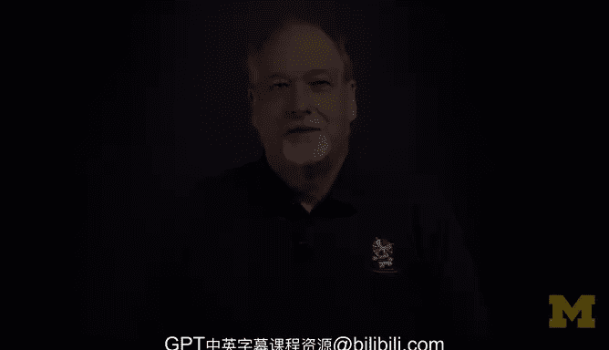

# 密歇根大学《给所有人的Python课》课程1：《编程入门指南（使用Python进行开发）》｜P32：下一步是什么？🚀




在本节课中，我们将回顾已学内容，并展望后续课程的核心主题。我们将理解“控制流”与“数据结构”这两个编程基本概念的关系，以及为何需要继续学习。

---


恭喜你，你已经完成了一半的旅程。我不得不将这门课程分为两部分。

主要原因是，如果我将这门课程设置为14或15周的长度，你可能会中途退出并感到沮丧。因此，我们在课程中间设置了这个节点。

如果你需要休息一下，完全可以。这就像在电子游戏中，你通过了一个检查点，之后遇到问题时可以回到这个点。现在就是这样一个检查点。所以，如果你在后续学习中遇到问题，不必从头再来。

---

## 回顾：我们已经学习了什么？📚

到目前为止，我们学习的内容被称为 **控制流**。

程序执行一个操作，然后执行下一个操作，接着可能遇到一个 `if` 语句，再进入一个小循环反复执行，之后又执行其他操作，读取一些数据并进行处理。

整个过程是一个**序列**。它一步步地决定程序接下来要做什么，再下一步做什么。我们教授了诸如赋值语句、`if` 语句和 `for` 循环等内容。这本质上是我们学习 Python 如何**导航**你的程序，并按照你设定的步骤执行。

**控制流**可以用一个简单的顺序结构表示：
```python
# 示例：一个简单的控制流
x = 10
if x > 5:
    for i in range(3):
        print(i)
```

---

## 展望：接下来要学习什么？🔮

但控制流只是编程的一半。接下来你将学习关于**变量**的更深层知识。

你可以将数字4存入一个变量，加上2，它就变成了6。然而，变量的能力远不止于此。在计算机科学中，我们称之为 **数据结构**。

在你的程序中，这一点可能并不明显，但事实是：我们通过巧妙设计数据结构来解决问题，往往比设计复杂的控制流要容易得多。

控制流相对直观，而数据结构则更为精妙。通过构建巧妙的数据结构，你的控制流会得到简化。当然，你现在可能还没有实践过，这正是数据结构如此重要的原因。

所以，你不应该现在就停止。你只完成了一半。当然，如果你需要短暂休息，可以暂停一下，但请务必回来完成下一部分。

---

## 编程的两大支柱 🏗️

下一门课程将专注于**数据结构**。**算法（控制流）** 和 **数据结构** 共同构成了编程的全貌。

希望能在下一门课程中见到你。

---

本节课中，我们一起回顾了“控制流”的概念，并引出了编程的另一半核心——“数据结构”。理解这两者的结合，是掌握完整编程技能的关键。