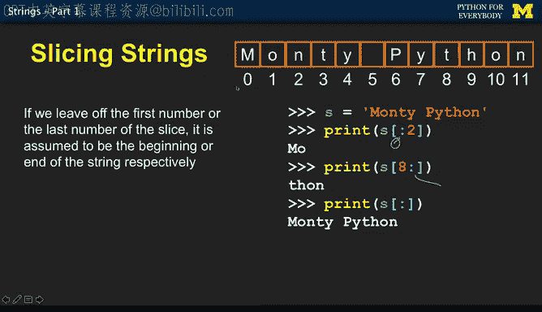

# 每个人的 Python 第二部分 2：字符串操作入门 🧵


在本节课中，我们将要学习Python中字符串的基本操作。字符串是编程中最常用的数据类型之一，从打印“Hello World”开始，我们就一直在使用它。本节课将详细介绍如何访问字符串中的字符、计算字符串长度、遍历字符串以及使用切片截取部分字符串。掌握这些操作是后续处理文本数据的基础。

---

## 字符串基础回顾

从第一行代码开始，我们就一直在使用字符串。例如，打印“Hello World”就涉及字符串。我们使用单引号或双引号来创建字符串，并使用加号进行拼接。

**代码示例：**
```python
print("Hello" + "World")  # 输出：HelloWorld
```

需要注意的是，使用加号拼接字符串时不会自动添加空格。如果尝试将字符串与数字直接相加，会导致类型错误。

**代码示例：**
```python
print("123" + 1)  # 报错：TypeError
```

为了解决这个问题，我们可以使用`int()`函数将字符串转换为整数，然后再进行运算。

**代码示例：**
```python
print(int("123") + 1)  # 输出：124
```

此外，`input()`函数总是返回字符串类型的数据，即使输入的是数字。因此，在需要进行数学运算前，通常需要将其转换为整数或浮点数。

**代码示例：**
```python
num_str = input("请输入一个数字：")  # 假设输入100
print(int(num_str) - 10)  # 输出：90
```

---

## 字符串索引

字符串由多个字符组成，我们可以通过索引访问其中的单个字符。索引从0开始，即第一个字符的索引是0。

**公式：**
`字符串变量[索引位置]`

例如，字符串`"banana"`有6个字符，索引从0到5。

**代码示例：**
```python
fruit = "banana"
letter = fruit[1]  # 获取索引为1的字符，即 'a'
print(letter)  # 输出：a
```

索引位置可以是变量或表达式。

**代码示例：**
```python
x = 3
print(fruit[x - 1])  # 输出：n
```

如果尝试访问超出字符串长度的索引，Python会抛出`IndexError`。

**代码示例：**
```python
print(fruit[10])  # 报错：IndexError
```

---

## 获取字符串长度

我们可以使用`len()`函数获取字符串的长度，即包含的字符数。

**代码示例：**
```python
fruit = "banana"
length = len(fruit)  # 长度为6
print(length)  # 输出：6
```

`len()`是一个内置函数，它接收一个字符串作为参数，并返回其长度值。

---

## 遍历字符串

有时我们需要逐个处理字符串中的每个字符，这时就需要遍历字符串。

### 使用while循环遍历

我们可以使用`while`循环和索引来遍历字符串。以下是具体步骤：

1.  初始化一个索引变量（通常从0开始）。
2.  在循环条件中检查索引是否小于字符串长度。
3.  在循环体内访问当前索引位置的字符。
4.  每次循环后递增索引。

**代码示例：**
```python
fruit = "banana"
index = 0
while index < len(fruit):
    letter = fruit[index]
    print(index, letter)
    index = index + 1
```

这段代码会依次输出每个字符及其索引。

### 使用for循环遍历

Python提供了更简洁的`for`循环来遍历字符串。`for`循环会自动处理迭代过程，无需手动管理索引。

**代码示例：**
```python
fruit = "banana"
for letter in fruit:
    print(letter)
```

这段代码同样会输出字符串中的每个字符，但写法更加简洁明了。`for`循环是遍历序列（如字符串、列表）的首选方法，因为它更易于编写和理解。

---

## 字符串切片

除了访问单个字符，我们还可以使用切片操作获取字符串的一部分。切片使用冒号分隔起始和结束索引。

**公式：**
`字符串变量[起始索引:结束索引]`

切片包含起始索引的字符，但不包含结束索引的字符（即“前闭后开”）。

**代码示例：**
```python
s = "Monty Python"
print(s[0:4])   # 输出：Mont
print(s[6:7])   # 输出：P
print(s[6:20])  # 输出：Python
```

如果省略起始索引，则默认从字符串开头开始；如果省略结束索引，则默认切片到字符串末尾。

**代码示例：**
```python
print(s[:2])    # 输出：Mo
print(s[8:])    # 输出：thon
print(s[:])     # 输出：Monty Python
```

---

## 总结



本节课中我们一起学习了Python字符串的核心操作。我们回顾了字符串的基础知识，学习了如何使用索引访问字符、如何获取字符串长度。我们比较了使用`while`循环和`for`循环遍历字符串的方法，并认识到`for`循环通常更加简洁高效。最后，我们介绍了字符串切片，这是一种快速获取子串的强大工具。掌握这些操作是处理文本数据和进行更复杂字符串分析的第一步。在接下来的课程中，我们将利用这些知识来实际解析和处理文件中的数据。