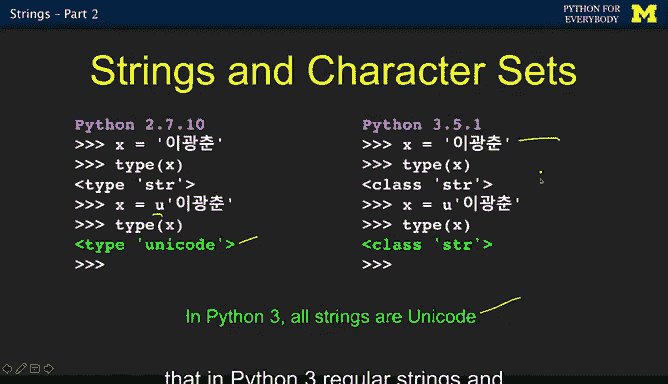

# 课程2：《Python数据结构》｜ 第3课：字符串操作 🧵


在本节课中，我们将学习如何操作字符串。字符串处理是编程中的一项核心任务，与数字处理同等重要。我们将探索连接、搜索、比较以及使用字符串库中的各种方法。

---

## 字符串连接

上一节我们介绍了字符串的基本概念，本节中我们来看看如何将字符串连接在一起。

使用加号 `+` 可以连接字符串。这个操作会严格地将两个字符串拼接在一起，中间不会自动添加空格。

```python
x = "Hello"
y = "World"
print(x + y)  # 输出：HelloWorld
```

如果你想在连接时加入空格，必须显式地将空格作为一个字符串加入。

```python
print(x + " " + y)  # 输出：Hello World
```

字符串连接就是简单地将字符串首尾相接。如果自动添加空格，反而需要另一种操作来抑制这种行为。因此，Python只提供一种连接方式，需要空格时由程序员自行添加。

---

## `in` 操作符

除了在 `for` 循环中使用，`in` 也可以作为逻辑运算符。它的表达式略有不同，用于提出一个“是否包含”的问题，类似于 `==` 或 `!=`。

以下是 `in` 操作符的使用方法：

*   我们创建一个变量 `fruit`，然后提问：字符串 `'n'` 是否在 `fruit` 中？答案是肯定的，因此返回 `True`。
*   提问：`'m'` 是否在 `fruit` 中？答案是否定的，因此返回 `False`。
*   `in` 操作符不仅可以查找单个字符，还可以查找子字符串。提问：`'nan'` 是否在 `fruit` 中？答案是肯定的，返回 `True`。

`in` 操作符很智能，它可以扫描整个字符串并判断目标是否存在。我们通常将其用在 `if` 语句中。

```python
fruit = "banana"
if 'a' in fruit:
    print("Found it!")
```

**注意**：在交互式解释器中输入多行代码块（如 `if` 语句）后，需要输入一个空行来告诉解释器代码块已结束。在脚本文件中则不需要这样做。

---

## 字符串比较

你可以比较字符串。`==` 操作符会逐个字符进行比较。

`<` 和 `>` 的比较规则取决于计算机的字符集和Python的配置。通常，所有大写字母排在所有小写字母之前（例如，`'Z' < 'a'`）。

这种排序是内部一致的。例如，`'Chuck'` 和 `'Glen'` 会按字母顺序正确排序，因为 `'C'` 在 `'G'` 之前。但 `'Chuck'` 和 `'glen'` 的排序可能不符合直觉，因为大写 `'C'` 排在小写 `'g'` 之前。不过，`==` 操作符总能正常工作。

---

## 字符串库与方法

以上是字符串的基本操作。字符串还拥有一个功能丰富的“库”，这源于字符串是“对象”这一概念。

简单来说，对象是一种内置了特定功能的变量。当你创建一个字符串变量（如 `greet`）时，Python知道它是一个字符串对象。字符串对象拥有许多整数或文件类型所没有的“方法”。

调用方法的语法是：`变量名.方法名()`。例如，`greet.lower()` 会调用字符串 `greet` 的 `lower` 方法。

```python
greet = "Hello Bob"
zap = greet.lower()
print(zap)   # 输出：hello bob
print(greet) # 输出：Hello Bob (原字符串未改变)
```

`lower()` 方法会创建并返回一个全部转为小写字母的字符串副本，而不会修改原始字符串。即使是字符串常量也拥有这些方法。

你可以使用 `dir()` 函数查看字符串对象的所有可用方法。虽然 `dir()` 的文档不详细，但Python有完善的在线文档说明每个方法的参数和用途。

---

## 常用字符串方法

了解了方法的基本概念后，我们来看看一些最常用的字符串方法。

### `find()` 方法

`find()` 方法与 `in` 操作符类似，但它不返回 `True/False`，而是返回子字符串首次出现的位置索引。

```python
fruit = "banana"
pos = fruit.find('na')
print(pos) # 输出：2
```

如果未找到子字符串，`find()` 会返回 `-1`。

### `upper()` 和 `lower()` 方法

我们已见过 `lower()`。`upper()` 方法则返回一个全部转为大写字母的字符串副本。这两个方法常用于忽略大小写的比较。

```python
if string1.lower() == string2.lower():
    print("They match, ignoring case.")
```

### `replace()` 方法

`replace(old, new)` 方法用于搜索并替换字符串中的内容。

```python
greet = "Hello Bob"
nstr = greet.replace('Bob', 'Jane')
print(nstr) # 输出：Hello Jane

nstr = greet.replace('o', 'X')
print(nstr) # 输出：HellX BXb
```

它会找到所有匹配项并进行替换，同样返回副本而不修改原字符串。

### 处理空白字符

“空白字符”包括空格、换行符、制表符等不可见的字符。`strip()` 方法用于移除字符串开头和结尾的空白字符。

```python
greet = "   Hello Bob  "
print(greet.strip()) # 输出："Hello Bob"
```

还有 `lstrip()`（移除左侧空白）和 `rstrip()`（移除右侧空白）方法。使用这些库方法比自己编写循环来移除空白要方便得多。

### `startswith()` 方法

这是一个常见需求：扫描文件时，只处理以特定前缀开头的行。`startswith(prefix)` 方法正是为此而生。

```python
line = "Please have a nice day"
print(line.startswith('Please')) # 输出：True
print(line.startswith('p'))      # 输出：False
```

我们通常在 `if` 语句中使用它来筛选行。

---

## 综合应用：查找与切片

现在，让我们把 `find()` 和切片操作结合起来解决一个实际问题。切片是指使用冒号 `:` 操作符来截取字符串的一部分。

假设我们有一个电子邮件头字符串：
`data = 'From stephen.marquard@uct.ac.za Sat Jan 5 09:14:16 2008'`

我们想提取域名 `'uct.ac.za'`，即 `@` 符号之后、下一个空格之前的部分。

以下是实现步骤：

1.  **查找起始位置**：使用 `find()` 定位 `@` 符号的位置。
    ```python
    atpos = data.find('@')
    print(atpos) # 输出：21
    ```
2.  **查找结束位置**：从 `@` 符号之后开始，查找下一个空格的位置。`find()` 方法可以接受第二个参数，指定开始搜索的位置。
    ```python
    sppos = data.find(' ', atpos)
    print(sppos) # 输出：31
    ```
3.  **执行切片**：使用切片操作 `[start:end]` 提取子字符串。注意，切片包含起始索引，但不包含结束索引。因此，起始索引是 `atpos+1`，结束索引是 `sppos`。
    ```python
    host = data[atpos+1 : sppos]
    print(host) # 输出：uct.ac.za
    ```

这种“查找起点 -> 查找终点 -> 切片提取”的模式在文本处理中非常常见。

---

## Python 2 与 Python 3 的字符串差异

我们讨论的是 Python 3。Python 3 的一个重大改进是，所有字符串在内部都使用 **Unicode** 编码，这意味着它们能够表示世界上绝大多数字符集。

在 Python 2 中，有普通字符串和 Unicode 字符串（用 `u` 前缀表示）之分，从文件或网络读取数据时经常需要进行令人困惑的转换。



在 Python 3 中，所有字符串都是 Unicode 字符串，处理起来更加统一和可预测。当然，在与数据库或网络等外部源交互时，可能仍需要进行编码/解码转换，但这些操作在 Python 3 中更加清晰合理。

---

## 总结

本节课中我们一起学习了 Python 字符串的多种操作。我们掌握了如何连接和比较字符串，如何使用 `in` 操作符进行成员检查，并深入了解了字符串对象及其强大的方法库，包括 `find()`、`upper()`/`lower()`、`replace()`、`strip()` 和 `startswith()`。最后，我们通过一个实例综合运用了查找和切片技术来提取特定文本。理解这些操作是进行有效文本处理的基础。在接下来的章节中，我们将运用这些知识来完成更实用的任务。