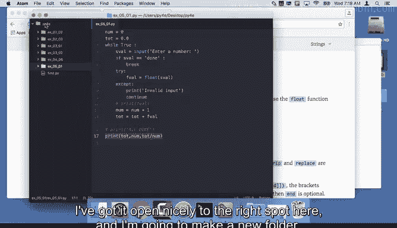
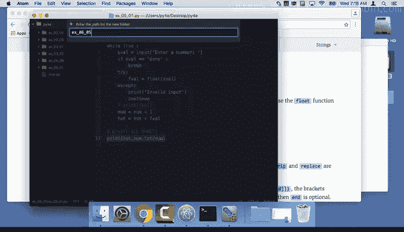
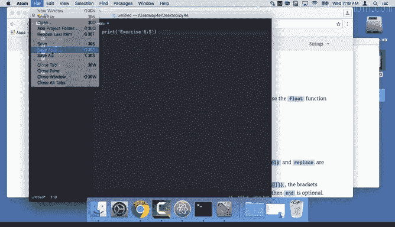
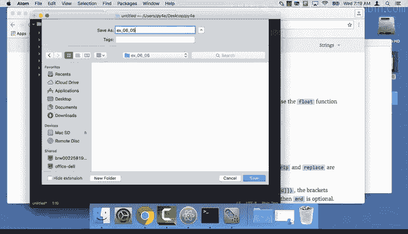
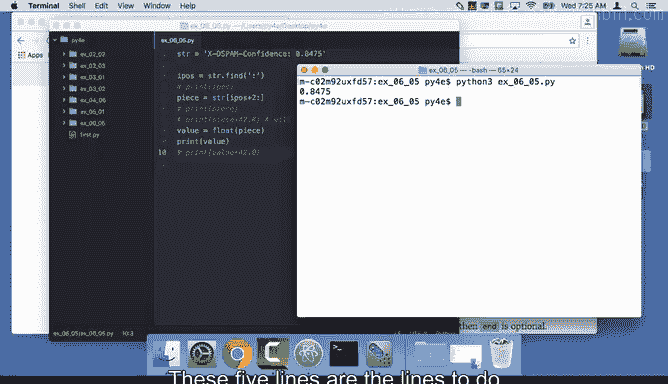
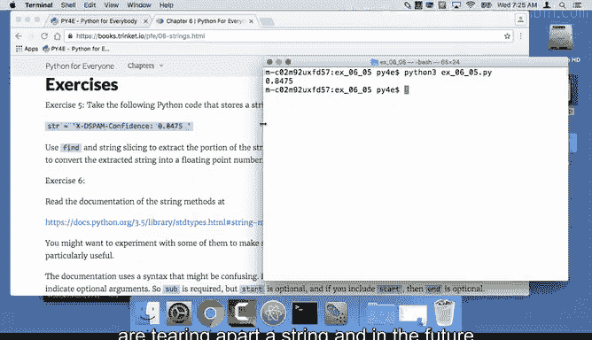

# 每个人的 Python 第二部分 4：字符串练习题讲解 📝

在本节课中，我们将学习如何解析文本字符串。这是一个重要的基础技能，它将帮助我们为后续处理文件或网络数据做好准备。我们将通过一个具体的练习题，学习如何从字符串中提取特定部分，并将其转换为浮点数。

---

## 字符串解析基础

上一节我们介绍了字符串的基本操作，本节中我们来看看如何从复杂的字符串中提取我们需要的信息。

解析字符串的核心在于识别模式并定位关键部分。我们通常使用 `find()` 方法来寻找特定字符（如冒号 `:`）的位置。





以下是解析字符串的基本步骤：
1.  使用 `find()` 方法定位关键字符。
2.  根据位置截取目标子字符串。
3.  将截取到的字符串转换为所需的数据类型（如浮点数）。

---





## 练习 6.5 逐步讲解

现在，让我们开始具体的练习。我们将处理以下字符串：
`X-DSPAM-Confidence: 0.8475`

我们的目标是从中提取数字 `0.8475` 并将其转换为浮点数。

### 步骤一：定位关键字符

首先，我们需要找到冒号 `:` 在字符串中的位置。

```python
str = "X-DSPAM-Confidence: 0.8475"
iPos = str.find(':')
print(iPos)  # 输出：18
```

代码中的 `iPos` 变量存储了冒号字符的索引位置。

### 步骤二：截取子字符串

找到冒号位置后，我们可以从该位置之后开始截取字符串。

```python
piece = str[iPos:]
print(piece)  # 输出：': 0.8475'
```

我们发现截取的结果包含了冒号和空格。为了只获取数字部分，我们需要从 `iPos + 2` 的位置开始截取（跳过冒号和后面的空格）。

```python
piece = str[iPos+2:]
print(piece)  # 输出：'0.8475'
```

### 步骤三：转换数据类型

现在，我们已经得到了纯数字字符串 `‘0.8475’`。接下来，使用 `float()` 函数将其转换为浮点数。

```python
value = float(piece)
print(value)  # 输出：0.8475
```

转换成功后，`value` 就是一个浮点数，我们可以对其进行数学运算。

```python
print(value + 42.0)  # 输出：42.8475
```

---

## 代码整合与清理

在开发过程中，我们通常会加入许多 `print` 语句来调试。完成功能后，可以清理代码，只保留核心逻辑。

以下是完成练习的最终简洁代码：

```python
str = "X-DSPAM-Confidence: 0.8475"
iPos = str.find(':')
piece = str[iPos+2:]
value = float(piece)
print(value)
```

这五行代码完整实现了从给定字符串中提取并转换浮点数的功能。

---

## 总结与展望

本节课中我们一起学习了字符串解析的基本方法。我们通过 `find()` 方法定位关键字符，利用字符串切片截取目标部分，最后使用 `float()` 函数进行类型转换。

目前，我们使用固定的字符串进行练习。在接下来的章节中，我们将学习如何从文件、数据库甚至互联网中读取数据，这些数据源都会提供类似的文本字符串供我们解析。掌握本节课的字符串解析技能，是处理这些更复杂数据源的重要基础。






希望本教程对你有所帮助！