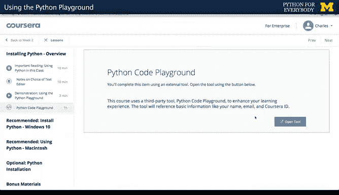
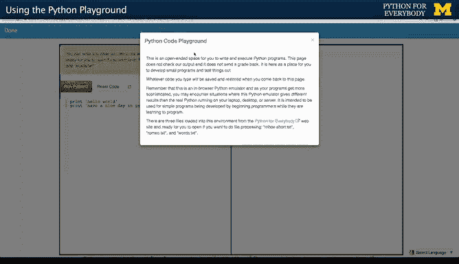
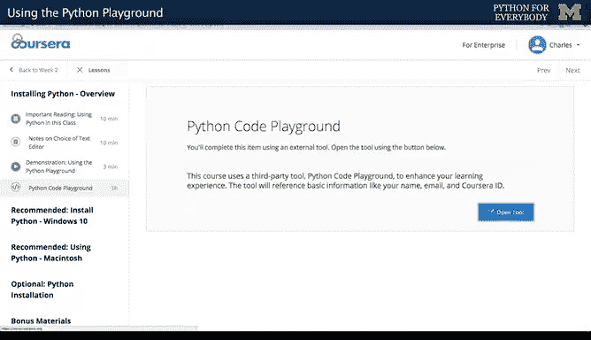

# 每个人的 Python 第二部分 8：演示-使用Python游乐场 🎮


## 概述

在本节课中，我们将学习如何使用课程提供的“Python游乐场”工具。这是一个在浏览器中运行Python代码的环境，无需在本地安装Python。我们将了解其基本操作、功能以及如何利用它来练习编程或获取教学帮助。

上周我们探讨了编程和计算机科学的基础理论。这很酷，但现在我们要开始使用Python编写程序了。

我们鼓励你安装并运行Python，因为迟早你都需要这么做。课程中有许多视频，但在课程一和课程二中，你实际上并非必须安装Python。我们知道有些人可能在使用iPad、Chromebook或其他设备，可能无法安装Python，或者学校环境不允许安装。

因此，你能使用我们在浏览器中提供的软件来编写Python程序，这很棒。我们拥有这个“Python游乐场”。

## Python游乐场简介

随着课程的进行，你会发现需要完成的作业。而Python游乐场是一个不计分的作业环境，它是一个Python代码游乐场。

它通过一项名为“学习工具互操作性”的技术在外部启动。它会将游乐场在一个新标签页中打开。你需要确认它确实在新标签页中，这就是Python游乐场。

这个环境有点像自动评分器，但它没有任何预设要求，你可以编写任何你想要的代码。

## 基本操作指南

以下是使用Python游乐场的基本步骤。





首先，你可以点击“重置代码”按钮。你随时可以返回到默认的初始代码。这就是为你准备的初始代码。

如果我想运行它，我只需点击“运行代码”按钮。


代码随即运行，输出结果显示在右侧。它实际上执行了Python代码，并将结果输出到这里。

当前默认的代码文件可能不是你想要的练习内容。例如，它可能来自课程2的第7章。

你可以尝试编写自己的代码，例如：
```python
print("Play!")
```
然后运行它。代码运行后，你的输出会显示在这里。

## 可用资源与高级功能

现在，我们来了解一下可用的资源和一些高级功能。

课程后期（第7章及之后）提供了三个示例文件。这些是我们在教材许多作业中使用的示例文件。你可以在这里随意使用它们进行任何练习，这里的操作不会被评分，也不会将成绩传回Coursera平台。

如果你能在自己的笔记本电脑或电脑上编写Python，最好尽快学习在那里运行Python，然后将代码粘贴到后续的自动评分器中。但如果你完全无法访问本地环境，这就是我们提供Python游乐场的原因。

如果你想使用Python 2（本课程主要使用Python 3教学），下方有一个小按钮写着“切换到 Python 2”。你也可以在这里运行Python 2代码。如果你熟悉Python 2，在本课程的前10周，你实际上可以在提交作业时在Python 3和Python 2之间切换。

## 教学协助功能

另一个很酷的功能是关于教学协助的。

你将不会看到某些按钮（例如“查看学生代码”）。这个“查看学生代码”功能允许我们的教学人员查看你的代码。我们不允许你在论坛中直接粘贴代码，但你可以这样做：在论坛中求助，教学人员可以进入系统，输入你的姓名或邮箱来查找你最近提交的代码。

因此，你可以把代码放在这里并寻求帮助。助教可以看到你的全部代码，可以运行你的代码，可以进行各种操作。这是一个与助教沟通的好方法：你基本上把代码留在游乐场，向助教提问，然后他们可以去查看你的代码并给你一些解答。

当你全部完成后，只需按下“完成”按钮。




## 总结

本节课中，我们一起学习了如何使用Python游乐场工具。我们介绍了它的基本操作，包括运行代码、重置代码以及使用示例文件。我们还探讨了其高级功能，如切换Python版本，并重点讲解了如何利用它与教学团队进行有效的代码审查和问题求助。

我们回到了第二周的内容，但正如我所说，我个人更希望你尽快掌握在笔记本电脑上运行Python的技能。但如果这对你不现实，那么这就是我们在课程一和课程二中提供Python游乐场的原因。