# 🐍 密歇根大学《给所有人的Python课》课程2：《Python数据结构》｜P9：在Windows 10上安装Python并编写第一个程序

在本节课中，我们将学习如何在Windows 10操作系统上安装Python编程语言，安装一个简单的文本编辑器，并运行你的第一个Python程序。整个过程分为三个主要步骤：下载安装Python、安装文本编辑器Brackets，以及创建并运行一个简单的脚本。

---

## 第一步：下载并安装Python

首先，我们需要获取Python的安装程序。请访问Python官方网站 `python.org`。

进入网站后，导航至“Downloads”（下载）区域，选择适用于Windows系统的Python版本进行下载。

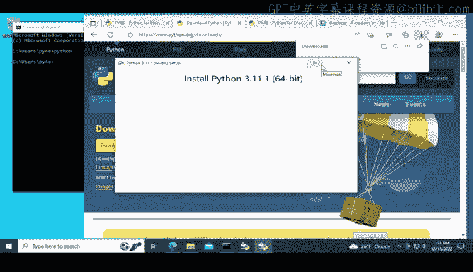

下载完成后，运行安装程序。请注意，在Windows系统上进行安装操作，可能需要管理员账户权限。


安装过程结束后，我们需要验证Python是否已成功安装。

打开命令提示符（Command Prompt），输入以下命令并回车：
```bash
python --version
```
此命令用于检查已安装的Python版本。如果安装成功，命令行将显示当前的Python版本号。

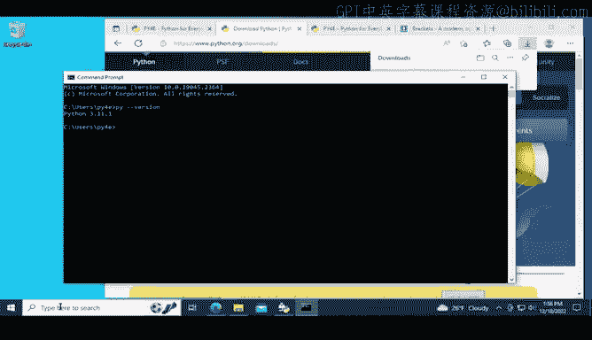


此外，你还可以直接在命令行中输入 `python` 来启动Python交互式解释器。这是一个可以即时执行Python代码的环境。

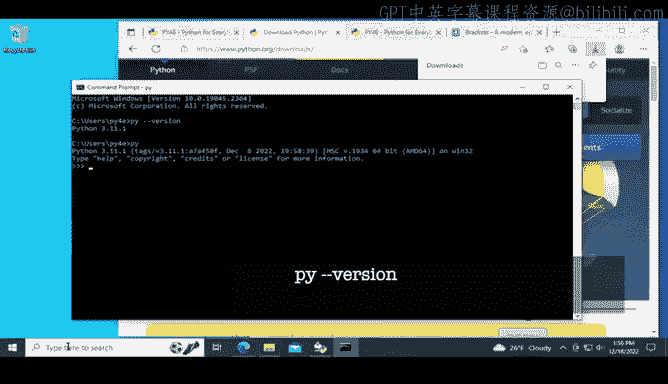

在解释器中，输入你的第一行代码：
```python
print("hello world")
```
按下回车后，屏幕上将显示“hello world”。输入 `quit()` 或按 `Ctrl+Z` 再回车即可退出解释器。


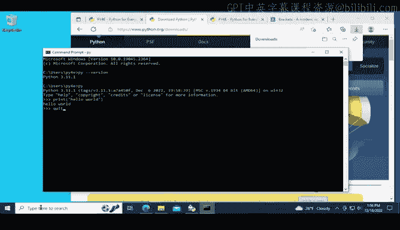

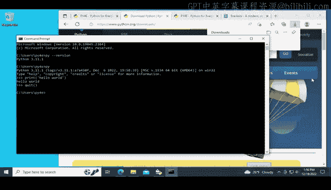

至此，Python已成功安装并可以运行。


验证完毕后，可以关闭命令提示符窗口。

---

## 第二步：安装文本编辑器Brackets

为了编写Python程序，我们需要一个文本编辑器。请注意，不建议使用Microsoft Word或系统自带的记事本（Notepad）来编写代码。

市面上有许多优秀的编辑器可供选择，例如VS Code。如果你已经安装了其他编辑器并且使用顺畅，可以继续使用。本教程将使用Brackets进行演示，因为它简单、开源，且兼容Windows、Mac和Linux系统。

访问Brackets官方网站下载安装程序。

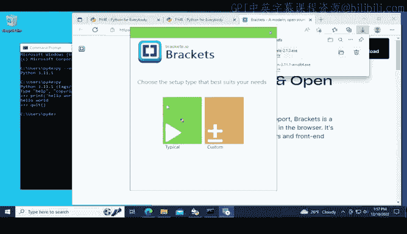


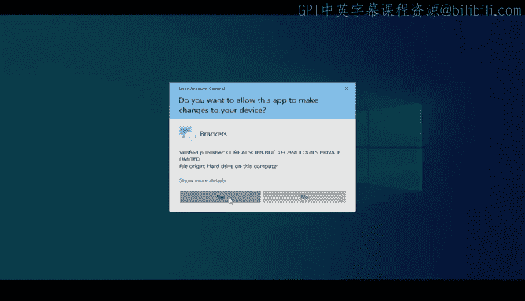

运行下载的安装程序，选择“典型”（Typical）安装选项即可。

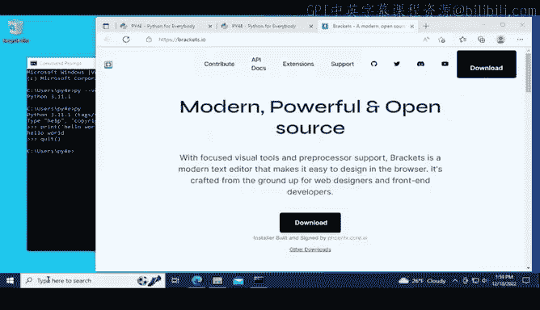


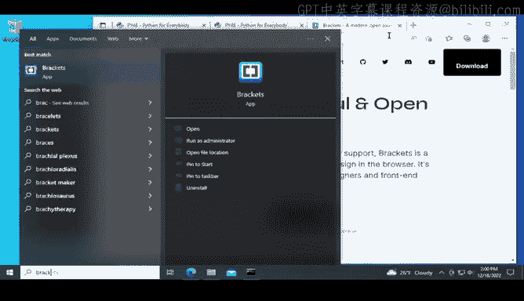

安装完成后，启动Brackets。

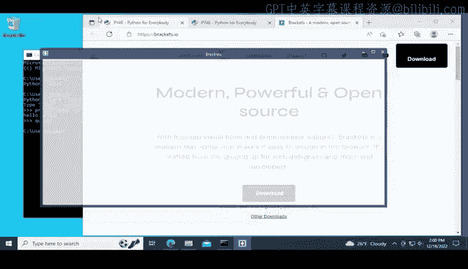


启动后，你可以先关闭欢迎界面。现在，我们将创建一个新的Python文件。

---

## 第三步：创建并运行你的第一个Python程序

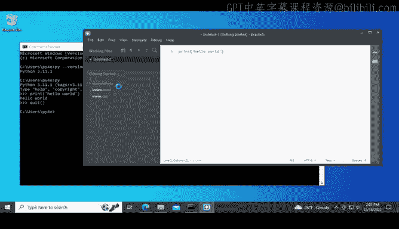

在Brackets中，点击“File”（文件）菜单，选择“New”（新建）来创建一个新文件。

在新文件中，输入经典的第一个程序：
```python
print("Hello world")
```

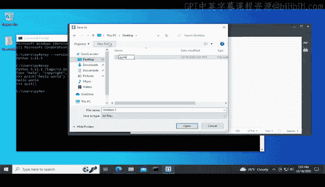


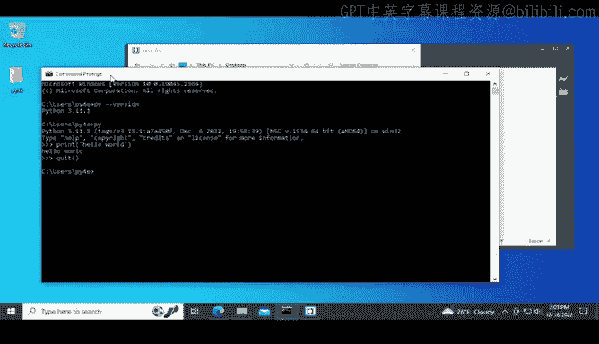

接下来，需要保存这个文件。点击“File”菜单，选择“Save”（保存）。

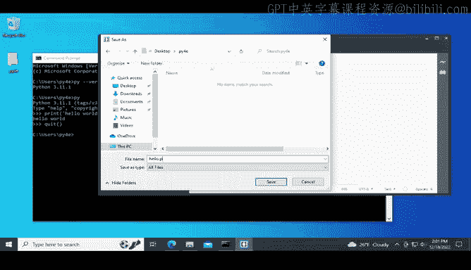

为了管理方便，建议为Python项目创建一个专门的文件夹。例如，在桌面上新建一个文件夹，将其命名为 `Py4E`（Python for Everybody的缩写）。


你会看到在桌面上出现了名为“Py4E”的文件夹。

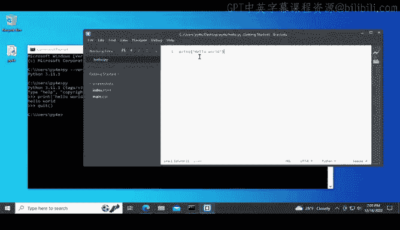


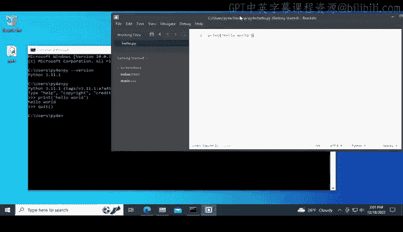

在保存文件对话框中，导航到这个新创建的 `Py4E` 文件夹。将文件命名为 `hello.py`。注意，`.py` 扩展名非常重要，它告诉系统这是一个Python文件。

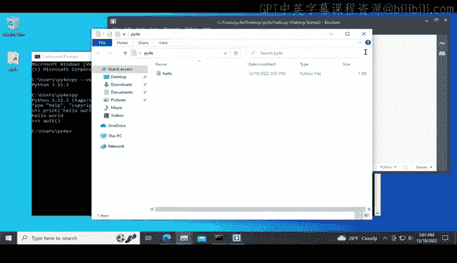


保存后，Brackets会自动识别 `.py` 后缀并进行语法高亮显示，这让代码更易读。


现在，打开文件资源管理器，进入桌面上的 `Py4E` 文件夹，确认 `hello.py` 文件已存在。

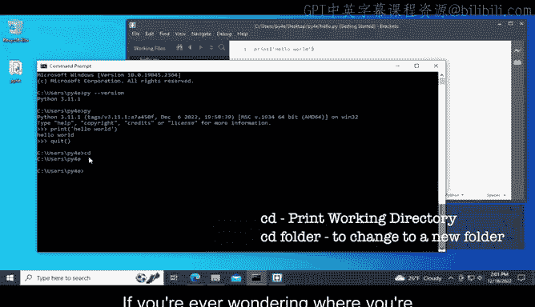


最后，我们需要通过命令行来运行这个程序。重新打开命令提示符。

首先，需要导航到保存 `hello.py` 文件的目录。以下是相关的命令行操作：

*   `cd` 命令用于切换目录。例如，`cd Desktop` 可以进入桌面目录。
*   `dir` 命令用于列出当前目录下的文件和文件夹。
*   如果你不确定当前所在位置，可以输入 `cd` 命令本身，它会显示当前工作目录的完整路径。

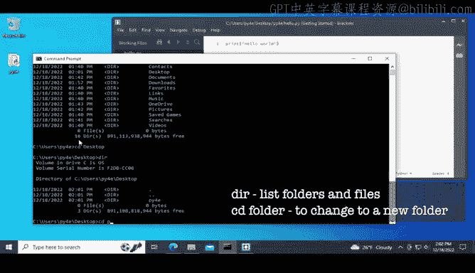

根据你的实际情况，使用 `cd` 命令进入 `Py4E` 文件夹。例如，如果你的文件保存在 `C:\Users\[你的用户名]\Desktop\Py4E`，则需相应切换目录。

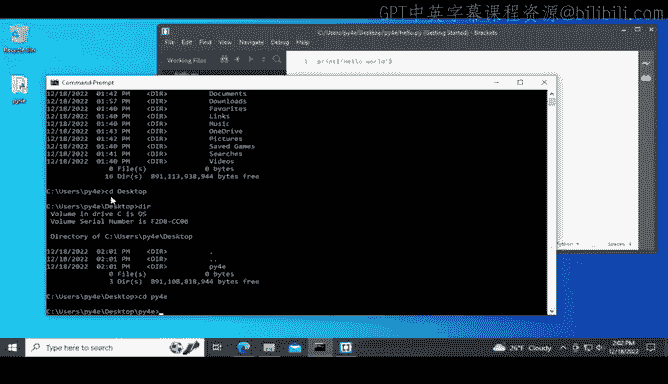


进入正确的目录后，使用 `dir` 命令确认能看到 `hello.py` 文件。


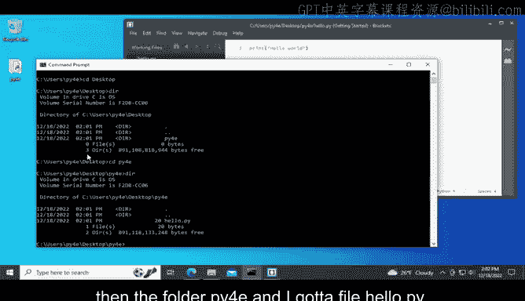

现在，运行你的程序。在命令提示符中输入：
```bash
python hello.py
```
按下回车。

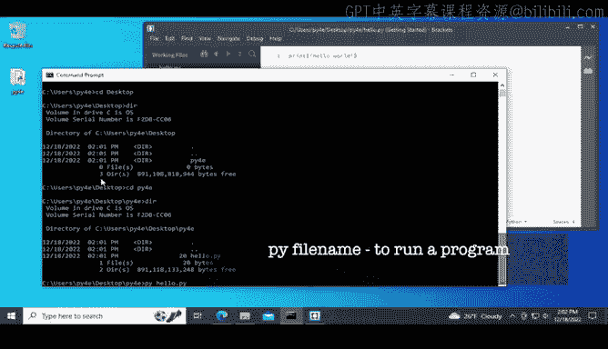


如果一切正常，你将在命令行中看到输出结果：
```
Hello world
```

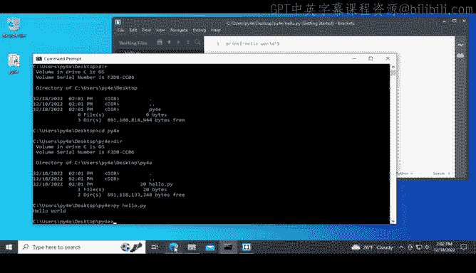
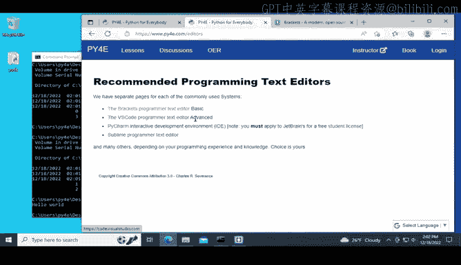

---

## 总结


本节课中，我们一起完成了在Windows 10上搭建Python编程环境的全过程。我们首先从官网下载并安装了Python，并通过命令行验证了安装。接着，我们安装了一款适合编码的文本编辑器Brackets。最后，我们创建了一个简单的Python脚本 `hello.py`，并在命令行中成功运行，输出了“Hello world”。


你完全可以根据自己的喜好选择其他文本编辑器。本教程旨在为你提供一个快速、清晰的入门指引，帮助你安装Python、配置编辑器并迈出编写程序的第一步。