# 每个人的 Python 第二部分 10：Windows截图工具使用教程 📸

## 概述

在本节课中，我们将学习如何使用Windows系统自带的“截图工具”进行屏幕捕获。这是一种简单有效的方法，适用于课程作业展示、问题反馈或日常记录。

虽然存在其他截图方式，但内置的截图工具是最便捷的选择。本教程以Windows 8为例进行演示，该工具在更早版本的Windows中也存在，用户界面可能略有不同，但基本操作一致。

---

## 启动截图工具

首先，我们需要找到并启动截图工具。

点击屏幕左下角的Windows图标，在搜索框中输入“SNI”（“Snipping”的前几个字母）。系统会搜索并显示“截图工具”应用程序。

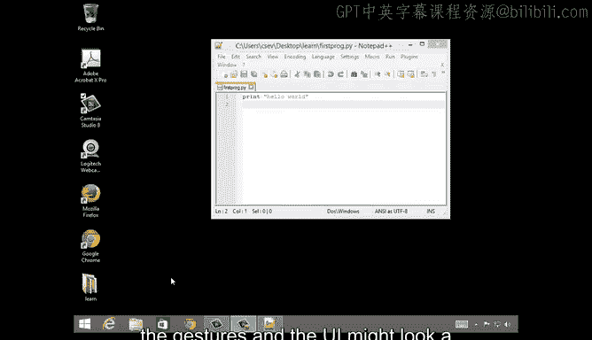

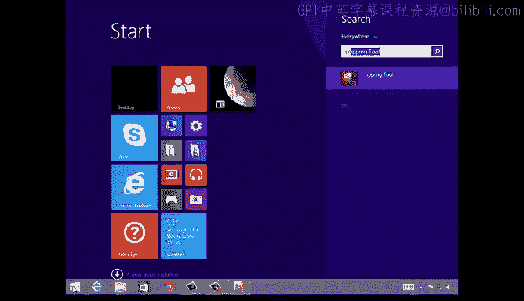

点击搜索结果中的“截图工具”即可将其打开。

---

## 进行截图操作

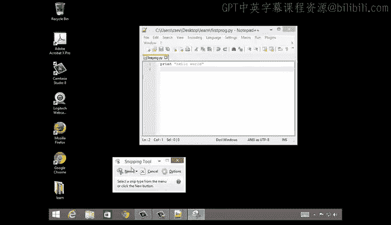

启动截图工具后，就可以开始捕获屏幕了。

在截图工具窗口中，点击“新建”按钮。此时整个屏幕会变暗，鼠标指针会变成一个十字线。

按住鼠标左键并拖动，框选出你想要截取的区域。松开鼠标后，被选中的区域就会被捕获到截图工具的新窗口中。

这个新窗口是一个独立的编辑窗口，原始的屏幕内容不会受到影响。

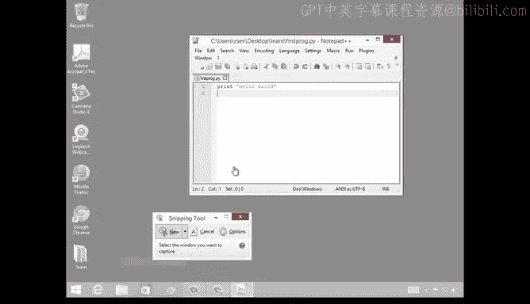

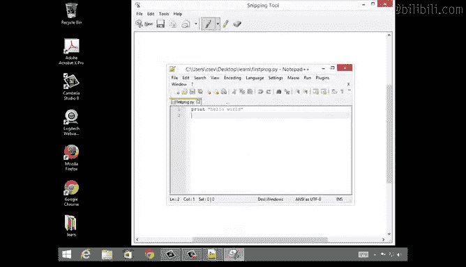

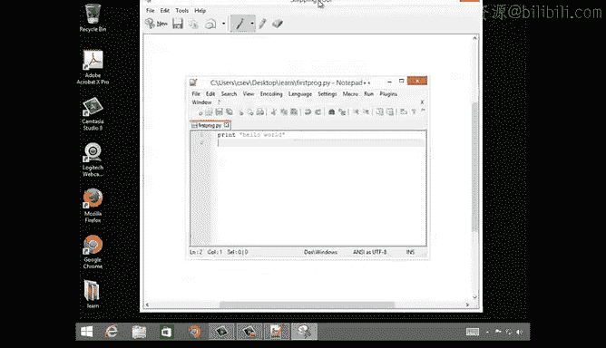

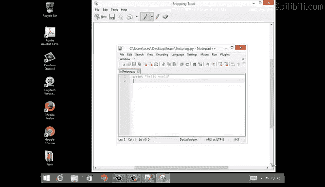

---

## 编辑与标注截图

捕获截图后，截图工具本身还提供了一些简单的绘图功能，方便我们对图片进行标注或修改。

例如，如果你想隐藏截图中的某些个人信息（如文件路径中的用户名），可以使用工具提供的笔刷进行涂抹。

在工具栏中选择笔刷或荧光笔，然后在需要遮盖的区域涂抹即可。

---

## 保存截图文件

编辑完成后，下一步就是将截图保存为文件。

点击菜单栏的“文件”，然后选择“另存为”。

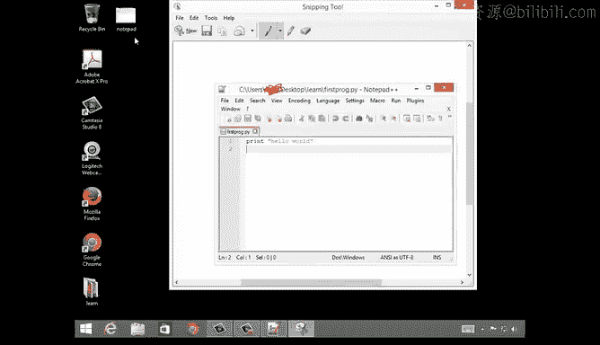

在弹出的保存对话框中，选择你想要保存的位置（例如桌面），并为文件命名。

**关键步骤：** 在文件名后手动添加文件扩展名，例如 `.png` 或 `.jpg`。

虽然Windows系统通常能识别文件类型，但显式地添加扩展名（如 `.png`）是一种好习惯。这能确保当你将文件转移到其他操作系统、通过电子邮件发送或上传到网络时，其他系统也能正确识别其格式。

例如，将文件命名为 `mynote.png`。

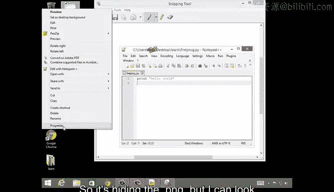

点击“保存”。保存后，你可以在保存位置找到该文件。如果系统默认隐藏了已知文件扩展名，你可以通过查看文件属性来确认它确实是 `.png` 格式。

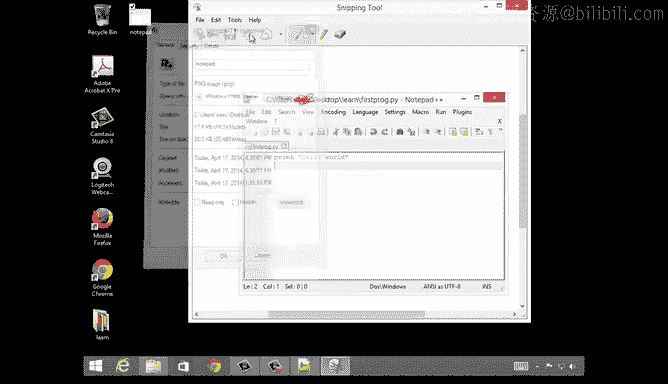

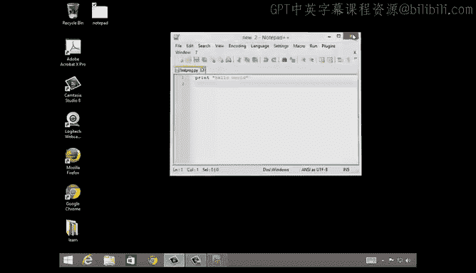

---

## 完成操作

至此，整个截图流程就完成了。

你可以关闭截图工具窗口。如果你再次打开刚才截图的源窗口（例如记事本），你会发现它保持原样，截图操作不会对原始内容产生任何影响。

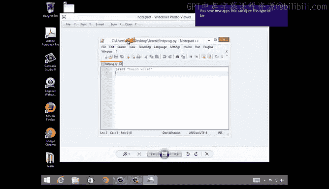

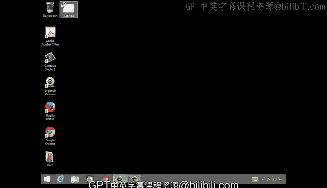

---

## 总结

本节课我们一起学习了Windows截图工具的基本使用方法。我们涵盖了从启动工具、捕获屏幕区域、进行简单编辑（如涂抹隐私信息）到最终保存为带正确扩展名（如`.png`）的图片文件的完整流程。掌握这个工具能帮助你在学习编程时更有效地记录和分享屏幕信息。