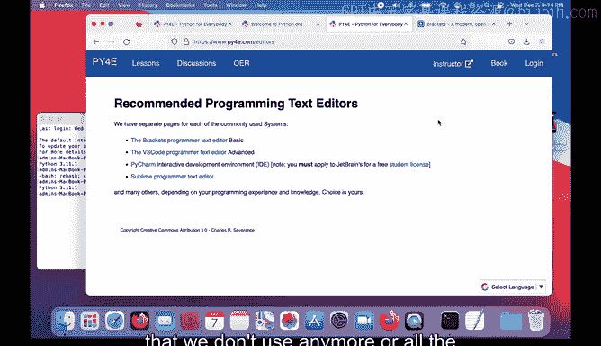
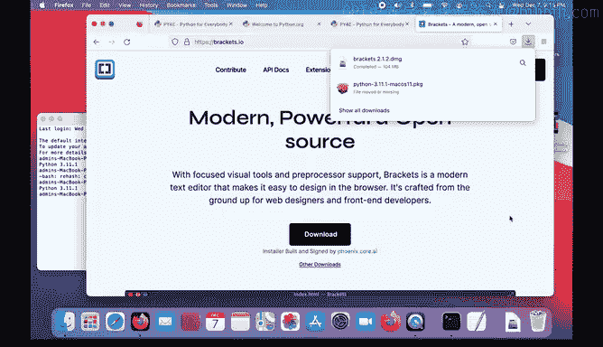
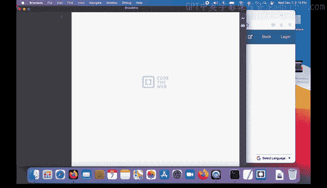
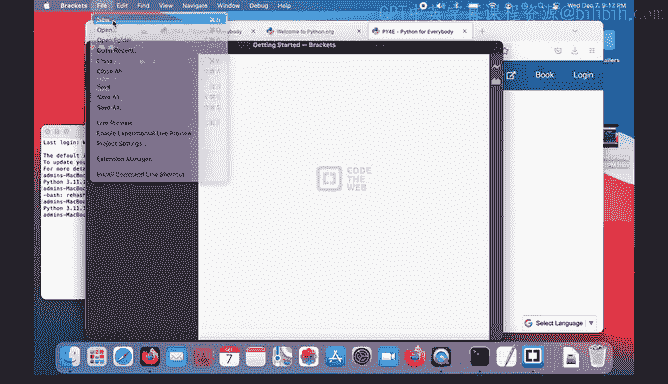
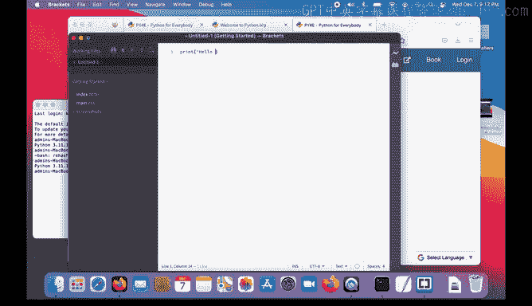
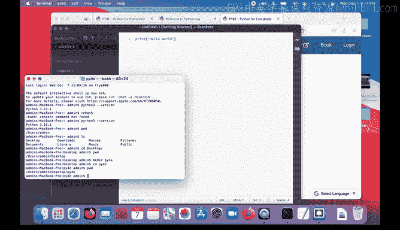
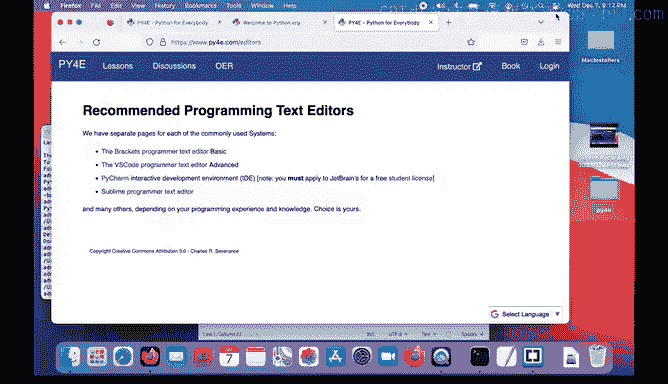
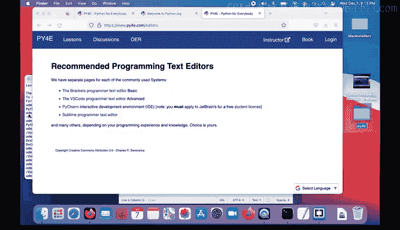
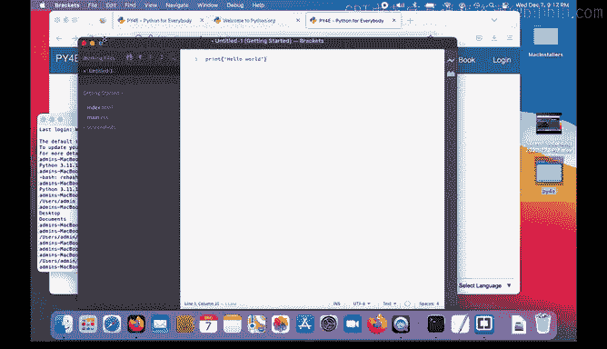

# 每个人的 Python 第二部分 11：在Mac上安装Python并编写程序 🍎💻

在本节课中，我们将学习如何在Mac电脑上安装Python，并配置一个合适的代码编辑器来编写和运行你的第一个Python程序。

---

## 概述

我们将首先检查Mac是否已预装Python，然后学习如何安装最新的Python 3版本。接着，我们会选择一个适合编程的文本编辑器，并最终在终端中创建并运行一个简单的Python程序。

---

## 检查现有Python版本

Mac系统通常预装了Python 2。首先，我们需要打开终端并检查当前安装的Python版本。

打开“终端”应用程序，输入以下命令来检查Python版本：

```bash
python --version
```

如果系统显示类似 `Python 2.7` 的信息，说明你安装的是Python 2。由于Python 2已停止支持，我们需要安装Python 3。

如果你在终端中输入 `python` 并进入了Python交互式环境（提示符为 `>>>`），可以输入 `quit()` 命令退出。

---

## 安装Python 3

因为Mac系统内部也使用Python，为了避免冲突，我们需要安装一个独立的Python 3版本。

首先，检查是否已安装Python 3：

```bash
python3 --version
```

如果该命令返回了版本号，说明Python 3已安装，你可以跳过安装步骤。如果没有，请继续。

我们不推荐通过Mac的“开发者工具”安装Python。建议访问Python官方网站下载安装包。

1.  打开浏览器，访问 [python.org](https://www.python.org)。
2.  点击“Downloads”选项卡，网站会自动识别你的操作系统为Mac。
3.  下载最新的Python 3版本（例如3.11）。
4.  打开下载的 `.pkg` 文件，按照安装向导的提示完成安装。

安装完成后，你需要**关闭并重新打开终端**，以便系统识别新安装的Python 3。再次运行 `python3 --version` 来验证安装是否成功。

---

## 选择并安装代码编辑器

Mac自带的“文本编辑”应用不适合编程，因为它默认保存为RTF格式。我们需要一个专业的代码编辑器。



如果你已经有喜欢的编辑器（如VS Code、Sublime Text等），可以继续使用。对于初学者，我们推荐使用Brackets，因为它简单、免费、开源，且支持Mac、Windows和Linux系统。



以下是安装Brackets的步骤：
1.  访问 [brackets.io](http://brackets.io) 下载Mac版本。
2.  打开下载的 `.dmg` 文件。
3.  将Brackets图标拖拽到“应用程序”文件夹中。
4.  在“应用程序”文件夹或通过Spotlight搜索启动Brackets。

---

## 创建并运行第一个Python程序

现在，我们将使用Brackets创建第一个Python程序，并在终端中运行它。

首先，我们需要在终端中创建一个专门存放代码的目录，并进入该目录：



```bash
# 每个人的 Python 第二部分 打印当前工作目录
pwd



# 每个人的 Python 第二部分 切换到桌面（假设你想在桌面创建文件夹）
cd ~/Desktop



# 每个人的 Python 第二部分 创建一个名为‘py4e’的文件夹
mkdir py4e

# 每个人的 Python 第二部分 进入新创建的文件夹
cd py4e
```

此时，终端的工作目录与桌面上的 `py4e` 文件夹是同步的。

接下来，打开Brackets编辑器：
1.  点击“文件” -> “新建”，创建一个新文件。
2.  在文件中输入你的第一行代码：`print("Hello World")`
3.  点击“文件” -> “另存为”，导航到桌面上的 `py4e` 文件夹。
4.  将文件命名为 `hello.py` 并保存。Brackets会自动识别 `.py` 后缀并进行语法高亮。

最后，回到终端。确保你仍在 `py4e` 目录下，然后运行你的程序：







```bash
python3 hello.py
```



如果终端成功输出了“Hello World”，恭喜你！你已经成功在Mac上配置了Python开发环境并运行了第一个程序。

---

## 总结

本节课中，我们一起学习了在Mac系统上配置Python开发环境的完整流程。我们检查了Python版本，安装了最新的Python 3，选择了Brackets作为代码编辑器，并最终创建、保存和运行了第一个Python程序 `hello.py`。

掌握这些基础步骤是开始Python编程之旅的关键。在接下来的课程中，我们将利用这个环境学习更多关于Python数据结构和编程的知识。