# 密歇根大学《给所有人的Python课》课程2：《Python数据结构》｜P12：在Macintosh上截屏 📸

在本节课中，我们将学习如何在Macintosh电脑上使用内置的“预览”应用程序进行屏幕截图。这是一个简单而强大的工具，尤其适合需要为课程作业或项目提交截图的同学。

---

## 概述

Macintosh操作系统内置了一个名为“预览”的应用程序。它最初设计用于查看PDF文件，但也包含了一系列完整的屏幕捕捉功能。我们将学习如何启动它、进行截图、保存为通用格式，并进行简单的编辑。

---

## 启动“预览”应用程序

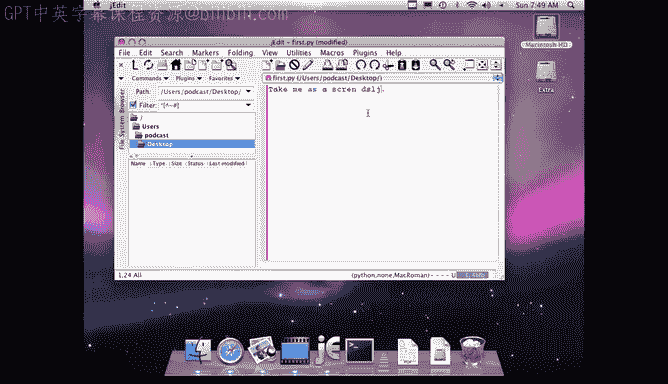

首先，我们需要找到并启动“预览”应用程序。你可以进入Macintosh的硬盘驱动器，打开“应用程序”文件夹，然后搜索“预览”。

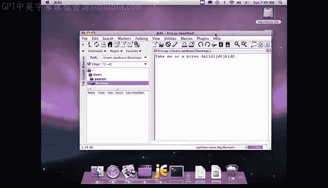

上一节我们介绍了课程目标，本节中我们来看看如何找到核心工具。

以下是启动“预览”的步骤：
*   进入硬盘驱动器。
*   打开“应用程序”文件夹。
*   在列表中搜索并找到“预览”应用程序。

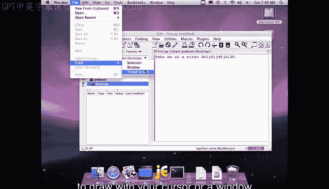

建议将“预览”程序固定在程序坞中，以便随时使用。你可以在程序坞中的“预览”图标上点击，然后选择“在程序坞中保留”。

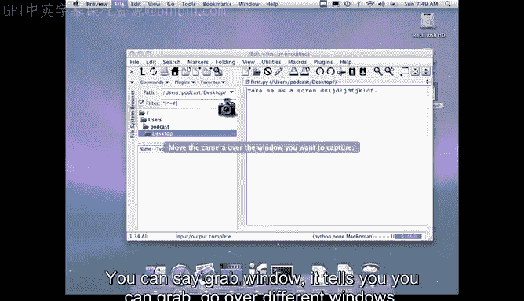

---

## 进行屏幕截图

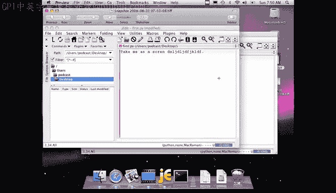

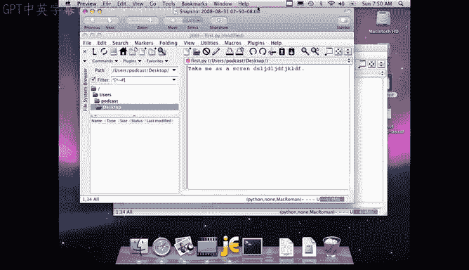

现在，让我们开始截取屏幕截图。我们将以一个示例窗口（如一个文本编辑器）作为目标。

以下是使用“预览”截图的步骤：
1.  打开“预览”应用程序。
2.  点击顶部菜单栏的“文件”。
3.  在下拉菜单中选择“拍摄屏幕截图”。
4.  在弹出的子菜单中，你会看到几个选项：**选择部分**、**窗口** 或 **整个屏幕**。
5.  大多数情况下，我们选择“窗口”。选择后，屏幕会变暗，光标会变成一个相机图标。
6.  将相机图标移动到你想截取的窗口上，窗口会高亮显示。
7.  点击鼠标，即可完成对该窗口的截图。

截图完成后，“预览”会自动打开这个截图图像。默认情况下，系统还会在桌面上保存一个副本，文件名为“屏幕快照 [日期].tiff”。

---

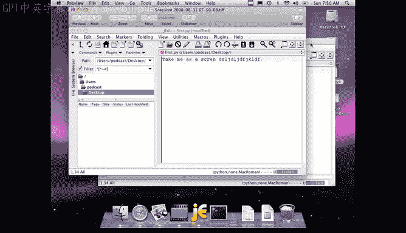

## 保存与重命名文件

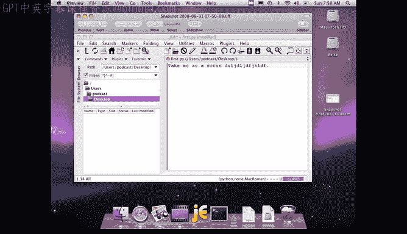

默认保存的TIFF格式和复杂的文件名可能不便于管理。因此，我们通常需要将文件另存为更通用的格式（如JPEG）并重命名。

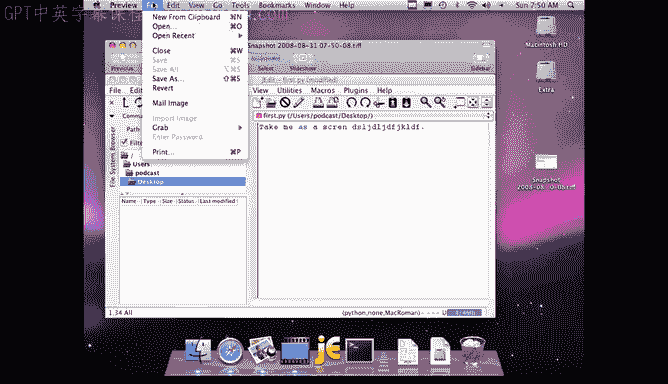

上一节我们完成了截图，本节中我们来看看如何妥善保存文件。

以下是保存截图文件的步骤：
1.  在“预览”中，确保你的截图图像是当前活动窗口。
2.  点击菜单栏的“文件”，选择“导出...”。
3.  在格式下拉菜单中，选择 **JPEG**。
4.  为文件输入一个清晰的名称，例如 `first_image.jpg`。
5.  选择保存位置（例如桌面），然后点击“存储”。

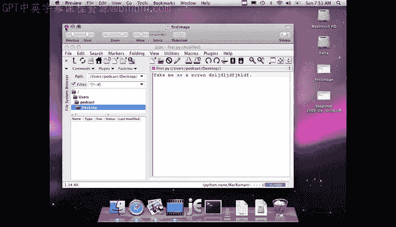

现在，你就在指定位置获得了一个JPEG格式的截图文件，可以用于上传或分享。

---

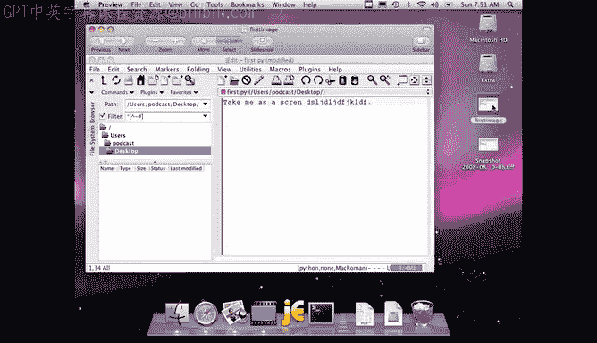

## 简单的图像编辑（裁剪）

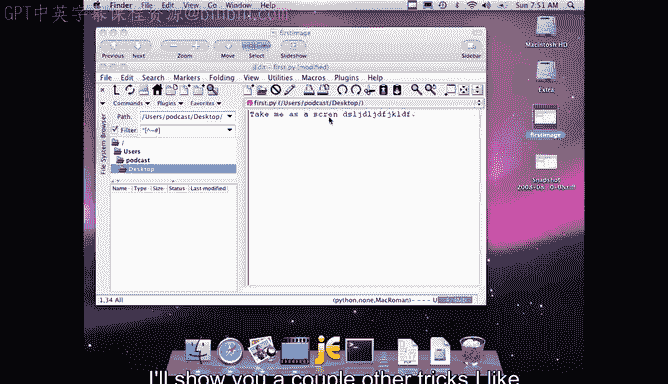

“预览”还提供基础的图像编辑功能，比如裁剪，这可以帮助你聚焦于图片的关键部分。

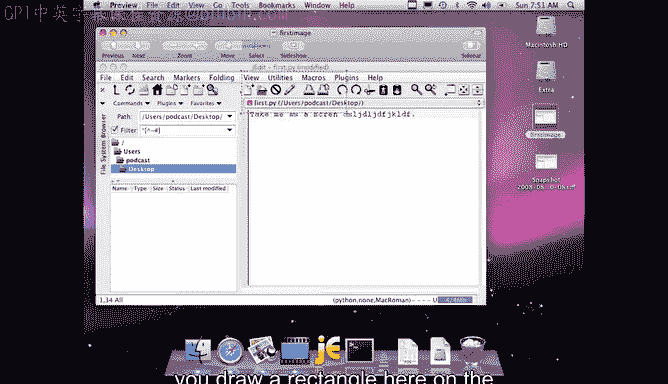

以下是裁剪图像的步骤：
1.  在“预览”中打开要编辑的图片。
2.  点击工具栏上的矩形选择工具（或从“工具”菜单中选择“矩形选择”）。
3.  在图片上拖动鼠标，框选出你想要保留的区域。
4.  点击菜单栏的“工具”，然后选择“裁剪”。
5.  图片将只保留你框选的部分。
6.  最后，别忘了使用“导出...”功能，将裁剪后的图片保存为一个新文件（例如 `cropped_image.jpg`）。

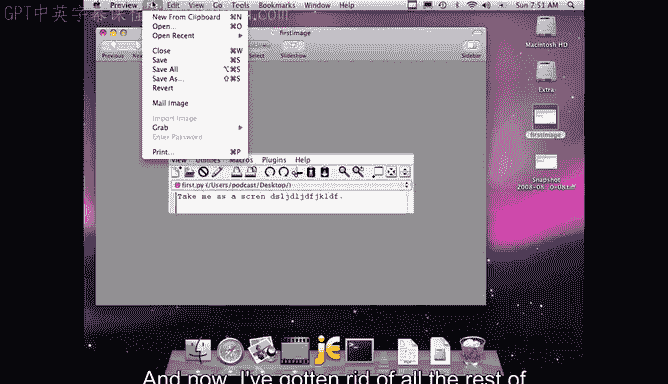

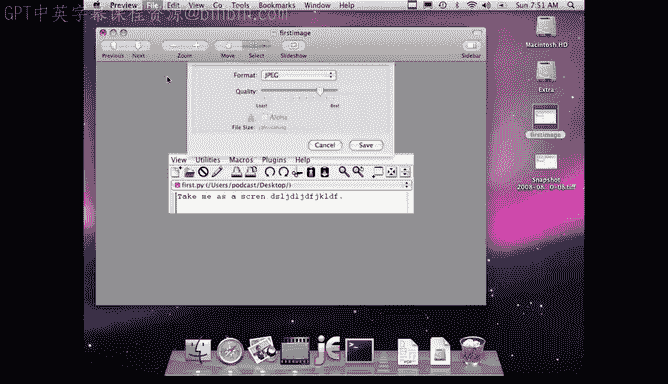

你可以使用快捷键 `Command (⌘) + W` 来快速关闭当前窗口。

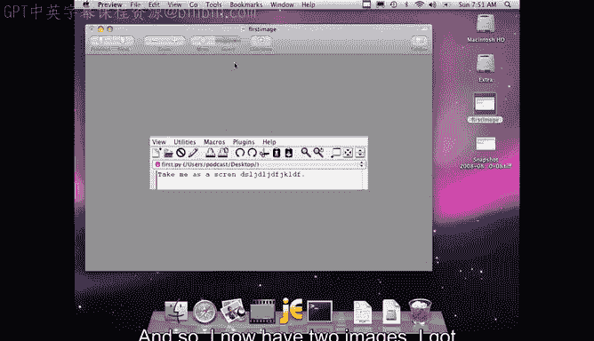

---

## 总结与提醒

本节课中我们一起学习了在Macintosh上使用“预览”应用程序进行屏幕截图的完整流程。

我们掌握了以下核心操作：
*   启动并固定“预览”程序。
*   使用“文件”->“拍摄屏幕截图”->“窗口”来捕获特定窗口。
*   将截图通过“导出”功能保存为JPEG格式并合理命名。
*   使用选择工具和“裁剪”功能编辑图片。

请注意，默认的截图会自动保存到桌面，定期清理这些文件可以保持桌面整洁。当你需要提交作业截图时，使用上述方法处理后的JPEG文件就是你应该上传的正确文件。