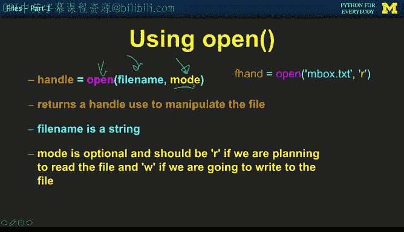
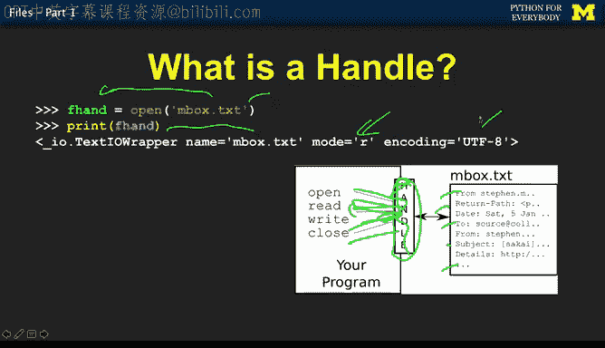
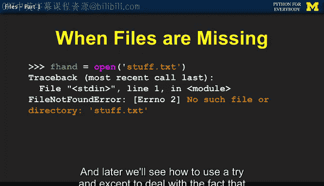

# 每个人的 Python 第二部分 13：文件操作入门 📁


在本节课中，我们将要学习Python中如何与文件进行交互。我们将了解什么是文件、如何打开文件、文件的基本结构，以及一个非常重要的字符——换行符。这是连接我们编写的程序与存储在计算机硬盘上数据的第一步。

到目前为止，我们所编写的程序大多只是在计算机内存中运行和计算。就像一个变量被赋值，如果没有人读取它，它的存在似乎没有意义。我们通过`input`和`print`与键盘和屏幕进行过简单的交互，但数据并未持久保存。从本章开始，我们将学习如何与计算机的永久存储——文件——进行对话，让程序能够读取和写入真实世界的数据。

## 认识文本文件

我们首先要操作的文件类型是“纯文本文件”。这类文件不是像Word文档或PDF那样的复杂格式，它们仅仅是由一行行文本组成的简单文件。你自己编写的Python程序文件（以`.py`结尾）就是纯文本文件。

文本文件的结构是一系列字符，每行末尾都有一个特殊的“换行符”，就像你在打字时按下回车键一样。其格式如下：
```
这是第一行<换行符>
这是第二行<换行符>
<换行符>  // 这是一个空行
这是第四行<换行符>
```

我们将使用一个名为`inbox.txt`（或`inbox-short.txt`）的文件作为示例。这是一种标准的“邮箱格式”文件，通常由邮件程序导出，常用于编写扫描和分析邮件的程序。

## 打开文件：建立连接

在Python中操作文件的第一步是“打开”它。打开文件并不是立即读取其中的数据，而是告诉Python我们准备操作哪个文件，并建立一个通往该文件的“连接”。这个连接我们称之为**文件句柄**。

我们使用Python的内置函数`open()`来打开文件。该函数需要至少一个参数，即文件名。第二个可选参数用于指定模式，例如读取（`‘r’`）或写入（`‘w’`）。如果省略，默认模式是读取（`‘r’`）。



以下是打开文件的代码示例：
```python
file_handle = open('inbox.txt')
```
这段代码执行后，`file_handle`变量就成为了一个文件句柄。**文件句柄不是文件数据本身**，而是一个我们可以用来获取数据的操作接口或“舷窗”。通过这个句柄，我们可以读取文件、写入文件，操作完成后，再关闭这个连接。

如果你直接打印这个文件句柄，看到的不是文件内容，而是关于这个连接的一些信息：
```python
print(file_handle)
# 每个人的 Python 第二部分 输出类似：<_io.TextIOWrapper name='inbox.txt' mode='r' encoding='UTF-8'>
```
输出告诉我们这是一个文件对象，处于读取模式，并使用UTF-8编码解读数据。

**重要提示**：如果你尝试打开一个不存在的文件，程序会报错（抛出`FileNotFoundError`异常）。在后续课程中，我们将学习如何使用`try`和`except`来优雅地处理这种错误情况。



## 理解“换行符”



在文件处理中，一个至关重要的概念是**换行符**。在Python字符串中，我们用两个字符`\n`来表示它，但在计算机内部，它被存储为**一个单独的、不可见的控制字符**。

请看以下示例：
```python
stuff = 'X\nY'
print(stuff)
# 每个人的 Python 第二部分 输出：
# 每个人的 Python 第二部分 X
# 每个人的 Python 第二部分 Y

print(len(stuff))
# 每个人的 Python 第二部分 输出：3
```
字符串`‘X\nY’`打印出来是两行，但它的长度是3个字符（‘X‘, ‘\n‘, ‘Y‘），而不是4个。这证明了`\n`是一个单独的字符。

所以，当我们视觉上看到文件有多“行”时，实际上文件内容是一个很长的字符串，其中插入了`\n`字符来标记每一行的结束。甚至一个空行，也包含一个（或两个，取决于系统）换行符。

换行符属于“空白字符”，虽然我们在屏幕上看不到它，但它确实存在并起着关键作用。另外，Python的`print()`函数在默认情况下，会在输出内容的末尾自动添加一个换行符，这也是为什么每次调用`print()`后，光标会移动到下一行的原因。

上一节我们介绍了文件的基本概念和如何打开文件，本节中我们重点理解了换行符这个核心角色。正是它定义了文件中“行”的结构。

## 总结

本节课中我们一起学习了：
*   **文件的作用**：作为程序的永久存储介质，使数据得以保存和重用。
*   **文本文件的结构**：由一系列以换行符（`\n`）分隔的文本行组成。
*   **如何打开文件**：使用`open()`函数获取一个**文件句柄**，这是程序与文件之间的连接通道。
*   **换行符（`\n`）**：它是一个单独的、不可见的控制字符，用于在文本中标记一行的结束，是文件处理的基础。


现在，我们已经成功打开了通往文件世界的大门，并理解了文件的基本构造。在接下来的课程中，我们将利用这个文件句柄，开始实际地读取和操作文件中的数据。