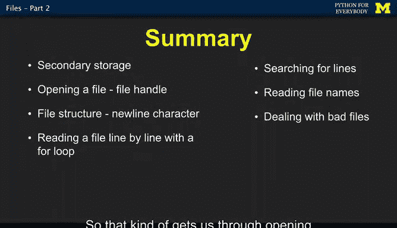

# 密歇根大学《Python数据结构》课程2-14：文件处理 📂


在本节课中，我们将学习如何使用Python读取和处理文件。我们将从打开文件开始，逐步学习如何遍历文件内容、统计信息、搜索特定行，并优雅地处理可能出现的错误。

---

## 打开文件与读取文件

上一节我们介绍了如何打开文件。本节中我们来看看如何读取文件内容。

读取文件非常简单。文件句柄本身不是数据，而是获取数据的一种方式，它可以被视为一个序列。我们已经掌握了一种确定循环——`for`循环。

以下是读取文件的基本方法：

```python
for line in file_handle:
    # 处理每一行
```

`for`循环足够智能，它能将文件句柄视为一个由行组成的序列。循环会运行多次，迭代变量（例如这里的`line`）会依次成为文件中的每一行。如果文件有10行，这个循环就会运行10次。

这种方法非常简洁，无需`while`循环，也无需检查文件结尾。

---

## 统计文件行数

现在，我们有了可以统计但事先不知道数量的对象。我们可以利用循环来统计文件的行数。

以下是统计文件行数的步骤：

1.  将计数器初始化为0。
2.  遍历文件的每一行。
3.  每读取一行，计数器加1。

```python
count = 0
for line in file_handle:
    count = count + 1
print('行数：', count)
```

通过这个简单的循环，我们就构建了一个行数计数器。

---

## 读取整个文件

有时，我们需要一次性读取整个文件内容。这时可以使用`.read()`方法。

需要注意的是，`.read()`方法不会将内容按行分割，而是将所有内容（包括换行符）作为一个大的字符串返回。

```python
file_content = file_handle.read()
print('字符总数：', len(file_content))
print('前20个字符：', file_content[:20])
```

你可以通过切片等方式处理这个字符串。具体使用`.read()`还是`for`循环，取决于你的目标。

---

## 在文件中搜索

我们可以遍历文件，并打印出符合特定条件的行。

例如，以下代码会搜索并打印所有以“From: ”开头的行：

```python
for line in file_handle:
    if line.startswith('From: '):
        print(line)
```

这个循环会逐行读取文件，就像执行搜索操作一样，跳过不符合条件的行，打印出匹配的行。

---

## 处理多余的空白行

运行上述搜索代码时，你可能会发现输出中包含很多空行。这是因为每行字符串本身以换行符`\n`结尾，而`print()`函数又会自动添加一个换行符，导致两个换行符，从而产生空行。

解决方法是在打印前使用`.rstrip()`方法去除每行右侧的空白字符（包括换行符）。

```python
for line in file_handle:
    line = line.rstrip() # 去除右侧空白字符
    if line.startswith('From: '):
        print(line)
```

这三行代码（打开文件、遍历行、去除空白）在本课程中会反复出现。

---

## 使用`continue`跳过行

有时，我们更倾向于跳过不感兴趣的行，只处理符合条件的行。这可以通过`continue`语句实现。

`continue`会让循环立即跳回开头，开始下一次迭代。

```python
for line in file_handle:
    line = line.rstrip()
    if not line.startswith('From: '): # 如果不是以'From: '开头
        continue # 跳过此行
    print(line) # 处理符合条件的行
```

这段代码的逻辑与之前的搜索示例完全相同，只是风格不同。当需要处理大量代码时，先跳过“坏”行，再处理“好”行，结构可能更清晰。

---

## 更灵活的搜索

我们可以使用`in`操作符进行更灵活的搜索，而不仅限于检查行首。

例如，以下代码会找出所有包含“UCT”字符串的行：

```python
for line in file_handle:
    line = line.rstrip()
    if 'UCT' not in line:
        continue
    print(line)
```

---

## 从用户输入获取文件名

通常，我们需要让程序能够处理不同的文件。我们可以通过`input()`函数让用户输入文件名。

```python
fname = input('请输入文件名：')
file_handle = open(fname)
count = 0
for line in file_handle:
    if line.startswith('Subject:'):
        count = count + 1
print('文件中包含', count, '个主题行')
```

这样，程序就可以动态地打开用户指定的文件并进行处理。

---

## 处理无效文件名

如果用户输入了一个不存在的文件名，`open()`函数会出错导致程序崩溃。我们可以使用`try`和`except`语句来优雅地处理这种错误。

```python
fname = input('请输入文件名：')
try:
    file_handle = open(fname)
except:
    print('文件无法打开：', fname)
    quit() # 退出程序，避免继续执行

# 如果文件成功打开，继续处理
count = 0
for line in file_handle:
    if line.startswith('Subject:'):
        count = count + 1
print('文件中包含', count, '个主题行')
```

`try`块中的代码会被尝试执行。如果出错（如文件不存在），程序会立即跳转到`except`块，执行错误处理代码（如打印友好提示）。`quit()`函数用于终止程序，防止因文件句柄无效而继续执行后续代码。

---



本节课中我们一起学习了Python文件处理的核心操作：使用`for`循环遍历文件、统计内容、搜索特定行、处理换行符以及通过`try/except`处理文件打开错误。这些是处理文本数据的基础，接下来我们将转换主题，开始学习数据结构。