# 密歇根大学《给所有人的Python课》课程2：《Python数据结构》｜P15：15_03_01_文件练习题讲解 📂

## 概述

在本节课中，我们将学习如何完成《Python for Everybody》一书中的练习7.1。这是第一个涉及读取文件并进行实际处理的程序。我们将编写一个程序，读取一个文本文件并将其内容全部转换为大写字母。通过这个练习，你将掌握文件操作的基本流程。

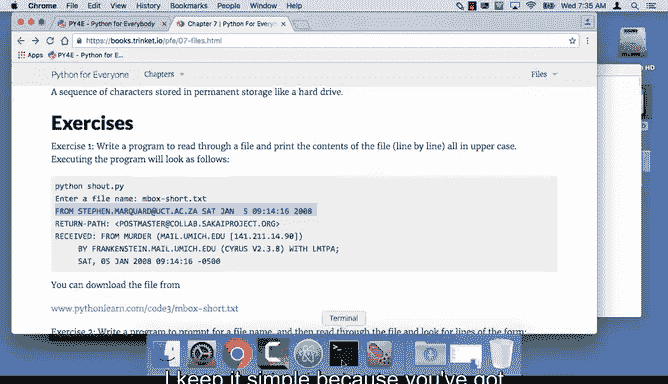

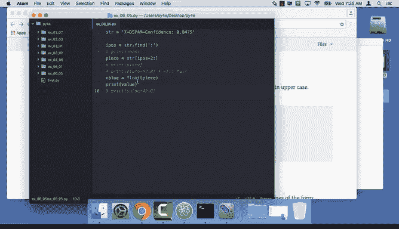

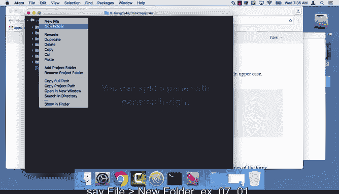


---

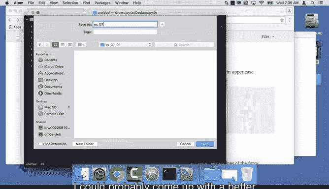

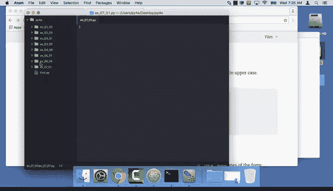

## 准备工作

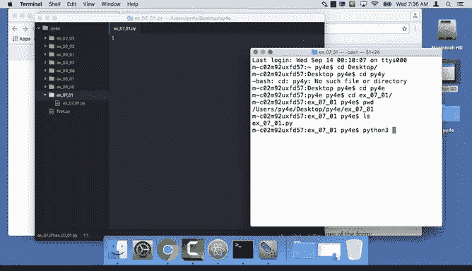

上一节我们介绍了文件操作的基本概念，本节中我们来看看如何具体实现一个文件处理程序。

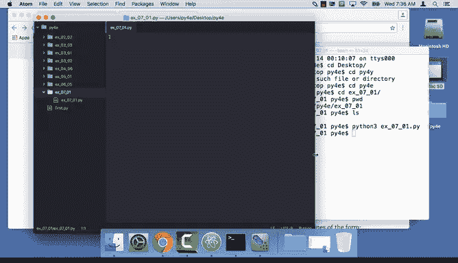

首先，我们需要创建一个Python文件来编写代码。同时，我们还需要一个用于读取的文本文件。

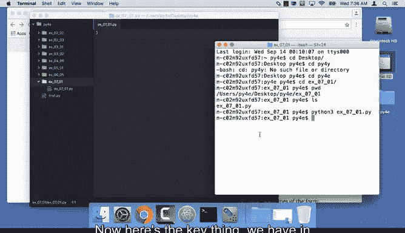

以下是创建文件和准备环境的步骤：

1.  在桌面创建一个名为“Python for everybody”的文件夹。
2.  在该文件夹内，创建一个名为“EX0701”的子文件夹，用于存放本次练习的代码。
3.  在代码编辑器中，创建一个新文件并保存为 `ex07.py`。
4.  打开终端或命令行，导航到 `EX0701` 文件夹所在目录，确保程序运行环境正确。


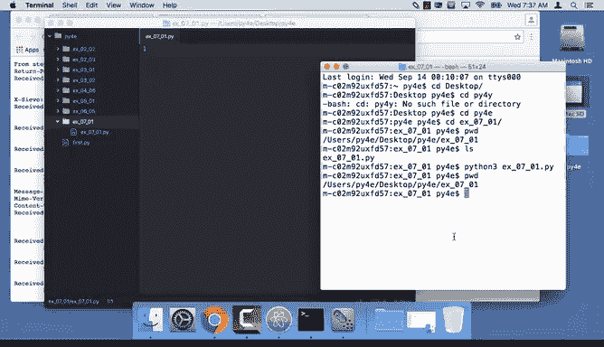

## 获取数据文件

程序需要读取一个外部文件。为了确保程序能找到文件，必须将该文件下载到与Python脚本相同的目录中。

1.  从课程网站（如 `pythonlearn.com`）找到名为 `mbox-short.txt` 的示例文件。
2.  在浏览器中右键点击文件链接，选择“链接另存为”。
3.  将文件保存到之前创建的 `EX0701` 文件夹中。

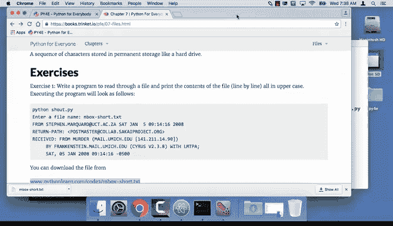

现在，你的 `EX0701` 文件夹中应该包含两个文件：`ex07.py` 和 `mbox-short.txt`。

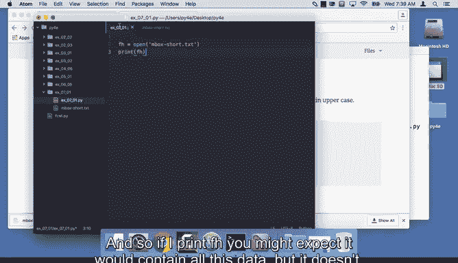

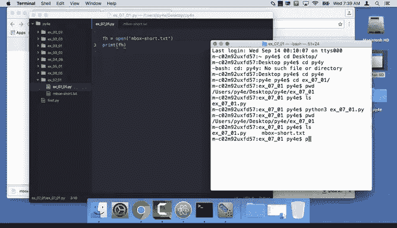

## 编写文件读取程序

接下来，我们开始编写核心代码。程序的第一步是使用 `open()` 函数打开文件。

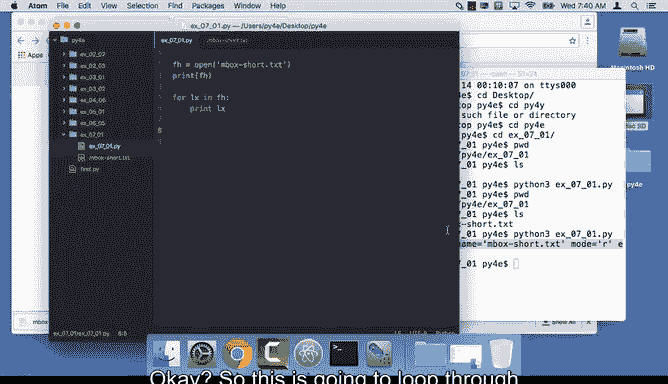

```python
fh = open('mbox-short.txt')
```

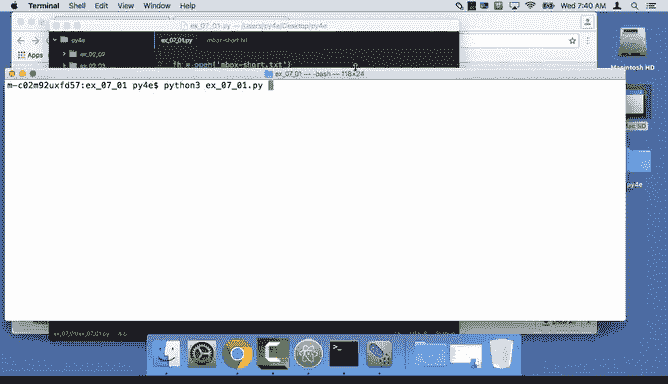

这里，`open()` 函数并不会直接读取文件内容，而是返回一个 **文件句柄（file handle）**。文件句柄可以被视为一个连接到文件的“门户”，通过它我们才能操作文件。

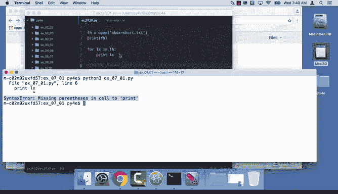

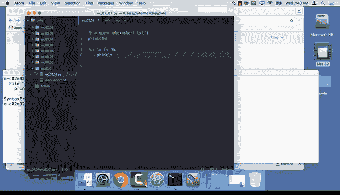

如果尝试打印文件句柄 `fh`，输出结果类似 `<_io.TextIOWrapper name='mbox-short.txt' mode='r' encoding='UTF-8'>`。这表示它是一个Python对象，包含了文件名、打开模式等信息，但**不是文件数据本身**。

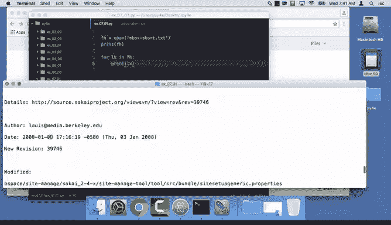

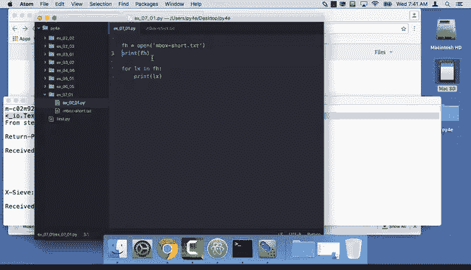

## 读取并处理文件内容

为了读取文件内容，我们需要使用循环。以下是读取文件的常用模式：

```python
for lx in fh:
    ly = lx.rstrip()
    print(ly.upper())
```

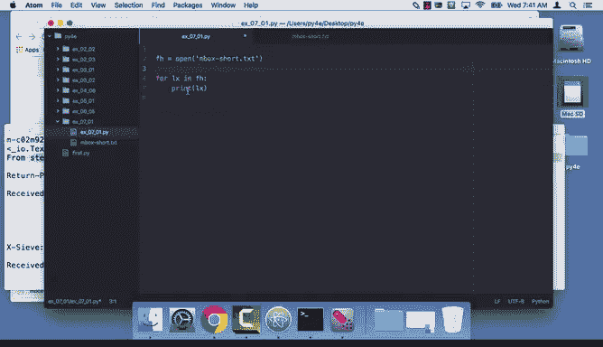


让我们分解这段代码：
*   `for lx in fh:`：这行代码会遍历文件句柄 `fh` 中的每一行。每次循环，变量 `lx` 会包含文件中的一行文本（包括行尾的换行符）。
*   `ly = lx.rstrip()`：`rstrip()` 方法用于移除字符串**右侧**的空白字符（包括换行符 `\n`）。如果不进行这一步，直接打印 `lx`，由于 `print()` 函数本身会自动添加一个换行符，会导致输出中出现多余的空行。
*   `print(ly.upper())`：`upper()` 是一个字符串方法，它会返回一个将所有字母转换为大写的新字符串。我们打印这个处理后的结果。

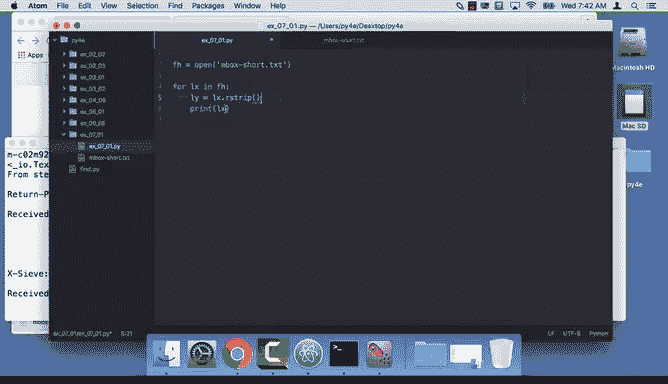

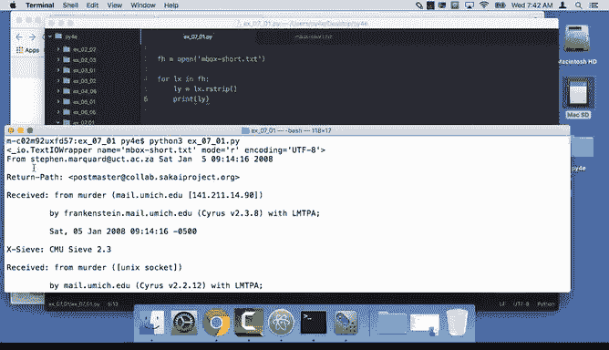

运行这段代码，你将看到 `mbox-short.txt` 文件的内容全部以大写字母的形式输出在终端中。

## 核心概念总结

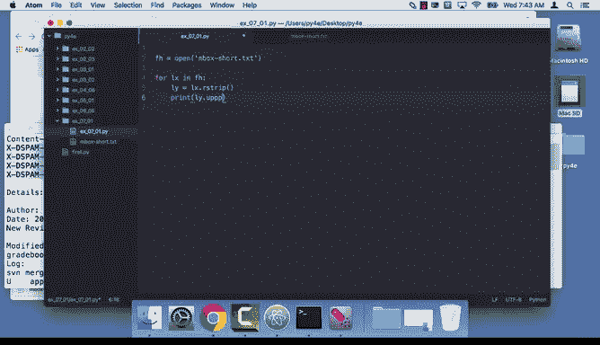

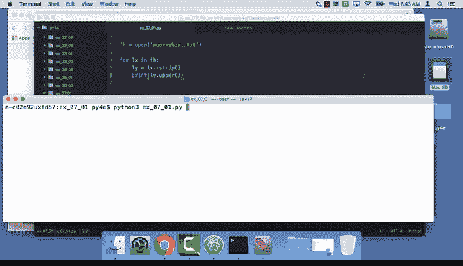

本节课中我们一起学习了文件处理的基本步骤：

1.  **打开文件**：使用 `open(‘filename’)` 函数获取文件句柄。
2.  **循环读取**：使用 `for line in file_handle:` 语法遍历文件的每一行。
3.  **清理数据**：使用 `line.rstrip()` 方法移除行尾的换行符，为后续处理做准备。
4.  **处理内容**：对清理后的字符串进行操作，例如使用 `line.upper()` 转换为大写。

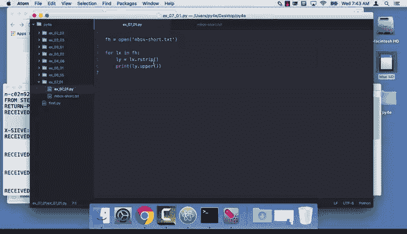

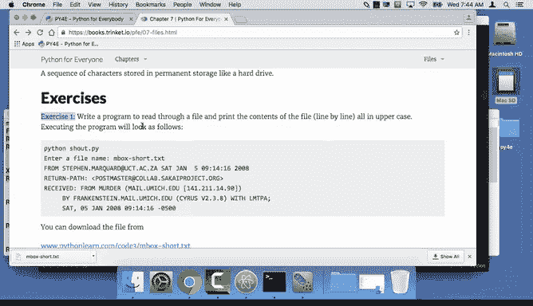

这个练习虽然简单，但它是后续所有文件处理任务的基础模板。通过掌握打开、读取、处理文件的基本流程，你已经迈出了用Python解决实际问题的关键一步。